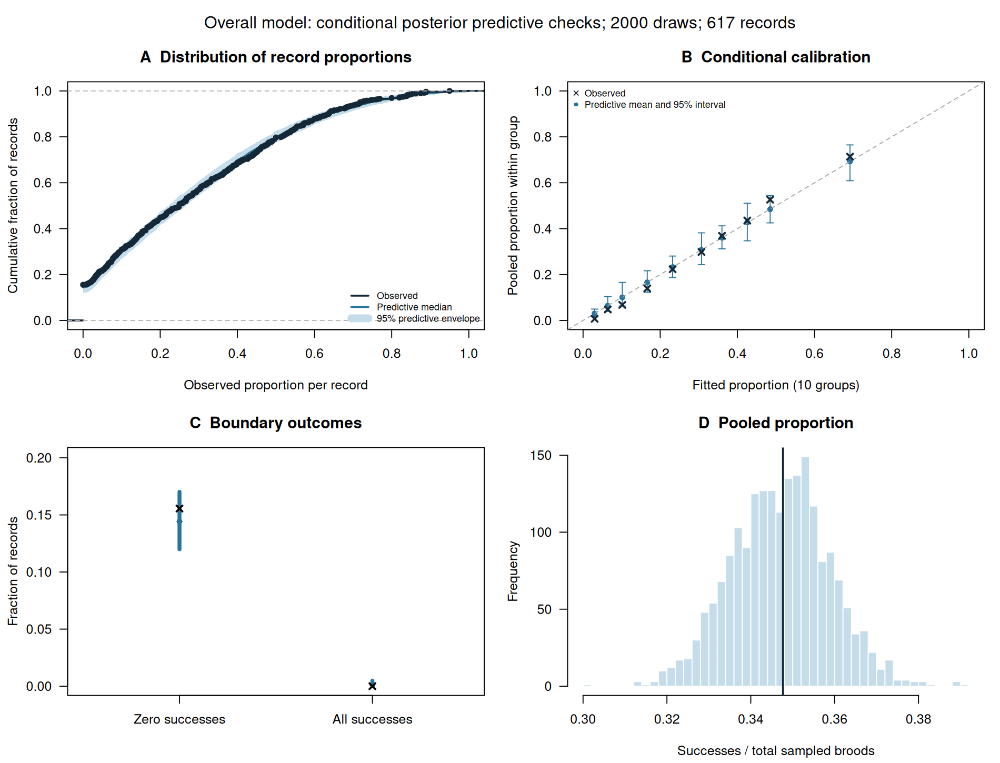

All results on this page use the models after exclusion of the two records for the common ostrich (6/6) and Nelson’s sparrow (8/8), whose exact counts could not be verified as broods with at least two genetic sires. Other records were retained, including the saltmarsh-sparrow record from the same Walsh study. Models updated 5 November 2026; marginal mean added 6 November 2026.

Estimates are posterior means with 95% equal-tailed credible intervals (CrI). Odds ratios are summarised after exponentiating each contrast draw. The overall marginal mean integrates over the fitted random-effect distributions. Conditional estimates at zero random effects are explicitly labelled for comparison. Continuous effects use the original common scaling constants, retained unchanged after exclusion. Mixed paternity refers to the source-derived brood-level measure described in Methods; source reporting sometimes used brood-level EPP without identifying sire number.

**The estimated mean prevalence of mixed paternity was 31.6% (95% CrI: 11.8–57.2%).** This marginal mean averages over the fitted distributions of study, non-phylogenetic species and phylogenetic species effects. The pooled raw proportion is 16,075 / 46,235 = 34.77%; it weights observations by their brood denominators and is a different summary.

## Overall model

617 records, 553 study identifiers and 373 species; 16075 mixed-paternity broods out of 46235 sampled broods.

| Coefficient | Mean log odds [95% CrI] | Mean OR [95% CrI] |
| --- | --- | --- |
| Intercept | -1.295 [-3.066, 0.476] | 0.412 [0.047, 1.610] |

### Variance components and precision

| Quantity | Posterior mean [95% CrI] |
| --- | --- |
| Phylogenetic species variance | 3.084 [1.737, 4.874] |
| Non-phylogenetic species variance | 0.496 [0.223, 0.802] |
| Study variance | 0.068 [0.000, 0.214] |
| Beta-binomial precision | 18.179 [12.095, 30.707] |
| Species-level phylogenetic heritability | 0.853 [0.715, 0.949] |
| Marginal mean prevalence (proportion) | 0.316 [0.118, 0.572] |
| Conditional prevalence at zero random effects (proportion) | 0.247 [0.045, 0.617] |

### Sampling diagnostics

| Maximum R-hat | Minimum bulk ESS | Minimum tail ESS | Divergences | Treedepth hits |
| --- | --- | --- | --- | --- |
| 1.0031 | 785 | 1720 | 0 | 0 |

[Download posterior summary](tables/refit_20261105/model_overall_study_summary.csv) · [Parameter-level diagnostics](tables/refit_20261105/model_overall_study_parameter_diagnostics.csv).

## Averaging over random effects

For each of 20,000 joint posterior draws, we calculated

$$
\bar p_s = \int \operatorname{logit}^{-1}(\alpha_s + \sqrt{V_s}z)\varphi(z)\,dz,
\quad V_s=\sigma^2_{\mathrm{study},s}+\sigma^2_{\mathrm{nonphylo},s}+\sigma^2_{\mathrm{phylo},s}.
$$

Here, $\varphi$ is the standard normal density. The phylogenetic covariance matrix has unit diagonal. We used 160-node Gaussian quadrature and summarised the resulting marginal probabilities by their posterior mean and 2.5th and 97.5th percentiles. Checks with 80 nodes and independent adaptive integration agreed to better than $4\times10^{-9}$ in probability. Beta-binomial precision controls sampling dispersion and does not change the expected probability.

This estimates a mean under the fitted study and species distributions, not an empirical or census-weighted average of all birds. Moderator-specific curves and category predictions elsewhere remain conditional on zero random effects. No models were refitted for this calculation.

[Download marginal summary](tables/refit_20261105/overall_marginal_prevalence.csv) · [Calculation script](scripts/refit_20261105/marginal_prevalence.R).

## Conditional posterior predictive checks

The following checks use 2,000 retained draws and include fitted study and species effects; they assess fit within the observed sample.

## Matched-sample variance comparison

The full and intercept-only models both use 531 records. Percentage reductions compare posterior means; negative values indicate increases. They are descriptive and do not represent total response variance explained.

| Component | Intercept-only [95% CrI] | Multivariable [95% CrI] | Reduction (%) |
| --- | --- | --- | --- |
| species phylo brms | 3.562 [1.922, 5.804] | 3.120 [1.487, 5.377] | 12.4 |
| species nonphylo | 0.464 [0.169, 0.804] | 0.463 [0.138, 0.821] | 0.4 |
| Study ID | 0.072 [0.000, 0.213] | 0.091 [0.001, 0.232] | -26.9 |
| variance sum | 4.098 [2.604, 6.193] | 3.674 [2.192, 5.751] | 10.3 |

## Matched-sample intercept-only model

531 records, 480 study identifiers and 324 species; 14903 mixed-paternity broods out of 41511 sampled broods.

| Coefficient | Mean log odds [95% CrI] | Mean OR [95% CrI] |
| --- | --- | --- |
| Intercept | -1.241 [-3.137, 0.642] | 0.460 [0.043, 1.899] |

### Variance components and precision

| Quantity | Posterior mean [95% CrI] |
| --- | --- |
| Phylogenetic species variance | 3.562 [1.922, 5.804] |
| Non-phylogenetic species variance | 0.464 [0.169, 0.804] |
| Study variance | 0.072 [0.000, 0.213] |
| Beta-binomial precision | 22.812 [14.050, 42.054] |
| Species-level phylogenetic heritability | 0.875 [0.733, 0.967] |
| Prevalence at zero random effects (proportion) | 0.259 [0.042, 0.655] |

### Sampling diagnostics

| Maximum R-hat | Minimum bulk ESS | Minimum tail ESS | Divergences | Treedepth hits |
| --- | --- | --- | --- | --- |
| 1.0056 | 889 | 1868 | 0 | 0 |

[Download posterior summary](tables/refit_20261105/model_null_matched_533_summary.csv) · [Parameter-level diagnostics](tables/refit_20261105/model_null_matched_533_parameter_diagnostics.csv).

## Study-only model (no species effects)

617 records, 553 study identifiers and 373 species; 16075 mixed-paternity broods out of 46235 sampled broods.

| Coefficient | Mean log odds [95% CrI] | Mean OR [95% CrI] |
| --- | --- | --- |
| Intercept | -1.087 [-1.217, -0.962] | 0.338 [0.296, 0.382] |

### Variance components and precision

| Quantity | Posterior mean [95% CrI] |
| --- | --- |
| Study variance | 1.002 [0.622, 1.422] |
| Beta-binomial precision | 6.627 [4.547, 9.605] |
| Prevalence at zero random effects (proportion) | 0.252 [0.228, 0.276] |

### Sampling diagnostics

| Maximum R-hat | Minimum bulk ESS | Minimum tail ESS | Divergences | Treedepth hits |
| --- | --- | --- | --- | --- |
| 1.0021 | 1388 | 2972 | 0 | 0 |

[Download posterior summary](tables/refit_20261105/model_overall_no_species_summary.csv) · [Parameter-level diagnostics](tables/refit_20261105/model_overall_no_species_parameter_diagnostics.csv).

