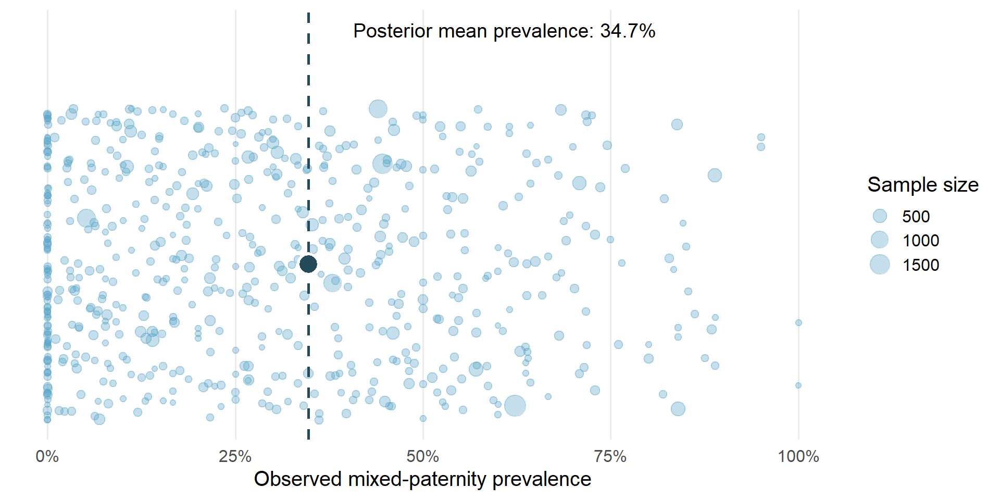
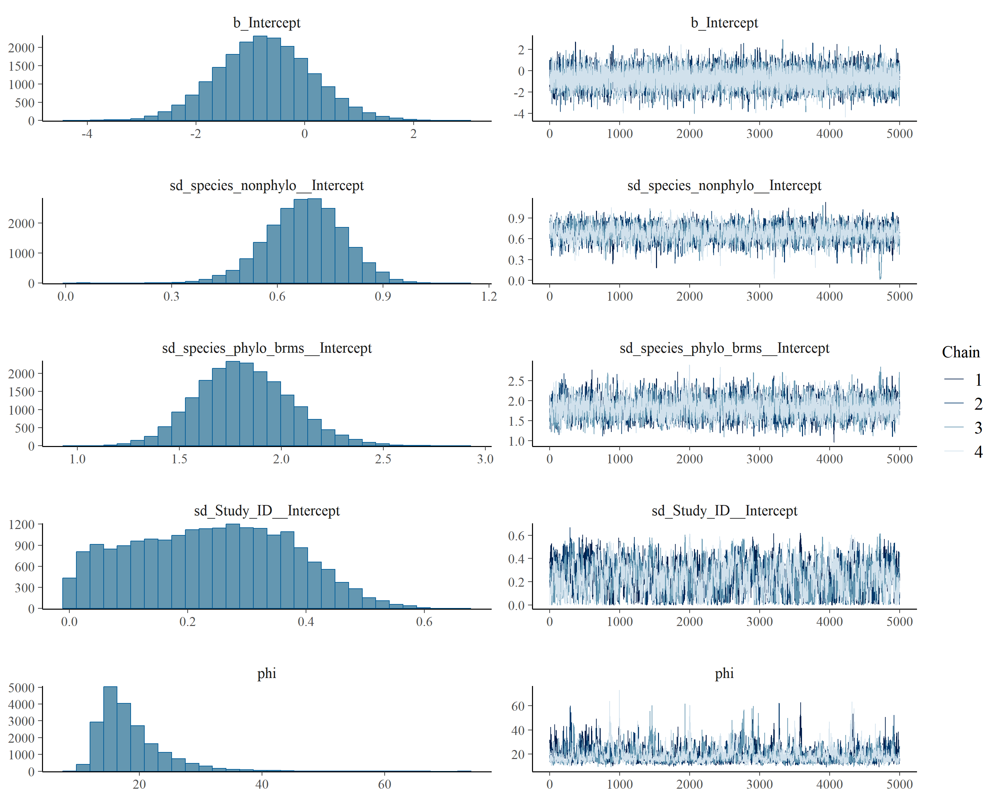

::: section-card
## Overall model

This section presents the intercept-only beta-binomial phylogenetic model used to estimate the population-level intercept and quantify heterogeneity in mixed-paternity prevalence across birds. The model accounts for study identity, non-phylogenetic species-level variation, and phylogenetically structured species-level variation.
:::

## Packages

The R packages required for model fitting and diagnostics.

```{r}
#| message: false
#| warning: false

library(tidyverse)
library(brms)
library(posterior)
library(bayesplot)
library(loo)

options(mc.cores = parallel::detectCores())
```

## Load prepared objects

```{r}
#| message: false
#| warning: false

data_overall_study <- readRDS("data/data_overall_study.rds")
phylo_mat <- readRDS("data/phylo_mat.rds")
```

## Overall dataset

```{r}
#| echo: false
#| message: false
#| warning: false

overall_data_summary <- data_overall_study %>%
  summarise(
    Observations = n(),
    `Study identities` = n_distinct(Study_ID),
    Species = n_distinct(species_phylo_brms),
    `Total broods` = sum(n_total_broods, na.rm = TRUE),
    `Mixed-paternity broods` = sum(n_mixed_broods, na.rm = TRUE),
    `Raw prevalence (%)` = 100 * `Mixed-paternity broods` / `Total broods`
  )

knitr::kable(overall_data_summary, digits = 2)
```

## Modelling framework

Because brood-level paternity data are expected to exhibit substantial extra-binomial heterogeneity across references, populations, and species, we modelled mixed-paternity prevalence using beta-binomial generalised linear mixed-effects models with a logit link:

$$y_i \sim \mathrm{BetaBinomial}(n_i, \mu_i, \phi)$$

where $y_i$ is the number of broods with mixed paternity, $n_i$ is the total number of broods genotyped, $\mu_i$ is the expected mixed-paternity prevalence, and the precision parameter $\phi$ describes extra-binomial variation among study units.

The linear predictor was modelled as:

$$\mathrm{logit}(\mu_i) = \alpha + \mathbf{X}_i \boldsymbol{\beta} + u_{\mathrm{reference}[i]} + u_{\mathrm{species}[i]} + u_{\mathrm{phylo}[i]}$$

where $\alpha$ is the intercept, $\mathbf{X}_i \boldsymbol{\beta}$ represents fixed biological and methodological moderators, and $u_{\mathrm{reference}}$, $u_{\mathrm{species}}$, and $u_{\mathrm{phylo}}$ represent study-identity-level, non-phylogenetic species-level, and phylogenetically structured random effects, respectively. Study identity (`Study_ID`) is an analytical grouping variable, not a bibliographic-publication count; one study identity can incorporate evidence reported across more than one source.

## Population-level intercept prevalence

### Model

The intercept-only model estimated the population-level intercept while quantifying study-identity-level, non-phylogenetic species-level, and phylogenetically structured species-level variation. Its inverse-logit transformation is the expected prevalence when all random effects are set to zero; it is not a marginal average across the observed study identities or species.

```{r}
#| eval: false
#| echo: true

model_overall_study <- brm(
  n_mixed_broods | trials(n_total_broods) ~
    1 +
    (1 | Study_ID) +
    (1 | species_nonphylo) +
    (1 | gr(species_phylo_brms, cov = phylo_mat)),
  family = beta_binomial(link = "logit"),
  data = data_overall_study,
  data2 = list(phylo_mat = phylo_mat),
  chains = 4,
  cores = 4,
  iter = 10000,
  warmup = 5000,
  control = list(adapt_delta = 0.99, max_treedepth = 15),
  seed = 123
)

```

### Figure

```{r}

```

### Model summary

```{r}
#| message: false 
#| warning: false 

model_overall_study <- readRDS("models/model_overall_study.rds")
summary(model_overall_study)
```

### Model estimates

Group-level estimates are posterior mean variances on the logit scale, with equal-tailed 95% credible intervals calculated from squared posterior SD draws. Raw brms diagnostic summaries retain their native SD parameterisation.

```{r}
#| echo: false
#| message: false
#| warning: false

s <- summary(model_overall_study)
v <- readr::read_csv("tables/variance_audit/posterior_variance_summaries.csv", show_col_types = FALSE) |>
  dplyr::filter(model == "model_overall_study")
get_variance <- function(parameter_name, statistic) v[[statistic]][match(parameter_name, v$parameter)]

model_summary_table <- tibble::tibble(
  Parameter = c(
    "Intercept (logit scale)",
    "Population-level intercept prevalence (%)",
    "Study-level variance",
    "Non-phylogenetic species-level variance",
    "Phylogenetic species-level variance",
    "Beta-binomial precision (phi)"
  ),
  Estimate = c(
    s$fixed["Intercept", "Estimate"],
    plogis(s$fixed["Intercept", "Estimate"]) * 100,
    get_variance("sd_Study_ID__Intercept", "mean"),
    get_variance("sd_species_nonphylo__Intercept", "mean"),
    get_variance("sd_species_phylo_brms__Intercept", "mean"),
    s$spec_pars["phi", "Estimate"]
  ),
  `Lower 95% CrI` = c(
    s$fixed["Intercept", "l-95% CI"],
    plogis(s$fixed["Intercept", "l-95% CI"]) * 100,
    get_variance("sd_Study_ID__Intercept", "q025"),
    get_variance("sd_species_nonphylo__Intercept", "q025"),
    get_variance("sd_species_phylo_brms__Intercept", "q025"),
    s$spec_pars["phi", "l-95% CI"]
  ),
  `Upper 95% CrI` = c(
    s$fixed["Intercept", "u-95% CI"],
    plogis(s$fixed["Intercept", "u-95% CI"]) * 100,
    get_variance("sd_Study_ID__Intercept", "q975"),
    get_variance("sd_species_nonphylo__Intercept", "q975"),
    get_variance("sd_species_phylo_brms__Intercept", "q975"),
    s$spec_pars["phi", "u-95% CI"]
  )
)

knitr::kable(model_summary_table, digits = 3)
```

```{}
```

### Phylogenetic signal

We quantified the phylogenetic signal in between-species variation as the proportion of species-level variance attributable to the phylogenetically structured random effect:

$$
\nu =
\frac{\sigma^2_{\mathrm{phylo}}}
{\sigma^2_{\mathrm{phylo}} + \sigma^2_{\mathrm{nonphylo}}}
$$

where $\sigma^2_{\mathrm{phylo}}$ is the variance of the phylogenetically structured species-level random effect and $\sigma^2_{\mathrm{nonphylo}}$ is the variance of the non-phylogenetic species-level random effect.

The table below summarises the relative contribution of the phylogenetic and non-phylogenetic species-level variance components in the overall model.

```{r}
#| label: phylogenetic-signal-table
#| echo: false
#| message: false
#| warning: false

library(dplyr)
library(tidybayes)

draws_phylo_signal <- model_overall_study %>%
  spread_draws(
    sd_species_phylo_brms__Intercept,
    sd_species_nonphylo__Intercept
  ) %>%
  mutate(
    phylo_signal = sd_species_phylo_brms__Intercept^2 /
      (sd_species_phylo_brms__Intercept^2 + sd_species_nonphylo__Intercept^2)
  )

phylo_signal_summary <- draws_phylo_signal %>%
  summarise(
    Statistic = "Phylogenetic signal (ν)",
    Estimate = mean(phylo_signal),
    `Lower 95% CrI` = quantile(phylo_signal, 0.025),
    `Upper 95% CrI` = quantile(phylo_signal, 0.975)
  )

knitr::kable(
  phylo_signal_summary, 
  digits = 3, 
  caption = "Posterior mean estimate of the phylogenetic signal with a 95% equal-tailed credible interval."
)
```

## Diagnostics

### Posterior predictive checks

```{r}
pp_check(model_overall_study)
```

### Divergences

```{r}
#| echo: false
#| message: false
#| warning: false

divergence_table <- nuts_params(model_overall_study) |>
  filter(Parameter == "divergent__") |>
  count(Value) |>
  mutate(
    Value = ifelse(Value == 0, "Non-divergent", "Divergent")
  )

knitr::kable(divergence_table)
```

### Traceplots

```{r}
#| label: save-overall-traceplot
#| echo: false
#| message: false
#| warning: false
#| fig-width: 10
#| fig-height: 8

dir.create("Figures/model_diagnostics", recursive = TRUE, showWarnings = FALSE)

png(
  filename = "Figures/model_diagnostics/model_overall_traceplots.png",
  width = 3000,
  height = 2400,
  res = 300
)

plot(model_overall_study)

dev.off()
```

```{r}

#| label: show-overall-traceplot
#| echo: false
#| out-width: "100%"


```


## Matched-sample model without moderators {#matched-sample-model-without-moderators}

This additional intercept-only model provides a matched-sample reference for the final multivariable model (Supplementary Table S12). It uses exactly the same 533 observations from 481 studies and 326 species. It is distinct from the overall model above, which uses the full dataset of 619 observations; it is not a replacement estimate of overall mixed-paternity prevalence.

The response is the number of mixed-paternity broods out of the total number of broods, modelled with a beta-binomial distribution and a logit link. The matched model includes an intercept and random intercepts for study identity, non-phylogenetic species identity, and phylogenetically structured species identity, with no moderators. The data, phylogenetic covariance matrix, grouping structure and corresponding priors are retained from the final multivariable model. Priors are Student-t(3, 0, 2.5) for the intercept and group-level standard deviations (restricted to positive values for standard deviations), and Gamma(0.01, 0.01), in shape-rate notation, for beta-binomial precision.

```{r}
#| label: matched-null-model
#| eval: false
#| code-fold: true

# Use the same observations and phylogenetic matrix as the final model.
full_model <- readRDS("models/common_scaling/model_full_brouwer_griffith.rds")
matched_data <- full_model$data
phylo_mat <- full_model$data2$phylo_mat
stopifnot(nrow(matched_data) == 533L)

matched_priors <- c(
  set_prior("student_t(3, 0, 2.5)", class = "Intercept"),
  set_prior("student_t(3, 0, 2.5)", class = "sd"),
  set_prior("gamma(0.01, 0.01)", class = "phi")
)

model_null_matched <- brm(
  n_mixed_broods | trials(n_total_broods) ~ 1 +
    (1 | Study_ID) + (1 | species_nonphylo) +
    (1 | gr(species_phylo_brms, cov = phylo_mat)),
  data = matched_data,
  data2 = list(phylo_mat = phylo_mat),
  family = beta_binomial(link = "logit"),
  prior = matched_priors,
  chains = 4, cores = 4, iter = 10000, warmup = 5000,
  seed = 20261015,
  control = list(adapt_delta = 0.99, max_treedepth = 15),
  file = "comment44_variance_20261015/model_null_matched_533",
  file_refit = "on_change"
)
```

The null model was fitted on Totoro with four chains, 10,000 iterations per chain including 5,000 warmup iterations (20,000 retained draws), seed 20261015, adapt_delta = 0.99 and max_treedepth = 15. Maximum R-hat was 1.003; minimum bulk and tail effective sample sizes were 844 and 1,738, respectively. There were no divergent transitions or maximum-treedepth hits. The existing final multivariable model was not refitted.

The table reports posterior mean variances and equal-tailed 95% credible intervals on the logit scale. Each posterior standard-deviation draw was squared before summarising; the sum was calculated within each model draw. Descriptive reduction (%) = 100 × (1 − posterior mean variance in the multivariable model / posterior mean variance in the matched intercept-only model). Negative reductions indicate an increase.

| Component | Matched intercept-only model | Multivariable model | Reduction (%) |
| --- | --- | --- | --- |
| Phylogenetic species | 3.941 [2.206, 6.251] | 3.230 [1.544, 5.530] | 18.0 |
| Non-phylogenetic species | 0.426 [0.139, 0.770] | 0.461 [0.143, 0.828] | -8.2 |
| Study identity | 0.076 [0.00030, 0.220] | 0.102 [0.00141, 0.244] | -33.9 |
| Sum of group-level variances | 4.443 [2.838, 6.606] | 3.792 [2.261, 5.901] | 14.6 |

Posterior mean phylogenetic variance was 18.0% lower in the multivariable model; the sum of the three group-level variances was 14.6% lower. These are descriptive reductions in group-level variance, not proportions of total response variance explained or predictive R-squared. Binomial sampling variation and beta-binomial dispersion remain in the observation model and are not included as additive components in this sum. No uncertainty interval is reported for the between-model reduction.
