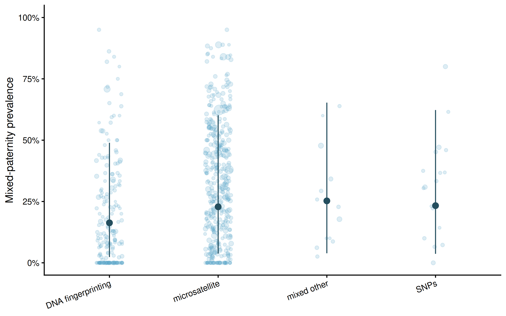
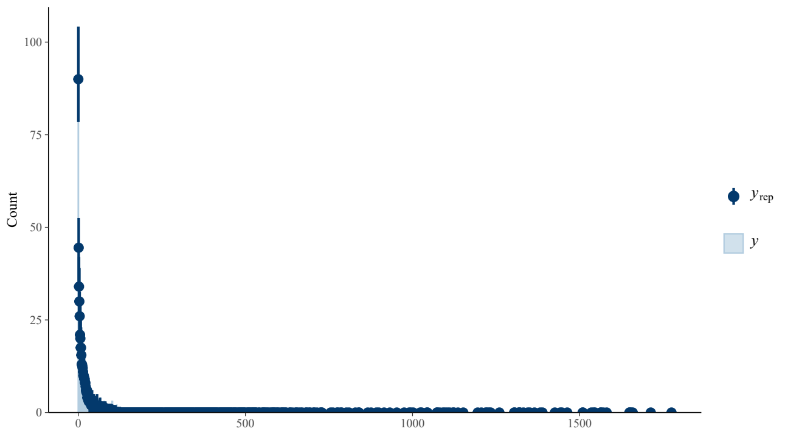
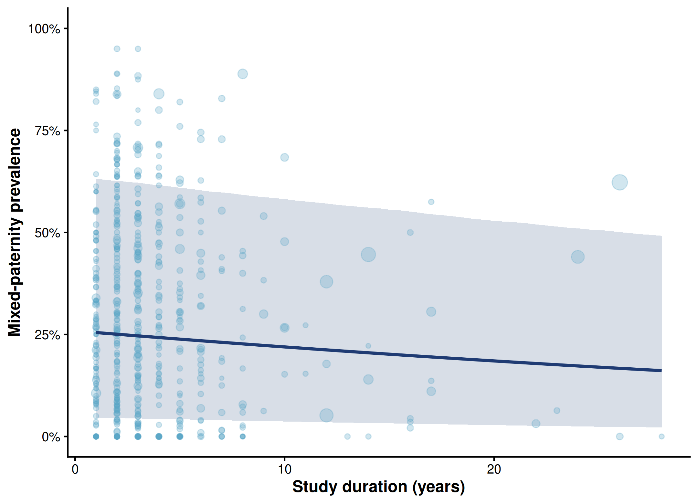
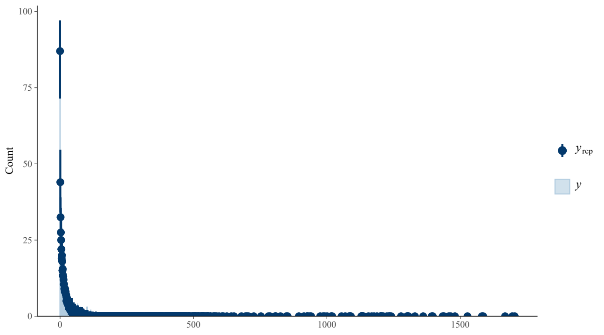
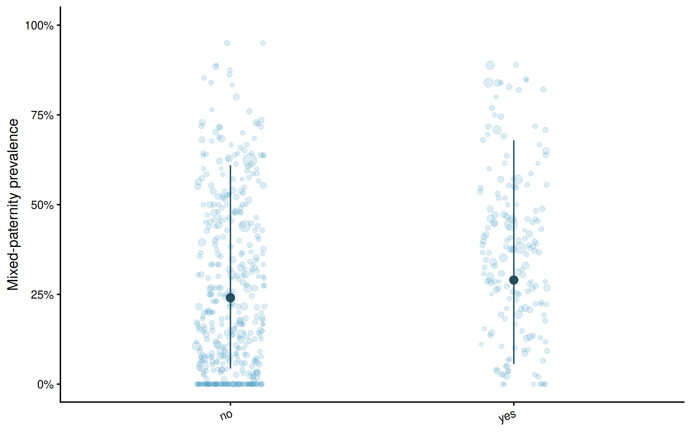
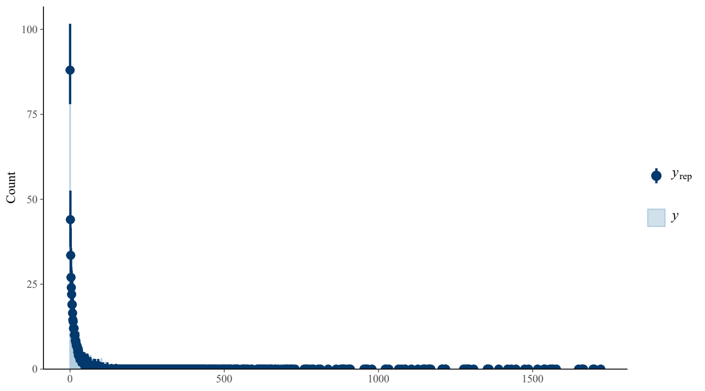

All results on this page use the models after exclusion of the two records for the common ostrich (6/6) and Nelson’s sparrow (8/8), whose exact counts could not be verified as broods with at least two genetic sires. Other records were retained, including the saltmarsh-sparrow record from the same Walsh study. Updated 5 November 2026.

Estimates are posterior means with 95% equal-tailed credible intervals (CrI). Odds ratios are summarised after exponentiating each contrast draw. Prevalence predictions are summarised after inverse-logit transformation, with random effects set to zero. Continuous effects use the original common scaling constants, retained unchanged after exclusion. Mixed paternity refers to the source-derived brood-level measure described in Methods; source reporting sometimes used brood-level EPP without identifying sire number.

## Marker type

612 records, 549 study identifiers and 371 species; 16047 mixed-paternity broods out of 46164 sampled broods.

| Coefficient | Mean log odds [95% CrI] | Mean OR [95% CrI] |
| --- | --- | --- |
| marker type modelDNA fingerprinting | -1.900 [-3.727, -0.043] | 0.234 [0.024, 0.958] |
| marker type modelmicrosatellite | -1.423 [-3.242, 0.412] | 0.375 [0.039, 1.510] |
| marker type modelmixed other | -1.288 [-3.204, 0.632] | 0.447 [0.041, 1.882] |
| marker type modelSNPs | -1.404 [-3.267, 0.502] | 0.392 [0.038, 1.652] |

### Pairwise contrasts

Each contrast compares the first category with the second.

| Contrast | Mean log odds [95% CrI] | Mean OR [95% CrI] |
| --- | --- | --- |
| DNA fingerprinting - microsatellite | -0.477 [-0.667, -0.290] | 0.624 [0.513, 0.748] |
| DNA fingerprinting - mixed other | -0.612 [-1.213, 0.005] | 0.569 [0.297, 1.005] |
| DNA fingerprinting - SNPs | -0.496 [-0.992, -0.006] | 0.628 [0.371, 0.994] |
| microsatellite - mixed other | -0.135 [-0.729, 0.458] | 0.914 [0.483, 1.582] |
| microsatellite - SNPs | -0.020 [-0.486, 0.453] | 1.009 [0.615, 1.573] |
| mixed other - SNPs | 0.116 [-0.635, 0.863] | 1.208 [0.530, 2.371] |

### Conditional prevalence

| Category | Prevalence (%) [95% CrI] |
| --- | --- |
| DNA fingerprinting | 16.307 [2.350, 48.937] |
| microsatellite | 22.840 [3.760, 60.155] |
| mixed other | 25.255 [3.900, 65.303] |
| SNPs | 23.310 [3.670, 62.289] |

### Variance components and precision

| Quantity | Posterior mean [95% CrI] |
| --- | --- |
| Phylogenetic species variance | 2.869 [1.556, 4.651] |
| Non-phylogenetic species variance | 0.476 [0.219, 0.785] |
| Study variance | 0.088 [0.000, 0.244] |
| Beta-binomial precision | 19.670 [12.440, 34.811] |
| Species-level phylogenetic heritability | 0.848 [0.697, 0.949] |

### Sampling diagnostics

| Maximum R-hat | Minimum bulk ESS | Minimum tail ESS | Divergences | Treedepth hits |
| --- | --- | --- | --- | --- |
| 1.0100 | 726 | 2074 | 0 | 0 |

[Download posterior summary](tables/refit_20261105/model_marker_type_0_summary.csv) · [Parameter-level diagnostics](tables/refit_20261105/model_marker_type_0_parameter_diagnostics.csv).

[Download PDF](Figures/refit_20261105/model_marker_type_0_prevalence.pdf).

### Posterior predictive check

## Study duration

605 records, 544 study identifiers and 371 species; 15822 mixed-paternity broods out of 45623 sampled broods.

| Coefficient | Mean log odds [95% CrI] | Mean OR [95% CrI] |
| --- | --- | --- |
| Intercept | -1.315 [-3.088, 0.479] | 0.408 [0.046, 1.614] |
| study duration sc | -0.086 [-0.165, -0.009] | 0.918 [0.848, 0.991] |

### Variance components and precision

| Quantity | Posterior mean [95% CrI] |
| --- | --- |
| Phylogenetic species variance | 3.182 [1.786, 5.063] |
| Non-phylogenetic species variance | 0.529 [0.259, 0.850] |
| Study variance | 0.060 [0.000, 0.196] |
| Beta-binomial precision | 20.059 [13.169, 35.029] |
| Species-level phylogenetic heritability | 0.848 [0.707, 0.944] |
| Prevalence at zero random effects (proportion) | 0.244 [0.044, 0.617] |

### Sampling diagnostics

| Maximum R-hat | Minimum bulk ESS | Minimum tail ESS | Divergences | Treedepth hits |
| --- | --- | --- | --- | --- |
| 1.0032 | 974 | 1934 | 0 | 0 |

[Download posterior summary](tables/refit_20261105/model_study_duration_summary.csv) · [Parameter-level diagnostics](tables/refit_20261105/model_study_duration_parameter_diagnostics.csv).

[Download PDF](Figures/refit_20261105/study_duration.pdf).

### Posterior predictive check

## Nest-box use

604 records, 542 study identifiers and 366 species; 15819 mixed-paternity broods out of 45413 sampled broods.

| Coefficient | Mean log odds [95% CrI] | Mean OR [95% CrI] |
| --- | --- | --- |
| Intercept | -1.330 [-3.087, 0.445] | 0.394 [0.046, 1.561] |
| nest box modelyes | 0.287 [-0.061, 0.628] | 1.353 [0.941, 1.873] |

### Conditional prevalence

| Category | Prevalence (%) [95% CrI] |
| --- | --- |
| no | 24.063 [4.364, 60.956] |
| yes | 29.001 [5.619, 67.910] |

### Variance components and precision

| Quantity | Posterior mean [95% CrI] |
| --- | --- |
| Phylogenetic species variance | 3.002 [1.687, 4.794] |
| Non-phylogenetic species variance | 0.525 [0.258, 0.844] |
| Study variance | 0.079 [0.000, 0.243] |
| Beta-binomial precision | 18.493 [11.834, 32.796] |
| Species-level phylogenetic heritability | 0.842 [0.703, 0.941] |
| Prevalence at zero random effects (proportion) | 0.241 [0.044, 0.610] |

### Sampling diagnostics

| Maximum R-hat | Minimum bulk ESS | Minimum tail ESS | Divergences | Treedepth hits |
| --- | --- | --- | --- | --- |
| 1.0039 | 818 | 1526 | 0 | 0 |

[Download posterior summary](tables/refit_20261105/model_nest_box_summary.csv) · [Parameter-level diagnostics](tables/refit_20261105/model_nest_box_parameter_diagnostics.csv).

[Download PDF](Figures/refit_20261105/model_nest_box_prevalence.pdf).

### Posterior predictive check

## Reproducibility

[Posterior summaries and contrasts](tables/refit_20261105/contrasts_equal_tailed.csv) · [Export code](scripts/refit_20261105/export_results.R) · [Prediction code](scripts/refit_20261105/prepare_release.R).
