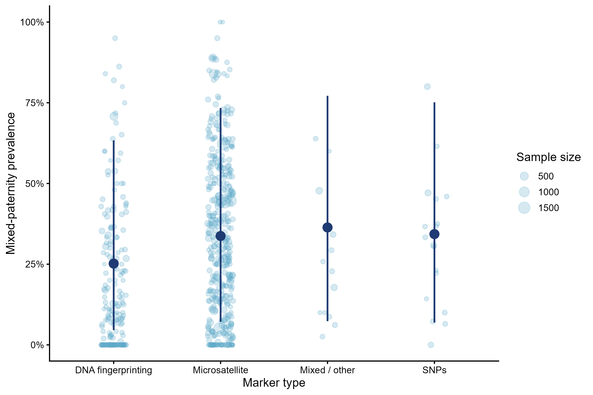
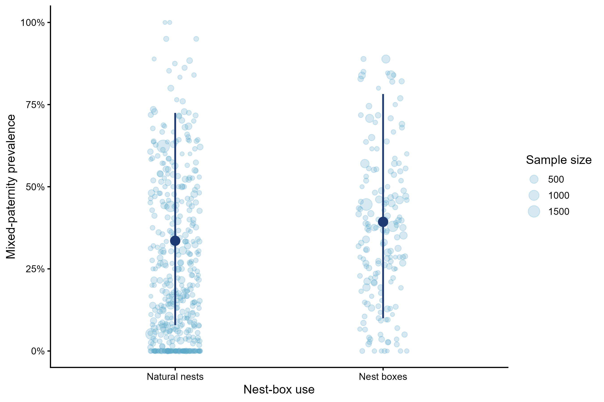

---
format:
  html:
    toc: true
    toc-depth: 3
---

::: section-card
## **Methodological moderators**

This section presents methodological moderators that may influence estimates of mixed-paternity prevalence across studies. We focus on marker type, nest-box use, nest type, and study duration, because these variables can affect both the detection and reporting of mixed paternity. All models use the same multilevel phylogenetic beta-binomial structure as the overall model.
:::

Model-based prevalence is summarised as the posterior mean on the probability scale, with 95% equal-tailed credible intervals. The inverse-logit transformation is applied to each posterior draw before averaging; all random effects are set to zero.

## Packages

The R packages required for model fitting.

```{r}
#| label: setup
#| message: false
#| warning: false
#| code-fold: true

library(tidyverse)
library(brms)
library(posterior)
library(bayesplot)
library(loo)
library(emmeans)

options(mc.cores = parallel::detectCores())
```

## Load prepared objects

```{r}

#| message: false
#| warning: false

data_overall_study <- readRDS("data/data_overall_study.rds")
phylo_mat <- readRDS("data/phylo_mat.rds")
```

```{r}
data_marker_type <- readRDS("data/data_marker_type.rds")
data_study_duration <- readRDS("data/common_scaling/data_study_duration.rds")
data_nest_box <- readRDS("data/data_nest_box.rds")

```

## Dataset sizes

The table below shows the number of observations available for each methodological moderator after removing missing values and, where relevant, rare categories.

```{r}

#| echo: false
#| message: false
#| warning: false

methodological_dataset_sizes <- tibble(
  Moderator = c(
    "Marker type",
    "Nest box",
    "Study duration"
  ),
  Observations = c(
    nrow(data_marker_type),
    nrow(data_nest_box),
    nrow(data_study_duration)
  )
)

knitr::kable(methodological_dataset_sizes)
```

## Model

This helper function documents the shared model structure used for all single-moderator models. These models are fitted outside this website workflow and saved as `.rds` files.

```{r}

#| eval: false
#| echo: true

fit_single_moderator <- function(formula, data) {
  brm(
    formula = formula,
    data = data,
    family = beta_binomial(link = "logit"),
    data2 = list(phylo_mat = phylo_mat),
    chains = 4,
    cores = 4,
    iter = 10000,
    warmup = 5000,
    control = list(
      adapt_delta = 0.99,
      max_treedepth = 15
    ),
    seed = 123
  )
}
```

## Marker type

This model tested whether estimated mixed-paternity prevalence differed among molecular marker types.

### Figure

```{r}

```

### Model summary

```{r}

#| #| message: false
#| #| warning: false
#| #| code-fold: true
model_marker_type_0 <- readRDS("models/model_marker_type_0.rds")
summary(model_marker_type_0)
```

### Prevalence table

```{r}
#| echo: false
#| message: false
#| warning: false

marker_type_probability_draws <- 100 * plogis(brms::fixef(model_marker_type_0, summary = FALSE))
marker_type_prevalence <- data.frame(
  `Marker type` = sub("^marker_type_model", "", colnames(marker_type_probability_draws)),
  `Posterior mean prevalence (%)` = colMeans(marker_type_probability_draws),
  `Lower 95% CrI` = apply(marker_type_probability_draws, 2, quantile, 0.025),
  `Upper 95% CrI` = apply(marker_type_probability_draws, 2, quantile, 0.975),
  row.names = NULL, check.names = FALSE
)
knitr::kable(marker_type_prevalence, digits = 2)
```

### Post-hoc comparisons

Pairwise contrasts among marker-type categories were calculated from the zero-intercept marker-type model. Estimates are shown on the logit scale.

```{r}

#| echo: false
#| message: false
#| warning: false

pairwise_marker_type_0 <- readRDS("models/pairwise_marker_type_0.rds")

pairwise_marker_type_table <- as.data.frame(pairwise_marker_type_0)

knitr::kable(pairwise_marker_type_table, digits = 3)
```

## Study duration

Study duration was included as a methodological moderator because longer studies may provide more stable estimates of mixed-paternity prevalence and may differ from short-term studies in sampling intensity and temporal coverage. It was standardised using all 607 non-missing records in the 619-record overall analytical dataset (mean = 3.649 years, SD = 3.452 years).

### Figure

```{r}
#| label: fig-study-duration-common-scaling
#| fig-cap: "Population-level predicted mixed-paternity prevalence across study duration from the refitted single-moderator model. Study duration was standardised using the overall analytical dataset; points show observed record-level prevalence and the ribbon shows the 95% credible interval."
#| echo: false

knitr::include_graphics("Figures/common_scaling/study_duration.png")
```

### Model summary

```{r}
#| echo: false
#| code-fold: true
#| code-summary: "Show fitted-model summary"

cat(readLines("logs/common_scaling/model_study_duration_summary.txt"), sep = "\n")
```

###  Model estimates

```{r}
#| echo: false
#| message: false
#| warning: false

study_duration_table <- readr::read_csv(
  "tables/common_scaling/model_study_duration_fixed_effects.csv",
  show_col_types = FALSE
) |>
  dplyr::filter(term == "study_duration_sc") |>
  dplyr::transmute(
    Parameter = "Study duration (per 1 SD = 3.452 years)",
    Estimate,
    `Lower 95% CrI` = Q2.5,
    `Upper 95% CrI` = Q97.5
  )

knitr::kable(study_duration_table, digits = 3)
```

Longer studies were associated with lower mixed-paternity prevalence on the log-odds scale ($\beta$ = -0.088, 95% CrI -0.167 to -0.009).

## Nest box

Nest-box use was included as a methodological moderator because studies conducted in nest-box populations may differ from studies of natural nests in monitoring accessibility, sampling completeness, and opportunities for detecting mixed paternity. This variable may also capture biological differences associated with nesting-site availability, breeding density, and local neighbourhood structure.

The intercept represents the reference category - natural nests .

### Figure

```{r}

```

### Model summary

```{r}
#| message: false
#| warning: false
#| code-fold: true

model_nest_box <- readRDS("models/model_nest_box.rds")
summary(model_nest_box)
```

###  Model estimates

```{r}
#| label: nest-box-effect-table
#| echo: false
#| message: false
#| warning: false

s_nest_box <- summary(model_nest_box)

nest_box_table <- tibble::tibble(
  Parameter = rownames(s_nest_box$fixed),
  Estimate = s_nest_box$fixed[, "Estimate"],
  `Lower 95% CrI` = s_nest_box$fixed[, "l-95% CI"],
  `Upper 95% CrI` = s_nest_box$fixed[, "u-95% CI"]
)

knitr::kable(nest_box_table, digits = 3)
```

The nest-box model estimated a positive but uncertain association between nest-box use and mixed-paternity prevalence. Compared with natural nests, nest-box studies had a higher estimated log-odds of mixed paternity, although the 95% credible interval overlapped zero.

## Heterogeneity summary

```{r}
#| echo: false
#| message: false
#| warning: false
variance_table <- readr::read_csv("tables/variance_audit/group_level_variances.csv", show_col_types = FALSE) |>
  dplyr::filter(Model %in% c("Overall model", "Marker type", "Nest box", "Study duration"))
knitr::kable(variance_table, digits = 3)
```

Group-level entries are posterior mean variances on the logit scale, calculated by squaring each posterior SD draw before averaging. Phi is the beta-binomial precision parameter. Models use different complete-case samples; these tables do not measure heterogeneity explained by individual moderators.
