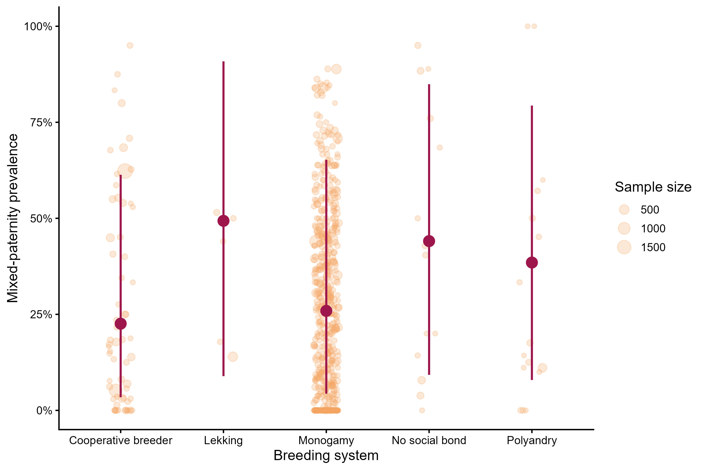
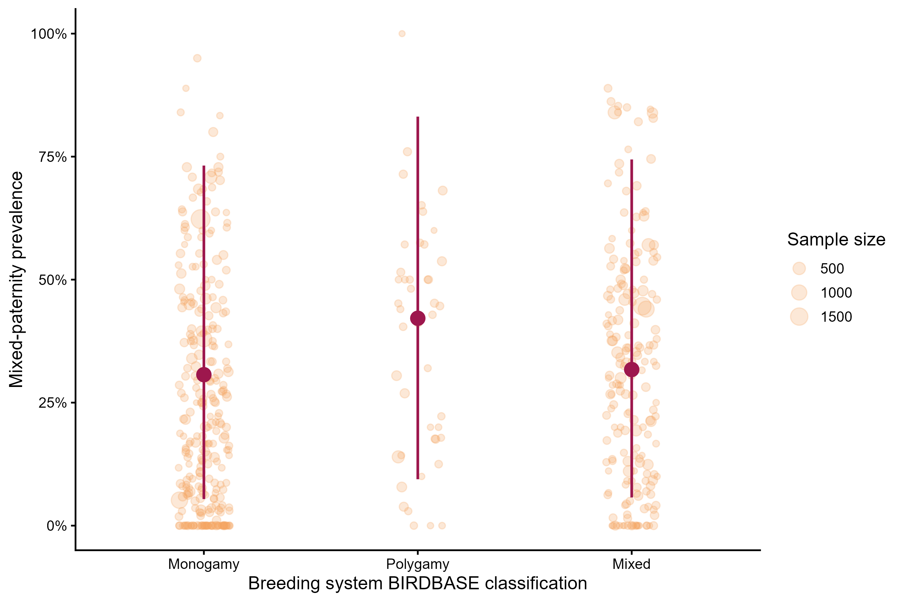
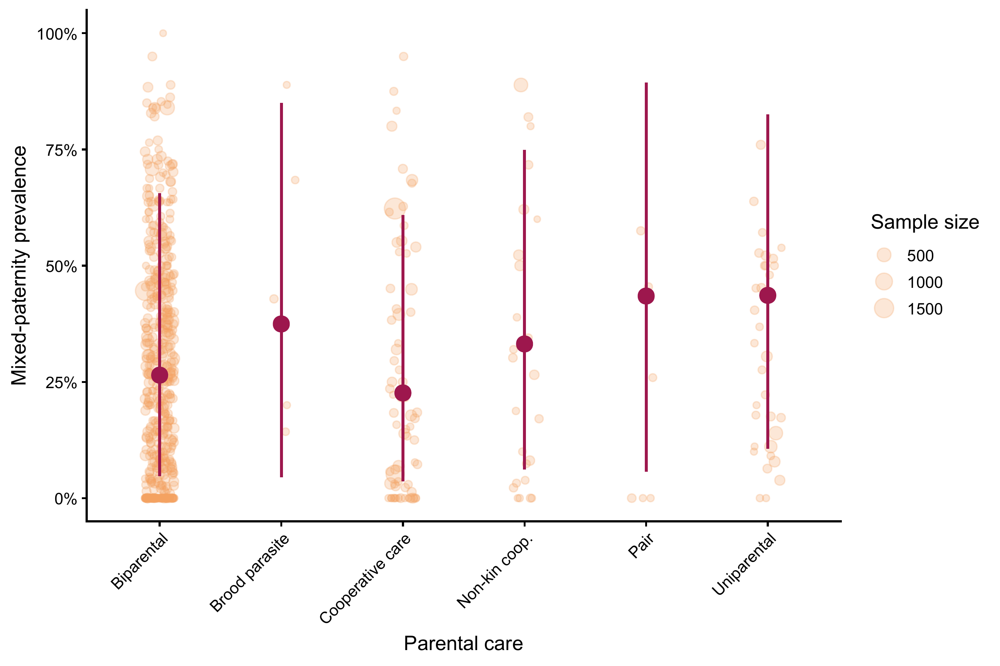
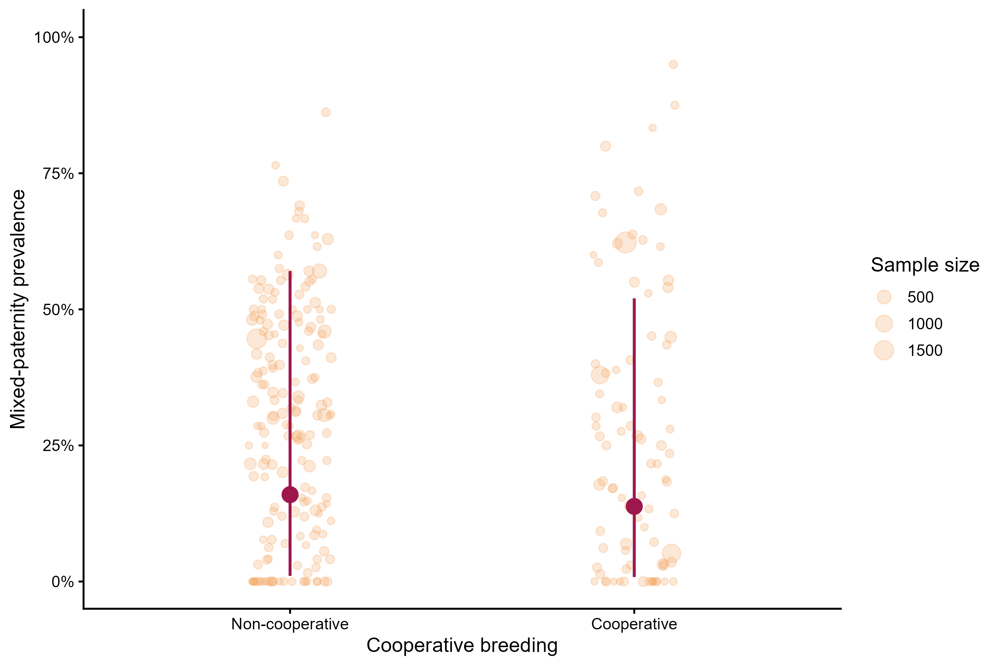

---
format:
  html:
    toc: true
    toc-depth: 3
---

:::: section-card
::: section-card
## Breeding system moderators

This section presents single-moderator models for variables describing avian breeding and parental systems, including the Brouwer and Griffith breeding-system classification, the BIRDBASE mono-/polygamy classification, parental-care system, and cooperative breeding.
:::
::::

```{r}

#| echo: false
#| message: false
#| warning: false

classification_sources <- tibble::tribble(
  ~Moderator, ~Classification_source, ~Notes,
  "Breeding system", "Brouwer and Griffith (2019)", "Rare categories with fewer than five observations were excluded.",
  "Mono-/polygamy", "BIRDBASE Şekercioğlu et al .2025", "A mixed category was created for records coded as both monogamous and polygamous.",
  "Parental care", "Cockburn (2006); Griesser et al. (2017)", "Used to represent variation in parental-care organisation.",
  "Cooperative breeding", "Co-BreeD Mocha et al. 2025", "Used to classify cooperative-breeding status."
)

knitr::kable(classification_sources)
```

Model-based prevalence is summarised as the posterior mean on the probability scale, with 95% equal-tailed credible intervals. The inverse-logit transformation is applied to each posterior draw before averaging; all random effects are set to zero.

## Packages

The R packages required for model fitting.

```{r}
#| label: setup
#| message: false
#| warning: false

library(tidyverse)
library(brms)
library(posterior)
library(bayesplot)
library(loo)
library(emmeans)

options(mc.cores = parallel::detectCores())
```

## Load prepared objects

```{r}

#| message: false
#| warning: false

data_overall_study <- readRDS("data/data_overall_study.rds")
phylo_mat <- readRDS("data/phylo_mat.rds")
```

```{r}
mixed_pat <- readRDS("data/mixed_pat_prepared.rds")
data_overall_study <- readRDS("data/data_overall_study.rds")

data_cooperative <- readRDS("data/data_cooperative.rds")
data_mono_poly <- readRDS("data/data_mono_poly.rds")
data_parental_care <- readRDS("data/data_parental_care.rds")
data_breeding_system <- readRDS("data/data_breeding_system.rds")

phylo_mat <- readRDS("data/phylo_mat.rds")
tree_analysis <- readRDS("data/tree_analysis.rds")
```

## Dataset sizes

```{r}
#| label: breeding-system-dataset-sizes
#| echo: false
#| message: false
#| warning: false

breeding_dataset_sizes <- tibble(
  Moderator = c(
    "Breeding system: Brouwer and Griffith",
    "Breeding system: BIRDBASE",
    "Parental care",
    "Cooperative breeding"
  ),
  Observations = c(
    nrow(data_breeding_system),
    nrow(data_mono_poly),
    nrow(data_parental_care),
    nrow(data_cooperative)
  )
)

knitr::kable(breeding_dataset_sizes)
```

## Model

This helper function documents the shared model structure used for all single-moderator models. These models are fitted outside this website workflow and saved as `.rds` files.

```{r}
#| label: single-moderator-helper
#| eval: false
#| echo: true

fit_single_moderator <- function(formula, data) {
  brm(
    formula = formula,
    data = data,
    family = beta_binomial(link = "logit"),
    data2 = list(phylo_mat = phylo_mat),
    chains = 4,
    cores = 4,
    iter = 10000,
    warmup = 5000,
    control = list(
      adapt_delta = 0.99,
      max_treedepth = 15
    ),
    seed = 123
  )
}
```

## Breeding system: Brouwer and Griffith classification

This model tested whether mixed-paternity prevalence differed among breeding-system categories based on the Brouwer and Griffith classification. Rare categories with fewer than five observations were excluded before model fitting.

### Figure

```{r}

```

### Model summary

```{r}
#| label: breeding-system-model-summary
#| message: false
#| warning: false
#| code-fold: true

model_breeding_system_0 <- readRDS("models/model_breeding_system_0.rds")
summary(model_breeding_system_0)
```

### Prevalence table

```{r}
#| echo: false
#| message: false
#| warning: false

breeding_system_probability_draws <- 100 * plogis(brms::fixef(model_breeding_system_0, summary = FALSE))
breeding_system_prevalence <- data.frame(
  `Breeding-system category` = sub("^breeding_system", "", colnames(breeding_system_probability_draws)),
  `Posterior mean prevalence (%)` = colMeans(breeding_system_probability_draws),
  `Lower 95% CrI` = apply(breeding_system_probability_draws, 2, quantile, 0.025),
  `Upper 95% CrI` = apply(breeding_system_probability_draws, 2, quantile, 0.975),
  row.names = NULL, check.names = FALSE
)
knitr::kable(breeding_system_prevalence, digits = 2)
```

### Post-hoc pairwise contrasts

Pairwise contrasts are posterior means with 95% equal-tailed credible intervals. Each contrast compares the first category with the second. Log-odds differences are calculated within each posterior draw. Odds ratios are summarised after exponentiating each difference, so mean OR is the mean of the transformed draws, not the exponential of the mean log-odds difference.

```{r}
#| echo: true
#| code-fold: true
#| message: false
#| warning: false

b <- brms::fixef(model_breeding_system_0, summary = FALSE)
pairs <- combn(colnames(b), 2L, simplify = FALSE)
breeding_system_contrasts <- do.call(rbind, lapply(pairs, function(pair) {
  difference <- b[, pair[1L]] - b[, pair[2L]]
  odds_ratio <- exp(difference)
  data.frame(
    contrast = paste(sub("breeding_system", "", pair, fixed = TRUE), collapse = " - "),
    estimate = mean(difference),
    lower.CrI = unname(quantile(difference, 0.025)),
    upper.CrI = unname(quantile(difference, 0.975)),
    OR = mean(odds_ratio),
    lower.OR = unname(quantile(odds_ratio, 0.025)),
    upper.OR = unname(quantile(odds_ratio, 0.975))
  )
}))
knitr::kable(breeding_system_contrasts, digits = 3,
  caption = "Posterior means and 95% equal-tailed intervals: log-odds contrasts and odds ratios.")
```

## BIRDBASE breeding-system classification

This model tested whether mixed-paternity prevalence differed among monogamous, polygamous, and mixed mating-system categories derived from the BIRDBASE breeding-system classification. The mixed category was created during data preparation for cases in which both monogamous and polygamous classifications were simultaneously assigned in the original BIRDBASE coding.

### Figure

```{r}

```

### Model summary

```{r}
#| message: false
#| warning: false

model_mono_poly_0 <- readRDS("models/model_mono_poly_0.rds")
summary(model_mono_poly_0)
```

### Prevalence table

```{r}
#| echo: false
#| message: false
#| warning: false

mono_poly_probability_draws <- 100 * plogis(brms::fixef(model_mono_poly_0, summary = FALSE))
mono_poly_prevalence <- data.frame(
  `Mono-/polygamy category` = sub("^mono_poly_model", "", colnames(mono_poly_probability_draws)),
  `Posterior mean prevalence (%)` = colMeans(mono_poly_probability_draws),
  `Lower 95% CrI` = apply(mono_poly_probability_draws, 2, quantile, 0.025),
  `Upper 95% CrI` = apply(mono_poly_probability_draws, 2, quantile, 0.975),
  row.names = NULL, check.names = FALSE
)
knitr::kable(mono_poly_prevalence, digits = 2)
```

### Post-hoc pairwise contrasts

Pairwise contrasts are posterior means with 95% equal-tailed credible intervals. Each contrast compares the first category with the second. Log-odds differences are calculated within each posterior draw. Odds ratios are summarised after exponentiating each difference, so mean OR is the mean of the transformed draws, not the exponential of the mean log-odds difference.

```{r}
#| echo: true
#| code-fold: true
#| message: false
#| warning: false

b <- brms::fixef(model_mono_poly_0, summary = FALSE)
pairs <- combn(colnames(b), 2L, simplify = FALSE)
mono_poly_contrasts <- do.call(rbind, lapply(pairs, function(pair) {
  difference <- b[, pair[1L]] - b[, pair[2L]]
  odds_ratio <- exp(difference)
  data.frame(
    contrast = paste(sub("mono_poly_model", "", pair, fixed = TRUE), collapse = " - "),
    estimate = mean(difference),
    lower.CrI = unname(quantile(difference, 0.025)),
    upper.CrI = unname(quantile(difference, 0.975)),
    OR = mean(odds_ratio),
    lower.OR = unname(quantile(odds_ratio, 0.025)),
    upper.OR = unname(quantile(odds_ratio, 0.975))
  )
}))
knitr::kable(mono_poly_contrasts, digits = 3,
  caption = "Posterior means and 95% equal-tailed intervals: log-odds contrasts and odds ratios.")
```

## Parental care

This model tested whether mixed-paternity prevalence differed among parental-care categories.

### Figure

```{r}

```

### Model summary

```{r}
#| message: false
#| warning: false
#| code-fold: true

model_parental_care_0 <- readRDS("models/model_parental_care_0.rds")
summary(model_parental_care_0)
```

### Prevalence table

Estimated mixed-paternity prevalence for each parental-care category was obtained by transforming every posterior draw from the zero-intercept model to a probability and then taking its mean and equal-tailed interval.

```{r}
#| echo: false
#| message: false
#| warning: false

parental_care_probability_draws <- 100 * plogis(brms::fixef(model_parental_care_0, summary = FALSE))
parental_care_prevalence <- data.frame(
  `Parental-care category` = sub("^parental_care", "", colnames(parental_care_probability_draws)),
  `Posterior mean prevalence (%)` = colMeans(parental_care_probability_draws),
  `Lower 95% CrI` = apply(parental_care_probability_draws, 2, quantile, 0.025),
  `Upper 95% CrI` = apply(parental_care_probability_draws, 2, quantile, 0.975),
  row.names = NULL, check.names = FALSE
)
knitr::kable(parental_care_prevalence, digits = 2)
```

### Post-hoc pairwise contrasts

Pairwise contrasts are posterior means with 95% equal-tailed credible intervals. Each contrast compares the first category with the second. Log-odds differences are calculated within each posterior draw. Odds ratios are summarised after exponentiating each difference, so mean OR is the mean of the transformed draws, not the exponential of the mean log-odds difference.

```{r}
#| echo: true
#| code-fold: true
#| message: false
#| warning: false

b <- brms::fixef(model_parental_care_0, summary = FALSE)
pairs <- combn(colnames(b), 2L, simplify = FALSE)
parental_care_contrasts <- do.call(rbind, lapply(pairs, function(pair) {
  difference <- b[, pair[1L]] - b[, pair[2L]]
  odds_ratio <- exp(difference)
  data.frame(
    contrast = paste(sub("parental_care", "", pair, fixed = TRUE), collapse = " - "),
    estimate = mean(difference),
    lower.CrI = unname(quantile(difference, 0.025)),
    upper.CrI = unname(quantile(difference, 0.975)),
    OR = mean(odds_ratio),
    lower.OR = unname(quantile(odds_ratio, 0.025)),
    upper.OR = unname(quantile(odds_ratio, 0.975))
  )
}))
knitr::kable(parental_care_contrasts, digits = 3,
  caption = "Posterior means and 95% equal-tailed intervals: log-odds contrasts and odds ratios.")
```

Posterior mean odds ratios indicated lower estimated odds of mixed paternity under cooperative care than uniparental care (OR = 0.343, 95% equal-tailed CrI 0.152–0.664), as well as under biparental care (OR = 0.430, 95% equal-tailed CrI 0.221–0.751).

## Cooperative breeding

This model tested whether mixed-paternity prevalence differed between cooperative and non-cooperative breeding species. The intercept represents the reference category - non-cooperative breeders.

### Figure

```{r}

```

### Model-summary

```{r}
#| message: false
#| warning: false
#| code-fold: true

model_cooperative <- readRDS("models/model_cooperative.rds")
summary(model_cooperative)
```

###  Model estimates

```{r}
#| echo: false
#| message: false
#| warning: false

s_cooperative <- summary(model_cooperative)

cooperative_table <- tibble::tibble(
  Parameter = rownames(s_cooperative$fixed),
  Estimate = s_cooperative$fixed[, "Estimate"],
  `Lower 95% CrI` = s_cooperative$fixed[, "l-95% CI"],
  `Upper 95% CrI` = s_cooperative$fixed[, "u-95% CI"]
)

knitr::kable(cooperative_table, digits = 3)
```

**Prevalence on the probability scale**

```{r}
#| echo: false
#| message: false
#| warning: false
b_cooperative <- brms::fixef(model_cooperative, summary = FALSE)
cooperative_probability_draws <- 100 * plogis(cbind(
  `Non-cooperative` = b_cooperative[, "Intercept"],
  Cooperative = b_cooperative[, "Intercept"] + b_cooperative[, "cooperative_breedingyes"]
))
cooperative_prevalence <- data.frame(
  `Cooperative breeding` = colnames(cooperative_probability_draws),
  `Posterior mean prevalence (%)` = colMeans(cooperative_probability_draws),
  `Lower 95% CrI` = apply(cooperative_probability_draws, 2, quantile, 0.025),
  `Upper 95% CrI` = apply(cooperative_probability_draws, 2, quantile, 0.975),
  row.names = NULL, check.names = FALSE
)
knitr::kable(cooperative_prevalence, digits = 2)
```

Posterior mean prevalence was 16.0% (95% equal-tailed CrI 1.0–57.0%) in non-cooperative species and 13.8% (0.8–52.0%) in cooperatively breeding species. Both estimates were highly uncertain.

## Heterogeneity summary

The table below compares residual heterogeneity across breeding-system, parental-care, and cooperative-breeding moderator models.

```{r}
#| echo: false
#| message: false
#| warning: false
variance_table <- readr::read_csv("tables/variance_audit/group_level_variances.csv", show_col_types = FALSE) |>
  dplyr::filter(Model %in% c("Overall model", "Breeding system", "Mono-/polygamy", "Parental care", "Cooperative breeding"))
knitr::kable(variance_table, digits = 3)
```

Group-level entries are posterior mean variances on the logit scale, calculated by squaring each posterior SD draw before averaging. Phi is the beta-binomial precision parameter. Models use different complete-case samples; these tables do not measure heterogeneity explained by individual moderators.
