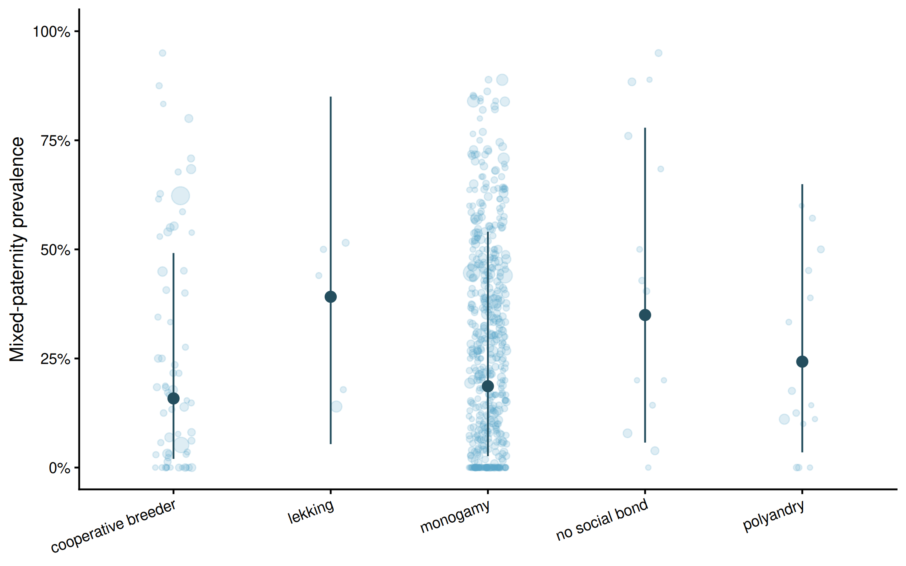
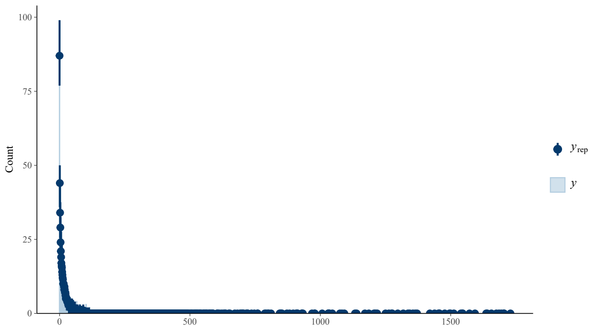
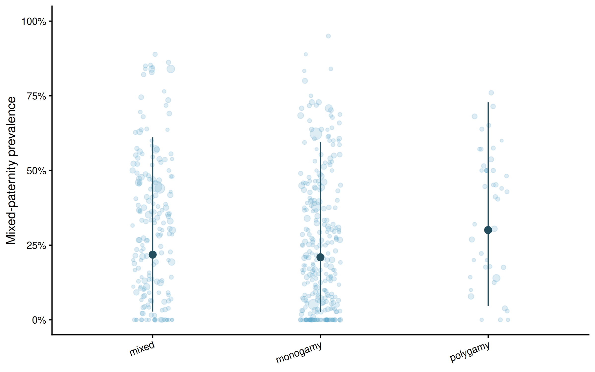
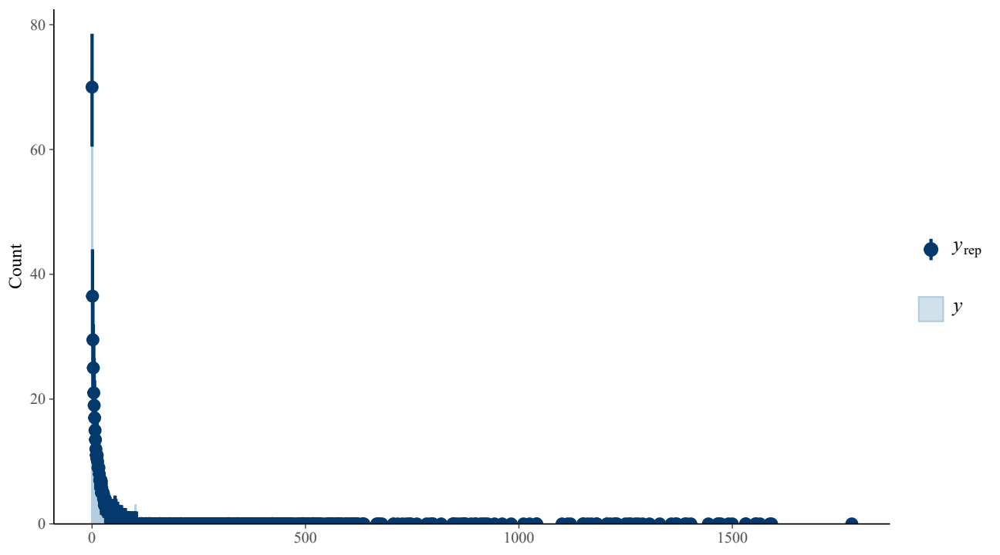
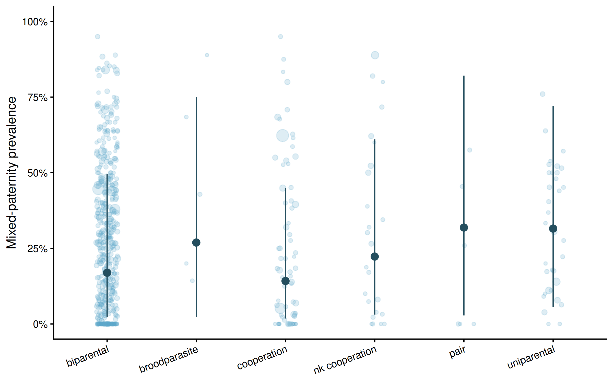
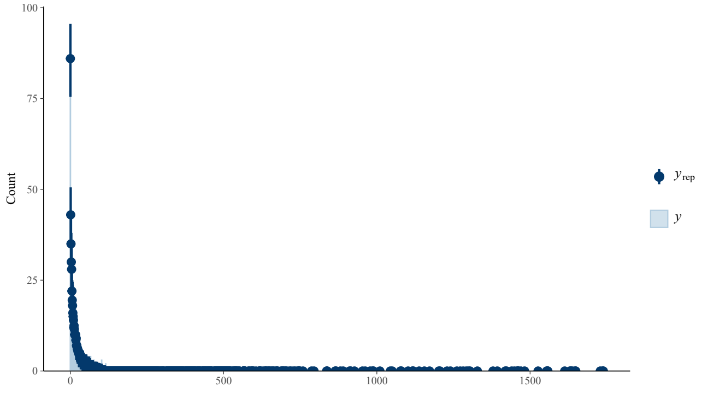
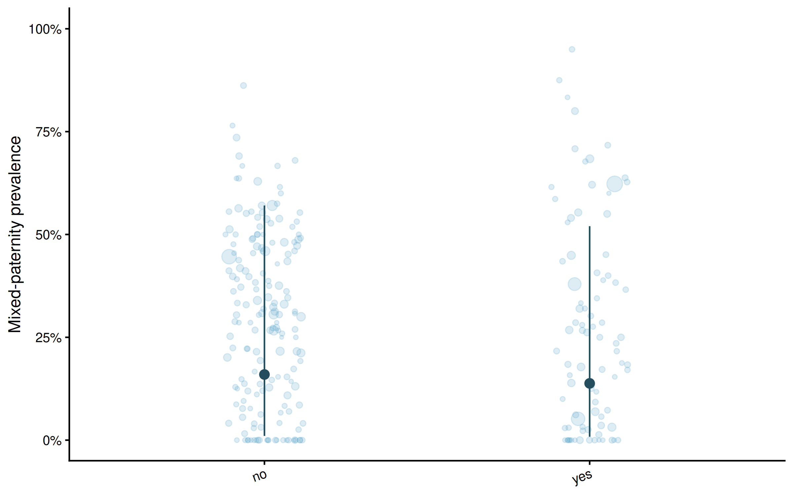
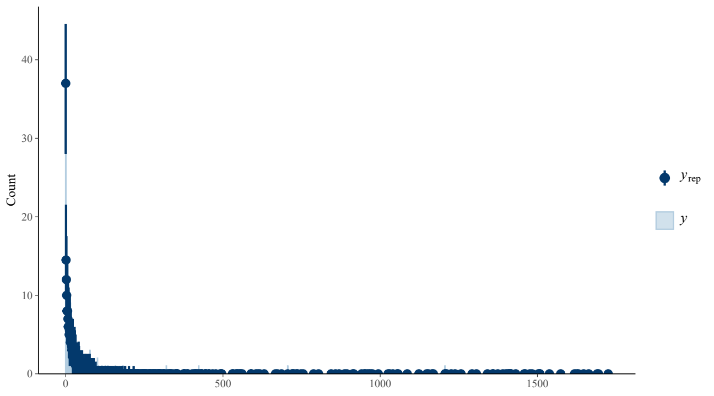

All results on this page use the models after exclusion of the two records for the common ostrich (6/6) and Nelson’s sparrow (8/8), whose exact counts could not be verified as broods with at least two genetic sires. Other records were retained, including the saltmarsh-sparrow record from the same Walsh study. Updated 5 November 2026.

Estimates are posterior means with 95% equal-tailed credible intervals (CrI). Odds ratios are summarised after exponentiating each contrast draw. Prevalence predictions are summarised after inverse-logit transformation, with random effects set to zero. Continuous effects use the original common scaling constants, retained unchanged after exclusion. Mixed paternity refers to the source-derived brood-level measure described in Methods; source reporting sometimes used brood-level EPP without identifying sire number.

## BG breeding system

603 records, 540 study identifiers and 366 species; 15884 mixed-paternity broods out of 45498 sampled broods.

| Coefficient | Mean log odds [95% CrI] | Mean OR [95% CrI] |
| --- | --- | --- |
| breeding systemcooperative breeder | -1.962 [-3.896, -0.033] | 0.229 [0.020, 0.967] |
| breeding systemlekking | -0.562 [-2.870, 1.736] | 1.136 [0.057, 5.675] |
| breeding systemmonogamy | -1.728 [-3.622, 0.162] | 0.283 [0.027, 1.176] |
| breeding systemno social bond | -0.755 [-2.802, 1.259] | 0.804 [0.061, 3.523] |
| breeding systempolyandry | -1.357 [-3.322, 0.617] | 0.426 [0.036, 1.853] |

### Pairwise contrasts

Each contrast compares the first category with the second.

| Contrast | Mean log odds [95% CrI] | Mean OR [95% CrI] |
| --- | --- | --- |
| cooperative breeder - lekking | -1.400 [-2.811, 0.022] | 0.321 [0.060, 1.022] |
| cooperative breeder - monogamy | -0.234 [-0.682, 0.216] | 0.813 [0.506, 1.241] |
| cooperative breeder - no social bond | -1.207 [-2.154, -0.278] | 0.336 [0.116, 0.757] |
| cooperative breeder - polyandry | -0.604 [-1.537, 0.314] | 0.610 [0.215, 1.368] |
| lekking - monogamy | 1.166 [-0.195, 2.527] | 4.097 [0.823, 12.519] |
| lekking - no social bond | 0.194 [-1.306, 1.673] | 1.616 [0.271, 5.327] |
| lekking - polyandry | 0.796 [-0.769, 2.322] | 3.012 [0.464, 10.199] |
| monogamy - no social bond | -0.973 [-1.816, -0.137] | 0.415 [0.163, 0.872] |
| monogamy - polyandry | -0.370 [-1.206, 0.464] | 0.756 [0.299, 1.591] |
| no social bond - polyandry | 0.602 [-0.511, 1.705] | 2.146 [0.600, 5.503] |

### Conditional prevalence

| Category | Prevalence (%) [95% CrI] |
| --- | --- |
| cooperative breeder | 15.843 [1.993, 49.163] |
| lekking | 39.137 [5.367, 85.019] |
| monogamy | 18.642 [2.602, 54.043] |
| no social bond | 34.962 [5.721, 77.892] |
| polyandry | 24.272 [3.482, 64.947] |

### Variance components and precision

| Quantity | Posterior mean [95% CrI] |
| --- | --- |
| Phylogenetic species variance | 3.001 [1.607, 4.914] |
| Non-phylogenetic species variance | 0.530 [0.241, 0.863] |
| Study variance | 0.064 [0.000, 0.205] |
| Beta-binomial precision | 20.202 [13.121, 35.018] |
| Species-level phylogenetic heritability | 0.839 [0.685, 0.946] |

### Sampling diagnostics

| Maximum R-hat | Minimum bulk ESS | Minimum tail ESS | Divergences | Treedepth hits |
| --- | --- | --- | --- | --- |
| 1.0033 | 803 | 1967 | 0 | 0 |

[Download posterior summary](tables/refit_20261105/model_breeding_system_0_summary.csv) · [Parameter-level diagnostics](tables/refit_20261105/model_breeding_system_0_parameter_diagnostics.csv).

[Download PDF](Figures/refit_20261105/model_breeding_system_0_prevalence.pdf).

### Posterior predictive check

## BIRDBASE mating system

509 records, 457 study identifiers and 286 species; 13661 mixed-paternity broods out of 39365 sampled broods.

| Coefficient | Mean log odds [95% CrI] | Mean OR [95% CrI] |
| --- | --- | --- |
| mono poly modelmixed | -1.529 [-3.562, 0.452] | 0.364 [0.028, 1.572] |
| mono poly modelmonogamy | -1.586 [-3.614, 0.389] | 0.342 [0.027, 1.475] |
| mono poly modelpolygamy | -1.020 [-3.013, 0.986] | 0.607 [0.049, 2.681] |

### Pairwise contrasts

Each contrast compares the first category with the second.

| Contrast | Mean log odds [95% CrI] | Mean OR [95% CrI] |
| --- | --- | --- |
| mixed - monogamy | 0.057 [-0.258, 0.373] | 1.072 [0.772, 1.452] |
| mixed - polygamy | -0.510 [-1.024, -0.004] | 0.621 [0.359, 0.996] |
| monogamy - polygamy | -0.566 [-1.072, -0.068] | 0.587 [0.342, 0.934] |

### Conditional prevalence

| Category | Prevalence (%) [95% CrI] |
| --- | --- |
| mixed | 21.813 [2.760, 61.114] |
| monogamy | 20.961 [2.623, 59.596] |
| polygamy | 30.062 [4.682, 72.835] |

### Variance components and precision

| Quantity | Posterior mean [95% CrI] |
| --- | --- |
| Phylogenetic species variance | 3.473 [1.825, 5.611] |
| Non-phylogenetic species variance | 0.260 [0.017, 0.574] |
| Study variance | 0.157 [0.002, 0.333] |
| Beta-binomial precision | 25.438 [12.979, 50.271] |
| Species-level phylogenetic heritability | 0.921 [0.785, 0.997] |

### Sampling diagnostics

| Maximum R-hat | Minimum bulk ESS | Minimum tail ESS | Divergences | Treedepth hits |
| --- | --- | --- | --- | --- |
| 1.0082 | 619 | 1080 | 0 | 0 |

[Download posterior summary](tables/refit_20261105/model_mono_poly_0_summary.csv) · [Parameter-level diagnostics](tables/refit_20261105/model_mono_poly_0_parameter_diagnostics.csv).

[Download PDF](Figures/refit_20261105/model_mono_poly_0_prevalence.pdf).

### Posterior predictive check

## Parental care

604 records, 543 study identifiers and 363 species; 15850 mixed-paternity broods out of 45665 sampled broods.

| Coefficient | Mean log odds [95% CrI] | Mean OR [95% CrI] |
| --- | --- | --- |
| parental carebiparental | -1.853 [-3.729, -0.017] | 0.244 [0.024, 0.983] |
| parental carebroodparasite | -1.285 [-3.734, 1.096] | 0.584 [0.024, 2.992] |
| parental carecooperation | -2.099 [-4.002, -0.205] | 0.195 [0.018, 0.814] |
| parental carenk cooperation | -1.485 [-3.441, 0.449] | 0.370 [0.032, 1.566] |
| parental carepair | -0.993 [-3.539, 1.524] | 0.843 [0.029, 4.592] |
| parental careuniparental | -0.920 [-2.807, 0.948] | 0.630 [0.060, 2.581] |

### Pairwise contrasts

Each contrast compares the first category with the second.

| Contrast | Mean log odds [95% CrI] | Mean OR [95% CrI] |
| --- | --- | --- |
| biparental - broodparasite | -0.568 [-2.172, 1.053] | 0.798 [0.114, 2.866] |
| biparental - cooperation | 0.245 [-0.192, 0.678] | 1.310 [0.826, 1.969] |
| biparental - nk cooperation | -0.368 [-0.987, 0.255] | 0.728 [0.373, 1.290] |
| biparental - pair | -0.861 [-2.580, 0.828] | 0.620 [0.076, 2.289] |
| biparental - uniparental | -0.934 [-1.559, -0.326] | 0.413 [0.210, 0.722] |
| broodparasite - cooperation | 0.813 [-0.852, 2.461] | 3.225 [0.427, 11.720] |
| broodparasite - nk cooperation | 0.200 [-1.490, 1.888] | 1.781 [0.225, 6.608] |
| broodparasite - pair | -0.292 [-2.585, 1.987] | 1.489 [0.075, 7.292] |
| broodparasite - uniparental | -0.366 [-2.053, 1.318] | 1.007 [0.128, 3.737] |
| cooperation - nk cooperation | -0.614 [-1.341, 0.115] | 0.580 [0.262, 1.122] |
| cooperation - pair | -1.106 [-2.878, 0.611] | 0.492 [0.056, 1.842] |
| cooperation - uniparental | -1.179 [-1.912, -0.458] | 0.329 [0.148, 0.633] |
| nk cooperation - pair | -0.492 [-2.299, 1.291] | 0.929 [0.100, 3.638] |
| nk cooperation - uniparental | -0.565 [-1.409, 0.274] | 0.623 [0.244, 1.315] |
| pair - uniparental | -0.073 [-1.863, 1.756] | 1.427 [0.155, 5.788] |

### Conditional prevalence

| Category | Prevalence (%) [95% CrI] |
| --- | --- |
| biparental | 16.945 [2.346, 49.563] |
| broodparasite | 26.917 [2.334, 74.951] |
| cooperation | 14.209 [1.796, 44.884] |
| nk cooperation | 22.285 [3.104, 61.035] |
| pair | 31.881 [2.821, 82.118] |
| uniparental | 31.542 [5.695, 72.075] |

### Variance components and precision

| Quantity | Posterior mean [95% CrI] |
| --- | --- |
| Phylogenetic species variance | 2.971 [1.603, 4.765] |
| Non-phylogenetic species variance | 0.513 [0.246, 0.838] |
| Study variance | 0.099 [0.000, 0.269] |
| Beta-binomial precision | 20.632 [12.420, 38.907] |
| Species-level phylogenetic heritability | 0.843 [0.693, 0.943] |

### Sampling diagnostics

| Maximum R-hat | Minimum bulk ESS | Minimum tail ESS | Divergences | Treedepth hits |
| --- | --- | --- | --- | --- |
| 1.0106 | 647 | 1567 | 0 | 0 |

[Download posterior summary](tables/refit_20261105/model_parental_care_0_summary.csv) · [Parameter-level diagnostics](tables/refit_20261105/model_parental_care_0_parameter_diagnostics.csv).

[Download PDF](Figures/refit_20261105/model_parental_care_0_prevalence.pdf).

### Posterior predictive check

## Cooperative breeding

259 records, 228 study identifiers and 115 species; 8408 mixed-paternity broods out of 24192 sampled broods.

| Coefficient | Mean log odds [95% CrI] | Mean OR [95% CrI] |
| --- | --- | --- |
| Intercept | -2.092 [-4.564, 0.284] | 0.267 [0.010, 1.328] |
| cooperative breedingyes | -0.209 [-0.716, 0.304] | 0.839 [0.489, 1.355] |

### Conditional prevalence

| Category | Prevalence (%) [95% CrI] |
| --- | --- |
| no | 15.958 [1.032, 57.042] |
| yes | 13.802 [0.829, 52.019] |

### Variance components and precision

| Quantity | Posterior mean [95% CrI] |
| --- | --- |
| Phylogenetic species variance | 3.695 [1.649, 6.801] |
| Non-phylogenetic species variance | 0.342 [0.011, 0.848] |
| Study variance | 0.123 [0.000, 0.358] |
| Beta-binomial precision | 18.972 [10.144, 41.036] |
| Species-level phylogenetic heritability | 0.903 [0.723, 0.998] |
| Prevalence at zero random effects (proportion) | 0.160 [0.010, 0.570] |

### Sampling diagnostics

| Maximum R-hat | Minimum bulk ESS | Minimum tail ESS | Divergences | Treedepth hits |
| --- | --- | --- | --- | --- |
| 1.0049 | 985 | 2183 | 0 | 0 |

[Download posterior summary](tables/refit_20261105/model_cooperative_summary.csv) · [Parameter-level diagnostics](tables/refit_20261105/model_cooperative_parameter_diagnostics.csv).

[Download PDF](Figures/refit_20261105/model_cooperative_prevalence.pdf).

### Posterior predictive check

## Reproducibility

[Posterior summaries and contrasts](tables/refit_20261105/contrasts_equal_tailed.csv) · [Export code](scripts/refit_20261105/export_results.R) · [Prediction code](scripts/refit_20261105/prepare_release.R).
