All results on this page use the models after exclusion of the two records for the common ostrich (6/6) and Nelson’s sparrow (8/8), whose exact counts could not be verified as broods with at least two genetic sires. Other records were retained, including the saltmarsh-sparrow record from the same Walsh study. Updated 5 November 2026.

Estimates are posterior means with 95% equal-tailed credible intervals (CrI). Odds ratios are summarised after exponentiating each contrast draw. Prevalence predictions are summarised after inverse-logit transformation, with random effects set to zero. Continuous effects use the original common scaling constants, retained unchanged after exclusion. Mixed paternity refers to the source-derived brood-level measure described in Methods; source reporting sometimes used brood-level EPP without identifying sire number.

## Nest architecture

585 records, 525 study identifiers and 348 species; 15687 mixed-paternity broods out of 44233 sampled broods.

| Coefficient | Mean log odds [95% CrI] | Mean OR [95% CrI] |
| --- | --- | --- |
| nest type modelcavity | -1.549 [-3.668, 0.572] | 0.378 [0.026, 1.773] |
| nest type modelground | -1.342 [-3.410, 0.737] | 0.462 [0.033, 2.089] |
| nest type modelopen | -1.540 [-3.644, 0.554] | 0.380 [0.026, 1.740] |
| nest type modelother enclosed | -1.771 [-3.933, 0.361] | 0.311 [0.020, 1.434] |

### Pairwise contrasts

Each contrast compares the first category with the second.

| Contrast | Mean log odds [95% CrI] | Mean OR [95% CrI] |
| --- | --- | --- |
| cavity - ground | -0.207 [-0.751, 0.335] | 0.845 [0.472, 1.398] |
| cavity - open | -0.009 [-0.434, 0.424] | 1.015 [0.648, 1.528] |
| cavity - other enclosed | 0.222 [-0.400, 0.854] | 1.314 [0.670, 2.349] |
| ground - open | 0.198 [-0.302, 0.699] | 1.258 [0.740, 2.012] |
| ground - other enclosed | 0.429 [-0.217, 1.085] | 1.623 [0.805, 2.960] |
| open - other enclosed | 0.231 [-0.341, 0.814] | 1.317 [0.711, 2.257] |

### Conditional prevalence

| Category | Prevalence (%) [95% CrI] |
| --- | --- |
| cavity | 21.810 [2.490, 63.933] |
| ground | 24.856 [3.198, 67.628] |
| open | 21.916 [2.548, 63.510] |
| other enclosed | 18.910 [1.921, 58.918] |

### Variance components and precision

| Quantity | Posterior mean [95% CrI] |
| --- | --- |
| Phylogenetic species variance | 3.561 [1.920, 5.664] |
| Non-phylogenetic species variance | 0.435 [0.160, 0.770] |
| Study variance | 0.068 [0.000, 0.218] |
| Beta-binomial precision | 18.782 [12.224, 32.989] |
| Species-level phylogenetic heritability | 0.882 [0.743, 0.968] |

### Sampling diagnostics

| Maximum R-hat | Minimum bulk ESS | Minimum tail ESS | Divergences | Treedepth hits |
| --- | --- | --- | --- | --- |
| 1.0031 | 898 | 2077 | 0 | 0 |

[Download posterior summary](tables/refit_20261105/model_nest_type_0_summary.csv) · [Parameter-level diagnostics](tables/refit_20261105/model_nest_type_0_parameter_diagnostics.csv).

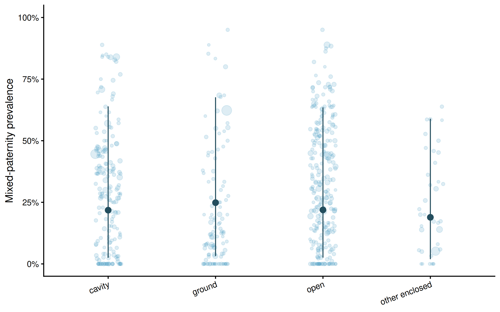

[Download PDF](Figures/refit_20261105/model_nest_type_0_prevalence.pdf).

### Posterior predictive check

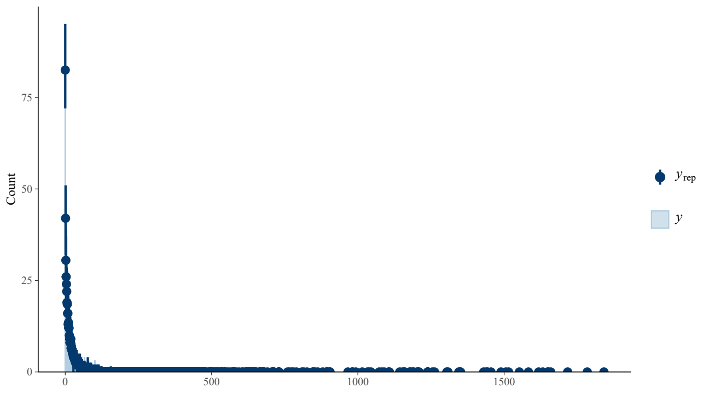

## Migration

617 records, 553 study identifiers and 373 species; 16075 mixed-paternity broods out of 46235 sampled broods.

| Coefficient | Mean log odds [95% CrI] | Mean OR [95% CrI] |
| --- | --- | --- |
| Intercept | -1.013 [-2.784, 0.749] | 0.549 [0.062, 2.116] |
| migrationWeak | -0.373 [-0.696, -0.050] | 0.698 [0.499, 0.951] |

### Conditional prevalence

| Category | Prevalence (%) [95% CrI] |
| --- | --- |
| Strong | 29.576 [5.822, 67.907] |
| Weak | 23.252 [4.091, 59.339] |

### Variance components and precision

| Quantity | Posterior mean [95% CrI] |
| --- | --- |
| Phylogenetic species variance | 3.070 [1.720, 4.909] |
| Non-phylogenetic species variance | 0.476 [0.211, 0.785] |
| Study variance | 0.066 [0.000, 0.217] |
| Beta-binomial precision | 17.971 [11.863, 30.761] |
| Species-level phylogenetic heritability | 0.857 [0.718, 0.952] |
| Prevalence at zero random effects (proportion) | 0.296 [0.058, 0.679] |

### Sampling diagnostics

| Maximum R-hat | Minimum bulk ESS | Minimum tail ESS | Divergences | Treedepth hits |
| --- | --- | --- | --- | --- |
| 1.0016 | 850 | 1405 | 0 | 0 |

[Download posterior summary](tables/refit_20261105/model_migration_summary.csv) · [Parameter-level diagnostics](tables/refit_20261105/model_migration_parameter_diagnostics.csv).

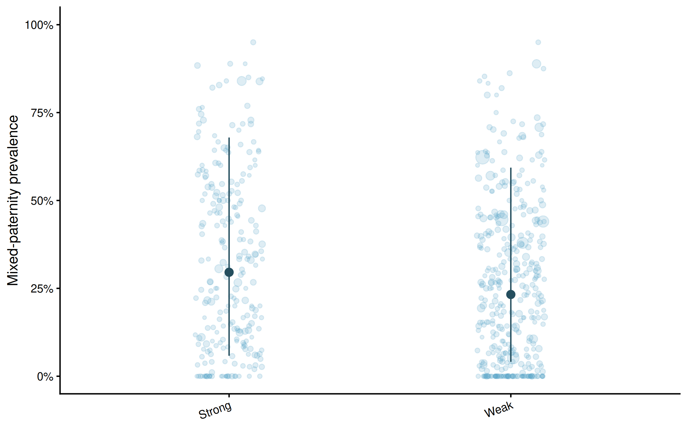

[Download PDF](Figures/refit_20261105/model_migration_prevalence.pdf).

### Posterior predictive check

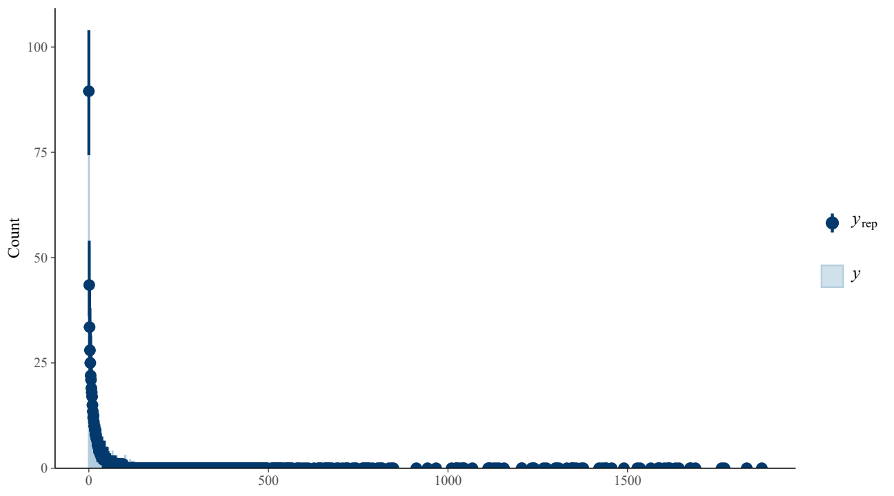

## Coloniality

617 records, 553 study identifiers and 373 species; 16075 mixed-paternity broods out of 46235 sampled broods.

| Coefficient | Mean log odds [95% CrI] | Mean OR [95% CrI] |
| --- | --- | --- |
| Intercept | -1.241 [-3.026, 0.540] | 0.437 [0.049, 1.716] |
| coloniality1 | -0.137 [-0.540, 0.262] | 0.890 [0.583, 1.299] |

### Conditional prevalence

| Category | Prevalence (%) [95% CrI] |
| --- | --- |
| 0 | 25.591 [4.628, 63.187] |
| 1 | 23.429 [3.994, 60.352] |

### Variance components and precision

| Quantity | Posterior mean [95% CrI] |
| --- | --- |
| Phylogenetic species variance | 3.065 [1.718, 4.888] |
| Non-phylogenetic species variance | 0.498 [0.235, 0.804] |
| Study variance | 0.070 [0.000, 0.225] |
| Beta-binomial precision | 18.322 [12.030, 32.262] |
| Species-level phylogenetic heritability | 0.851 [0.715, 0.947] |
| Prevalence at zero random effects (proportion) | 0.256 [0.046, 0.632] |

### Sampling diagnostics

| Maximum R-hat | Minimum bulk ESS | Minimum tail ESS | Divergences | Treedepth hits |
| --- | --- | --- | --- | --- |
| 1.0044 | 896 | 1881 | 0 | 0 |

[Download posterior summary](tables/refit_20261105/model_coloniality_summary.csv) · [Parameter-level diagnostics](tables/refit_20261105/model_coloniality_parameter_diagnostics.csv).

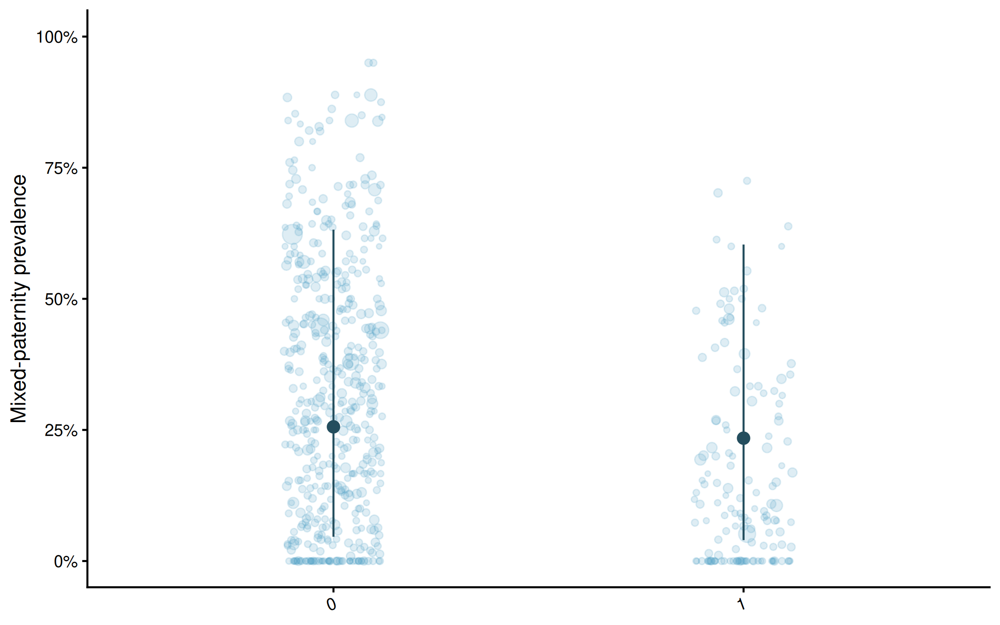

[Download PDF](Figures/refit_20261105/model_coloniality_prevalence.pdf).

### Posterior predictive check

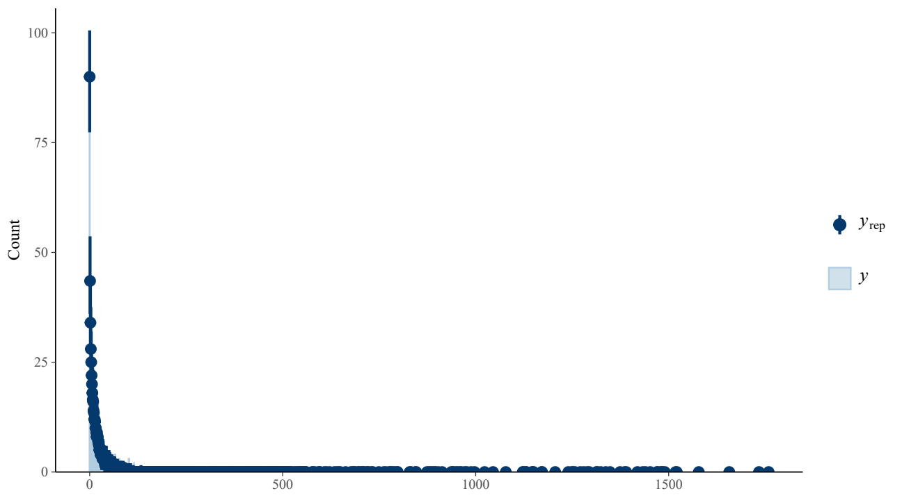

## Maximum clutch size

616 records, 552 study identifiers and 372 species; 16074 mixed-paternity broods out of 46207 sampled broods.

| Coefficient | Mean log odds [95% CrI] | Mean OR [95% CrI] |
| --- | --- | --- |
| Intercept | -1.373 [-3.125, 0.374] | 0.376 [0.044, 1.453] |
| CS max sc | 0.319 [0.103, 0.533] | 1.384 [1.109, 1.705] |

### Variance components and precision

| Quantity | Posterior mean [95% CrI] |
| --- | --- |
| Phylogenetic species variance | 2.947 [1.635, 4.686] |
| Non-phylogenetic species variance | 0.495 [0.239, 0.806] |
| Study variance | 0.064 [0.000, 0.216] |
| Beta-binomial precision | 17.891 [11.924, 31.101] |
| Species-level phylogenetic heritability | 0.847 [0.704, 0.944] |
| Prevalence at zero random effects (proportion) | 0.233 [0.042, 0.592] |

### Sampling diagnostics

| Maximum R-hat | Minimum bulk ESS | Minimum tail ESS | Divergences | Treedepth hits |
| --- | --- | --- | --- | --- |
| 1.0034 | 804 | 1763 | 0 | 0 |

[Download posterior summary](tables/refit_20261105/model_clutch_size_summary.csv) · [Parameter-level diagnostics](tables/refit_20261105/model_clutch_size_parameter_diagnostics.csv).

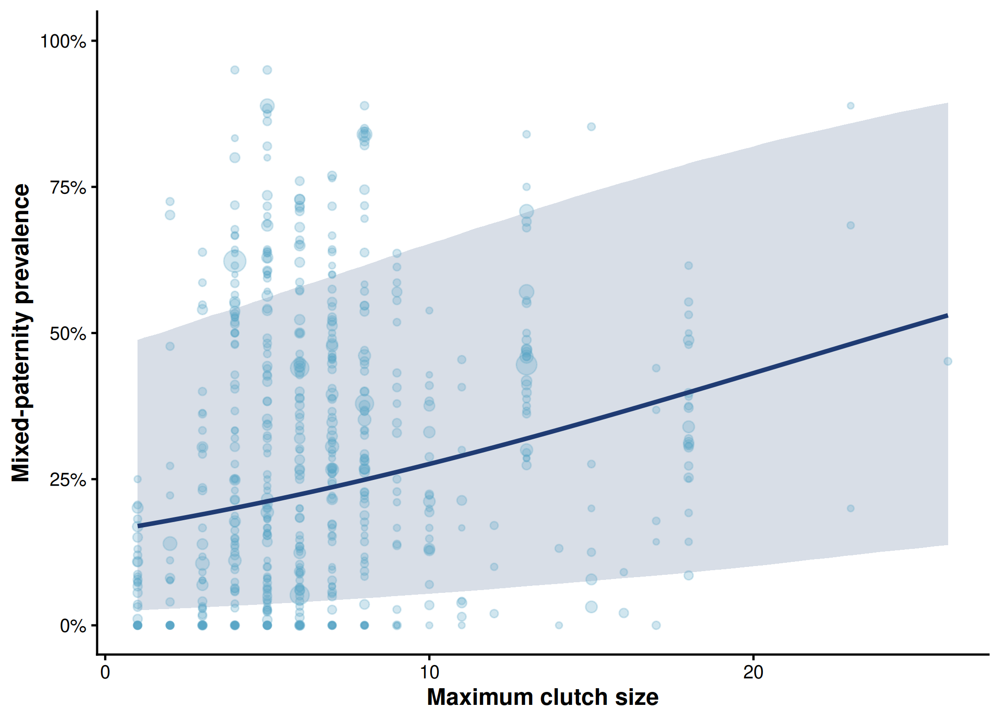

[Download PDF](Figures/refit_20261105/clutch_size.pdf).

### Posterior predictive check

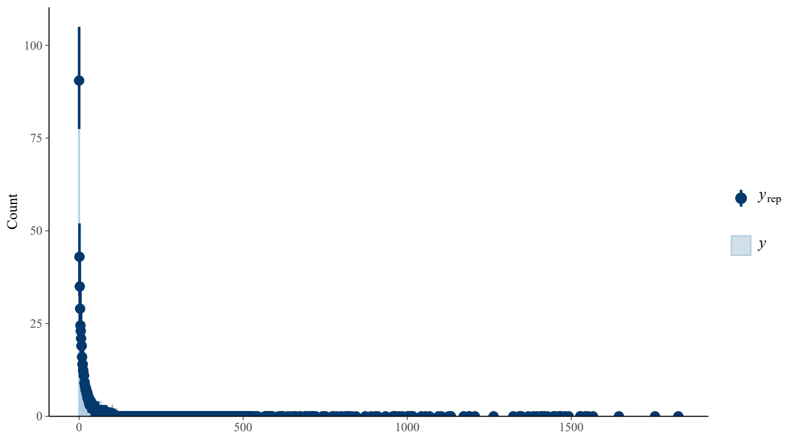

## Log body mass

617 records, 553 study identifiers and 373 species; 16075 mixed-paternity broods out of 46235 sampled broods.

| Coefficient | Mean log odds [95% CrI] | Mean OR [95% CrI] |
| --- | --- | --- |
| Intercept | -1.229 [-3.015, 0.582] | 0.448 [0.049, 1.789] |
| log body mass sc | -0.058 [-0.356, 0.242] | 0.955 [0.701, 1.274] |

### Variance components and precision

| Quantity | Posterior mean [95% CrI] |
| --- | --- |
| Phylogenetic species variance | 3.120 [1.766, 4.936] |
| Non-phylogenetic species variance | 0.497 [0.234, 0.801] |
| Study variance | 0.068 [0.000, 0.220] |
| Beta-binomial precision | 18.293 [12.040, 32.273] |
| Species-level phylogenetic heritability | 0.854 [0.719, 0.947] |
| Prevalence at zero random effects (proportion) | 0.259 [0.047, 0.641] |

### Sampling diagnostics

| Maximum R-hat | Minimum bulk ESS | Minimum tail ESS | Divergences | Treedepth hits |
| --- | --- | --- | --- | --- |
| 1.0103 | 714 | 1436 | 0 | 0 |

[Download posterior summary](tables/refit_20261105/model_log_body_mass_summary.csv) · [Parameter-level diagnostics](tables/refit_20261105/model_log_body_mass_parameter_diagnostics.csv).

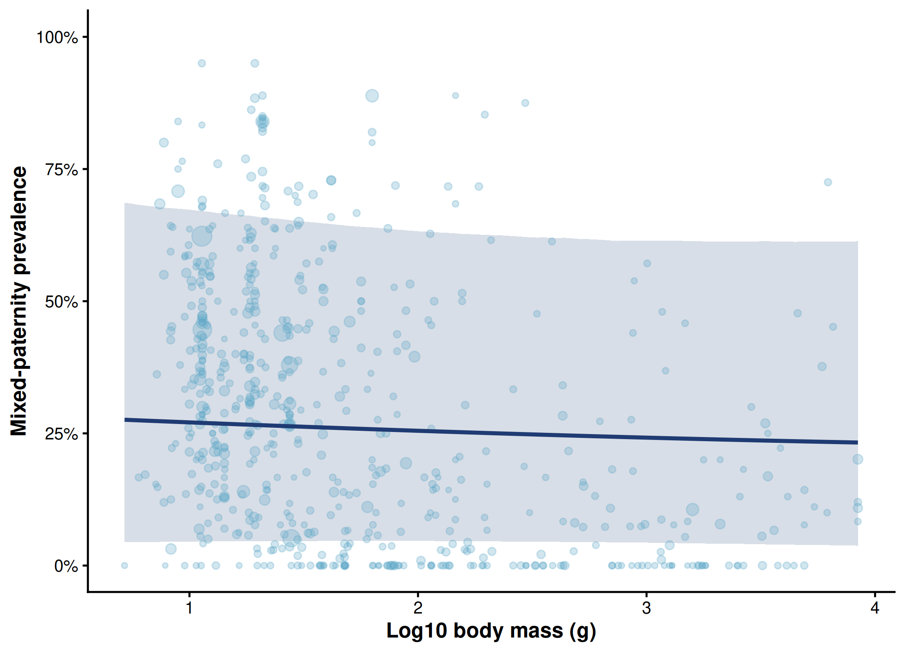

[Download PDF](Figures/refit_20261105/body_mass.pdf).

### Posterior predictive check

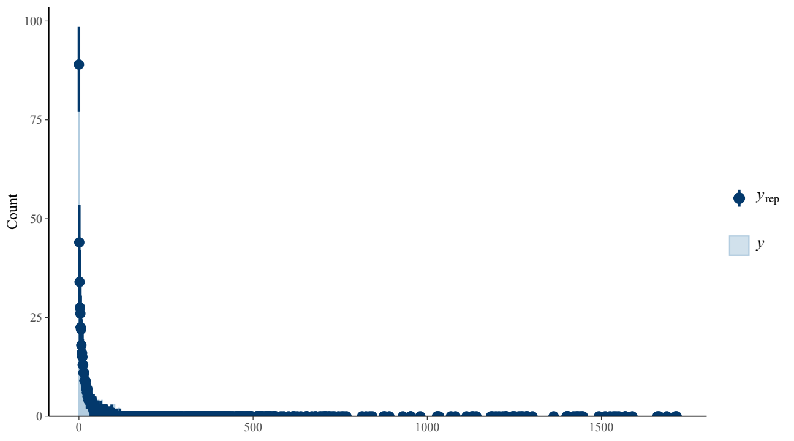

## Absolute latitude

590 records, 531 study identifiers and 361 species; 15797 mixed-paternity broods out of 45168 sampled broods.

| Coefficient | Mean log odds [95% CrI] | Mean OR [95% CrI] |
| --- | --- | --- |
| Intercept | -1.297 [-3.095, 0.510] | 0.419 [0.045, 1.665] |
| abs lat sc | -0.123 [-0.244, -0.002] | 0.886 [0.784, 0.998] |

### Variance components and precision

| Quantity | Posterior mean [95% CrI] |
| --- | --- |
| Phylogenetic species variance | 3.189 [1.797, 5.058] |
| Non-phylogenetic species variance | 0.533 [0.254, 0.860] |
| Study variance | 0.056 [0.000, 0.198] |
| Beta-binomial precision | 19.189 [12.799, 32.954] |
| Species-level phylogenetic heritability | 0.848 [0.709, 0.946] |
| Prevalence at zero random effects (proportion) | 0.248 [0.043, 0.625] |

### Sampling diagnostics

| Maximum R-hat | Minimum bulk ESS | Minimum tail ESS | Divergences | Treedepth hits |
| --- | --- | --- | --- | --- |
| 1.0051 | 872 | 1455 | 0 | 0 |

[Download posterior summary](tables/refit_20261105/model_abs_latitude_summary.csv) · [Parameter-level diagnostics](tables/refit_20261105/model_abs_latitude_parameter_diagnostics.csv).

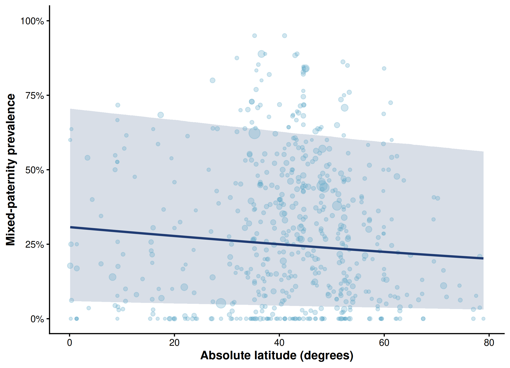

[Download PDF](Figures/refit_20261105/abs_latitude.pdf).

### Posterior predictive check

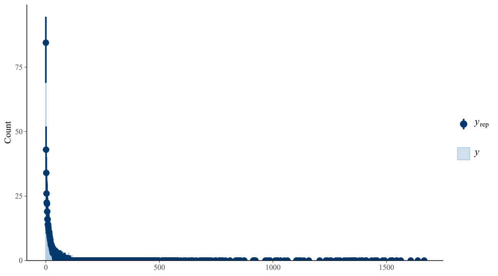

## Reproducibility

[Posterior summaries and contrasts](tables/refit_20261105/contrasts_equal_tailed.csv) · [Export code](scripts/refit_20261105/export_results.R) · [Prediction code](scripts/refit_20261105/prepare_release.R).
