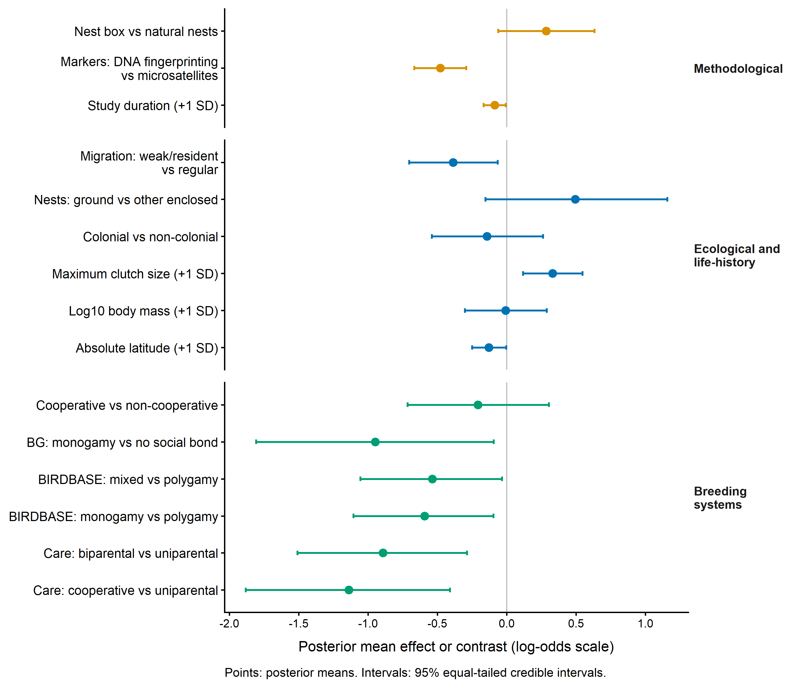

---
format:
  html:
    toc: true
    toc-depth: 3
---

::: section-card
## Figures

This section presents the main reproducible figures generated for the mixed-paternity meta-analysis, including phylogenetic, geographic, methodological, biological, and breeding-system moderator plots. Figures combine observed study-level prevalence with posterior predictions from the fitted phylogenetic beta-binomial models.
:::

## Packages

```{r}
#| message: false
#| warning: false

library(tidyverse)
library(ape)

library(brms)
library(posterior)
library(bayesplot)
library(loo)
library(tidybayes)

library(patchwork)
library(maps)

library(ggtree)
library(ggtreeExtra)
library(ggnewscale)
library(viridis)

# for plotting/export helpers
library(scales)
library(grid)

options(mc.cores = parallel::detectCores())
```

## Data import

### Load data

```{r}
mixed_pat <- readRDS("data/mixed_pat_prepared.rds")
data_overall_study <- readRDS("data/data_overall_study.rds")

data_abs_latitude <- readRDS("data/common_scaling/data_abs_latitude.rds")
data_body_mass <- readRDS("data/common_scaling/data_log_body_mass.rds")
data_clutch_size <- readRDS("data/common_scaling/data_clutch_size.rds")
data_coloniality <- readRDS("data/data_coloniality.rds")
data_cooperative <- readRDS("data/data_cooperative.rds")
data_marker_type <- readRDS("data/data_marker_type.rds")
data_migration <- readRDS("data/data_migration.rds")
data_mono_poly <- readRDS("data/data_mono_poly.rds")
data_nest_box <- readRDS("data/data_nest_box.rds")
data_nest_type <- readRDS("data/data_nest_type.rds")
data_parental_care <- readRDS("data/data_parental_care.rds")
data_study_duration <- readRDS("data/common_scaling/data_study_duration.rds")
data_breeding_system <- readRDS("data/data_breeding_system.rds")

phylo_mat <- readRDS("data/phylo_mat.rds")
tree_analysis <- readRDS("data/tree_analysis.rds")
```

### Load models

```{r}
model_overall_study <- readRDS("models/model_overall_study.rds")
model_nest_type <- readRDS("models/model_nest_type_0.rds")
model_migration <- readRDS("models/model_migration.rds")
model_coloniality <- readRDS("models/model_coloniality.rds")
model_breeding_system_0 <- readRDS("models/model_breeding_system_0.rds")
model_mono_poly_0 <- readRDS("models/model_mono_poly_0.rds")
model_parental_care_0 <- readRDS("models/model_parental_care_0.rds")
model_cooperative <- readRDS("models/model_cooperative.rds")
model_marker_type_0 <- readRDS("models/model_marker_type_0.rds")
model_nest_box <- readRDS("models/model_nest_box.rds")
```

The continuous-moderator and full-model figures use the accepted fits in `models/common_scaling/`. Other models retain their accepted files in `models/`. The [common-scaling model code](https://github.com/anetaarct/avian_mixed_paternity/tree/main/mixed_paternity_final/common_scaling_refit) and [figure-generation code](https://github.com/anetaarct/avian_mixed_paternity/blob/main/mixed_paternity_final/scripts/generate_common_scaling_figures.R) are provided with the analysis. Figure generation reads saved fits and uses posterior means and equal-tailed intervals for prevalence predictions; it does not refit the models.

The code below records the common-scaling preparation, model specifications and figure generation. These code blocks are displayed without execution during website rendering. The accepted fits used R 4.5.3, brms 2.23.0 and rstan 2.32.7; generating figures requires the corresponding saved model objects.

```{r}
#| eval: false
#| echo: true
#| code-fold: true
#| code-summary: "Code: common scaling and data preparation"

library(dplyr)
library(readr)
library(tibble)

dir.create("data", showWarnings = FALSE, recursive = TRUE)
dir.create("logs", showWarnings = FALSE, recursive = TRUE)
dir.create("tables", showWarnings = FALSE, recursive = TRUE)

input_path <- "data/data_overall_study.rds"
if (!file.exists(input_path)) {
  stop("Missing required file: ", input_path)
}

dat <- readRDS(input_path)
if (nrow(dat) != 619L) {
  stop(
    "The common scaling reference must be the 619-record overall analytical dataset; found ",
    nrow(dat), " records."
  )
}

to_numeric <- function(x) {
  if (is.numeric(x)) return(x)
  readr::parse_number(as.character(x), na = c("", "NA", "NaN"))
}

if (!"study_duration" %in% names(dat)) {
  if (!"study_duration_num" %in% names(dat)) {
    stop("Neither study_duration nor study_duration_num is available.")
  }
  dat$study_duration <- to_numeric(dat$study_duration_num)
} else {
  dat$study_duration <- to_numeric(dat$study_duration)
}

required_raw <- c("CS_max", "body_mass", "abs_lat")
missing_raw <- setdiff(required_raw, names(dat))
if (length(missing_raw) > 0L) {
  stop("Missing raw continuous predictors: ", paste(missing_raw, collapse = ", "))
}

dat <- dat %>%
  mutate(
    CS_max = to_numeric(CS_max),
    body_mass = to_numeric(body_mass),
    abs_lat = to_numeric(abs_lat),
    log_body_mass = if_else(
      is.finite(body_mass) & body_mass > 0,
      log10(body_mass),
      NA_real_
    )
  )

raw_values <- list(
  study_duration = dat$study_duration,
  CS_max = dat$CS_max,
  log_body_mass = dat$log_body_mass,
  abs_lat = dat$abs_lat
)

scaling <- tibble(
  predictor = names(raw_values),
  standardized_variable = c(
    "study_duration_sc", "CS_max_sc", "log_body_mass_sc", "abs_lat_sc"
  ),
  transformation = c("none", "none", "log10(body mass)", "absolute latitude"),
  unit = c("years", "eggs", "log10(g)", "degrees"),
  n_used = vapply(raw_values, function(x) sum(is.finite(x)), integer(1)),
  raw_mean = vapply(raw_values, function(x) mean(x[is.finite(x)]), numeric(1)),
  raw_sd = vapply(raw_values, function(x) stats::sd(x[is.finite(x)]), numeric(1)),
  reference_dataset = "overall analytical dataset (619 records)"
)

if (any(!is.finite(scaling$raw_sd)) || any(scaling$raw_sd <= 0)) {
  stop("At least one scaling SD is non-finite or non-positive.")
}

scale_from_table <- function(x, predictor_name) {
  row <- scaling %>% filter(predictor == predictor_name)
  if (nrow(row) != 1L) stop("Scaling row not uniquely identified: ", predictor_name)
  (x - row$raw_mean) / row$raw_sd
}

dat <- dat %>%
  mutate(
    study_duration_sc = scale_from_table(study_duration, "study_duration"),
    CS_max_sc = scale_from_table(CS_max, "CS_max"),
    log_body_mass_sc = scale_from_table(log_body_mass, "log_body_mass"),
    abs_lat_sc = scale_from_table(abs_lat, "abs_lat")
  )

scaled_names <- scaling$standardized_variable
validation <- tibble(
  standardized_variable = scaled_names,
  mean_after_scaling = vapply(
    dat[scaled_names], function(x) mean(x[is.finite(x)]), numeric(1)
  ),
  sd_after_scaling = vapply(
    dat[scaled_names], function(x) stats::sd(x[is.finite(x)]), numeric(1)
  )
)

if (any(abs(validation$mean_after_scaling) > 1e-10) ||
    any(abs(validation$sd_after_scaling - 1) > 1e-10)) {
  stop("Common-scaling validation failed.")
}

write_csv(scaling, "tables/continuous_predictor_scaling.csv")
write_csv(validation, "tables/continuous_predictor_scaling_validation.csv")
saveRDS(scaling, "data/continuous_predictor_scaling.rds")
saveRDS(dat, "data/data_overall_study_common_scaled.rds")

writeLines(
  c(
    "Common scaling reference: overall analytical dataset",
    paste("Records:", nrow(dat)),
    "",
    capture.output(print(scaling, n = Inf)),
    "",
    capture.output(print(validation, n = Inf)),
    "",
    paste0(
      "One SD of study duration corresponds to ",
      formatC(
        scaling$raw_sd[scaling$predictor == "study_duration"],
        digits = 4,
        format = "f"
      ),
      " years."
    )
  ),
  "logs/common_scaling_summary.txt"
)

message("Common scaling data, constants, validation, and summary saved.")
```

```{r}
#| eval: false
#| echo: true
#| code-fold: true
#| code-summary: "Code: four continuous-moderator models"

library(brms)
library(dplyr)
library(posterior)
library(readr)
library(tibble)

options(mc.cores = min(4L, parallel::detectCores()))

model_dir <- "models/common_scaling"
data_dir <- "data/common_scaling"
table_dir <- "tables/common_scaling"
log_dir <- "logs/common_scaling"

invisible(lapply(
  c(model_dir, data_dir, table_dir, log_dir),
  dir.create,
  showWarnings = FALSE,
  recursive = TRUE
))

required <- c(
  "data/data_overall_study_common_scaled.rds",
  "data/phylo_mat.rds",
  "data/continuous_predictor_scaling.rds"
)
missing <- required[!file.exists(required)]
if (length(missing) > 0L) stop("Missing required files: ", paste(missing, collapse = ", "))

dat_all <- readRDS("data/data_overall_study_common_scaled.rds")
phylo_mat <- readRDS("data/phylo_mat.rds")

if (nrow(dat_all) != 619L) stop("Expected the 619-record common scaling dataset.")

model_specs <- tribble(
  ~model_id, ~predictor, ~raw_predictor,
  "study_duration", "study_duration_sc", "study_duration",
  "clutch_size", "CS_max_sc", "CS_max",
  "log_body_mass", "log_body_mass_sc", "log_body_mass",
  "abs_latitude", "abs_lat_sc", "abs_lat"
)

diagnose_fit <- function(fit, model_id) {
  draw_summary <- posterior::summarise_draws(posterior::as_draws_array(fit))
  nuts <- brms::nuts_params(fit)
  max_depth <- tryCatch(
    fit$fit@stan_args[[1]]$control$max_treedepth,
    error = function(e) NULL
  )
  if (is.null(max_depth) || length(max_depth) != 1L) max_depth <- 15L

  tibble(
    model = model_id,
    observations = nobs(fit),
    max_rhat = max(draw_summary$rhat, na.rm = TRUE),
    min_bulk_ess = min(draw_summary$ess_bulk, na.rm = TRUE),
    min_tail_ess = min(draw_summary$ess_tail, na.rm = TRUE),
    divergences = sum(nuts$Parameter == "divergent__" & nuts$Value == 1),
    treedepth_hits = sum(nuts$Parameter == "treedepth__" & nuts$Value >= max_depth),
    maximum_observed_treedepth = max(nuts$Value[nuts$Parameter == "treedepth__"]),
    configured_max_treedepth = max_depth
  )
}

fit_one <- function(model_id, predictor, raw_predictor) {
  dat <- dat_all %>%
    filter(is.finite(.data[[predictor]]), is.finite(.data[[raw_predictor]])) %>%
    droplevels()

  saveRDS(dat, file.path(data_dir, paste0("data_", model_id, ".rds")))

  model_formula <- stats::as.formula(paste0(
    "n_mixed_broods | trials(n_total_broods) ~ ", predictor,
    " + (1 | Study_ID) + (1 | species_nonphylo)",
    " + (1 | gr(species_phylo_brms, cov = phylo_mat))"
  ))

  fit <- brm(
    formula = model_formula,
    family = beta_binomial(link = "logit"),
    data = dat,
    data2 = list(phylo_mat = phylo_mat),
    chains = 4,
    cores = 4,
    iter = 10000,
    warmup = 5000,
    control = list(adapt_delta = 0.99, max_treedepth = 15),
    seed = 123,
    file = file.path(model_dir, paste0("model_", model_id)),
    file_refit = "on_change"
  )

  writeLines(
    capture.output(summary(fit)),
    file.path(log_dir, paste0("model_", model_id, "_summary.txt"))
  )
  readr::write_csv(
    as.data.frame(brms::prior_summary(fit)),
    file.path(table_dir, paste0("model_", model_id, "_priors.csv"))
  )
  readr::write_csv(
    tibble::rownames_to_column(as.data.frame(brms::fixef(fit)), "term"),
    file.path(table_dir, paste0("model_", model_id, "_fixed_effects.csv"))
  )
  readr::write_csv(
    diagnose_fit(fit, model_id),
    file.path(table_dir, paste0("model_", model_id, "_diagnostics.csv"))
  )

  invisible(fit)
}

for (i in seq_len(nrow(model_specs))) {
  message("Fitting ", model_specs$model_id[[i]], " ...")
  fit_one(
    model_specs$model_id[[i]],
    model_specs$predictor[[i]],
    model_specs$raw_predictor[[i]]
  )
}

diagnostic_files <- list.files(
  table_dir,
  pattern = "_diagnostics[.]csv$",
  full.names = TRUE
)
diagnostics <- bind_rows(lapply(diagnostic_files, readr::read_csv, show_col_types = FALSE))
write_csv(diagnostics, file.path(table_dir, "continuous_models_diagnostics.csv"))

message("Four common-scaling continuous-moderator models finished.")
```

```{r}
#| eval: false
#| echo: true
#| code-fold: true
#| code-summary: "Code: full multivariable model"

library(brms)
library(dplyr)
library(posterior)
library(readr)
library(tibble)

options(mc.cores = min(4L, parallel::detectCores()))

model_dir <- "models/common_scaling"
data_dir <- "data/common_scaling"
table_dir <- "tables/common_scaling"
log_dir <- "logs/common_scaling"

invisible(lapply(
  c(model_dir, data_dir, table_dir, log_dir),
  dir.create,
  showWarnings = FALSE,
  recursive = TRUE
))

required <- c(
  "data/data_overall_study_common_scaled.rds",
  "data/phylo_mat.rds",
  "data/continuous_predictor_scaling.rds"
)
missing <- required[!file.exists(required)]
if (length(missing) > 0L) stop("Missing required files: ", paste(missing, collapse = ", "))

dat_all <- readRDS("data/data_overall_study_common_scaled.rds")
phylo_mat <- readRDS("data/phylo_mat.rds")

if (nrow(dat_all) != 619L) stop("Expected the 619-record common scaling dataset.")

valid_breeding_levels <- dat_all %>%
  count(breeding_system) %>%
  filter(!is.na(breeding_system), n >= 5) %>%
  pull(breeding_system)

dat_full <- dat_all %>%
  filter(
    !is.na(marker_type_model),
    is.finite(study_duration_sc),
    !is.na(breeding_system),
    breeding_system %in% valid_breeding_levels,
    !is.na(nest_type_model),
    !is.na(migration),
    !is.na(coloniality),
    is.finite(CS_max_sc),
    is.finite(log_body_mass_sc),
    is.finite(abs_lat_sc)
  ) %>%
  mutate(
    across(
      c(
        marker_type_model, breeding_system, nest_type_model, migration,
        coloniality, Study_ID, species_nonphylo, species_phylo_brms
      ),
      droplevels
    )
  ) %>%
  group_by(breeding_system) %>%
  filter(n() >= 5) %>%
  ungroup() %>%
  droplevels()

if (nrow(dat_full) != 533L) {
  stop("Expected 533 records in the accepted full-model dataset; found ", nrow(dat_full), ".")
}

saveRDS(dat_full, file.path(data_dir, "data_full_brouwer_griffith.rds"))

writeLines(
  c(
    "Common-scaling full model",
    paste("Observations:", nrow(dat_full)),
    paste("Studies:", n_distinct(dat_full$Study_ID)),
    paste("Species:", n_distinct(dat_full$species_nonphylo)),
    "",
    "Breeding-system counts:",
    capture.output(table(dat_full$breeding_system))
  ),
  file.path(log_dir, "model_full_brouwer_griffith_dataset.txt")
)

full_formula <- bf(
  n_mixed_broods | trials(n_total_broods) ~
    marker_type_model +
    study_duration_sc +
    breeding_system +
    nest_type_model +
    migration +
    coloniality +
    CS_max_sc +
    log_body_mass_sc +
    abs_lat_sc +
    (1 | Study_ID) +
    (1 | species_nonphylo) +
    (1 | gr(species_phylo_brms, cov = phylo_mat))
)

fit <- brm(
  formula = full_formula,
  family = beta_binomial(link = "logit"),
  data = dat_full,
  data2 = list(phylo_mat = phylo_mat),
  chains = 4,
  cores = 4,
  iter = 10000,
  warmup = 5000,
  control = list(adapt_delta = 0.99, max_treedepth = 15),
  seed = 123,
  file = file.path(model_dir, "model_full_brouwer_griffith"),
  file_refit = "on_change"
)

writeLines(
  capture.output(summary(fit)),
  file.path(log_dir, "model_full_brouwer_griffith_summary.txt")
)
write_csv(
  as.data.frame(prior_summary(fit)),
  file.path(table_dir, "model_full_brouwer_griffith_priors.csv")
)
write_csv(
  rownames_to_column(as.data.frame(fixef(fit)), "term"),
  file.path(table_dir, "model_full_brouwer_griffith_fixed_effects.csv")
)

draw_summary <- posterior::summarise_draws(posterior::as_draws_array(fit))
nuts <- brms::nuts_params(fit)
configured_depth <- tryCatch(
  fit$fit@stan_args[[1]]$control$max_treedepth,
  error = function(e) NULL
)
if (is.null(configured_depth) || length(configured_depth) != 1L) configured_depth <- 15L

diagnostics <- tibble(
  model = "full_brouwer_griffith",
  observations = nobs(fit),
  max_rhat = max(draw_summary$rhat, na.rm = TRUE),
  min_bulk_ess = min(draw_summary$ess_bulk, na.rm = TRUE),
  min_tail_ess = min(draw_summary$ess_tail, na.rm = TRUE),
  divergences = sum(nuts$Parameter == "divergent__" & nuts$Value == 1),
  treedepth_hits = sum(
    nuts$Parameter == "treedepth__" & nuts$Value >= configured_depth
  ),
  maximum_observed_treedepth = max(nuts$Value[nuts$Parameter == "treedepth__"]),
  configured_max_treedepth = configured_depth
)
write_csv(diagnostics, file.path(table_dir, "model_full_brouwer_griffith_diagnostics.csv"))

message("Common-scaling full model finished.")
```

```{r}
#| eval: false
#| echo: true
#| code-fold: true
#| code-summary: "Code: continuous and full-model figures"

# Run from mixed_paternity_final. Uses accepted saved fits; no model fitting.
library(brms)
library(dplyr)
library(ggplot2)
library(patchwork)
library(readr)
library(scales)
library(tibble)

out_dir <- "Figures/common_scaling"
dir.create(out_dir, recursive = TRUE, showWarnings = FALSE)

summarise_epred <- function(fit, newdata) {
  ep <- posterior_epred(fit, newdata = newdata, re_formula = NA)
  tibble(
    estimate = apply(ep, 2, mean),
    lower = apply(ep, 2, quantile, probs = 0.025),
    upper = apply(ep, 2, quantile, probs = 0.975)
  )
}

save_both <- function(plot, stem, width, height) {
  ggsave(file.path(out_dir, paste0(stem, ".pdf")), plot,
        width = width, height = height, units = "in")
  ggsave(file.path(out_dir, paste0(stem, ".png")), plot,
        width = width, height = height, units = "in", dpi = 300)
}

theme_mp <- theme_classic(base_size = 12) +
  theme(
    plot.title = element_text(face = "bold"),
    axis.title = element_text(face = "bold"),
    legend.position = "none"
  )

scaling <- read_csv("tables/continuous_predictor_scaling.csv", show_col_types = FALSE)

single_specs <- tribble(
  ~model_file, ~data_file, ~raw_var, ~scaled_var, ~x_label, ~stem,
  "model_study_duration.rds", "data_study_duration.rds", "study_duration", "study_duration_sc", "Study duration (years)", "study_duration",
  "model_clutch_size.rds", "data_clutch_size.rds", "CS_max", "CS_max_sc", "Maximum clutch size", "clutch_size",
  "model_log_body_mass.rds", "data_log_body_mass.rds", "log_body_mass", "log_body_mass_sc", "Log10 body mass (g)", "body_mass",
  "model_abs_latitude.rds", "data_abs_latitude.rds", "abs_lat", "abs_lat_sc", "Absolute latitude (degrees)", "abs_latitude"
)

for (i in seq_len(nrow(single_specs))) {
  spec <- single_specs[i, ]
  fit <- readRDS(file.path("models/common_scaling", spec$model_file))
  dat <- readRDS(file.path("data/common_scaling", spec$data_file))
  stopifnot(isTRUE(all.equal(as.data.frame(fit$data),
    as.data.frame(dat[, names(fit$data), drop = FALSE]), check.attributes = FALSE)))
  scale_row <- scaling |> filter(standardized_variable == spec$scaled_var)
  stopifnot(nrow(scale_row) == 1L,
    max(abs((dat[[spec$raw_var]] - scale_row$raw_mean[[1]]) /
      scale_row$raw_sd[[1]] - dat[[spec$scaled_var]])) < 1e-8)

  raw_grid <- seq(
    min(dat[[spec$raw_var]], na.rm = TRUE),
    max(dat[[spec$raw_var]], na.rm = TRUE),
    length.out = 120
  )
  newdata <- dat[rep(1, length(raw_grid)), , drop = FALSE]
  newdata[[spec$raw_var]] <- raw_grid
  newdata[[spec$scaled_var]] <-
    (raw_grid - scale_row$raw_mean[[1]]) / scale_row$raw_sd[[1]]
  newdata$n_total_broods <- 1L

  pred <- bind_cols(
    tibble(raw_value = raw_grid),
    summarise_epred(fit, newdata)
  )
  observed <- dat |>
    mutate(observed = n_mixed_broods / n_total_broods)

  p <- ggplot() +
    geom_ribbon(
      data = pred,
      aes(x = raw_value, ymin = lower, ymax = upper),
      fill = "#2C4A7A", alpha = 0.18
    ) +
    geom_point(
      data = observed,
      aes(x = .data[[spec$raw_var]], y = observed, size = n_total_broods),
      colour = "#5AA6C8", alpha = 0.28
    ) +
    geom_line(
      data = pred,
      aes(x = raw_value, y = estimate),
      colour = "#1F3B73", linewidth = 1.1
    ) +
    scale_y_continuous(labels = percent_format(accuracy = 1), limits = c(0, 1)) +
    scale_size_continuous(range = c(1, 5)) +
    labs(x = spec$x_label[[1]], y = "Mixed-paternity prevalence") +
    theme_mp

  save_both(p, spec$stem, 7.2, 5.2)
  rm(fit)
  invisible(gc())
}

fit_full <- readRDS("models/common_scaling/model_full_brouwer_griffith.rds")
dat_full <- readRDS("data/common_scaling/data_full_brouwer_griffith.rds")
stopifnot(nrow(dat_full) == 533L,
  isTRUE(all.equal(as.data.frame(fit_full$data),
    as.data.frame(dat_full[, names(fit_full$data), drop = FALSE]), check.attributes = FALSE)))

fixed <- as.data.frame(fixef(fit_full)) |>
  rownames_to_column("term") |>
  filter(term != "Intercept") |>
  transmute(
    term,
    estimate = Estimate,
    lower = Q2.5,
    upper = Q97.5,
    label = recode(
      term,
      marker_type_modelmicrosatellite = "Marker: microsatellite",
      marker_type_modelmixed_other = "Marker: mixed / other",
      marker_type_modelSNPs = "Marker: SNPs",
      study_duration_sc = "Study duration",
      breeding_systemmonogamy = "Breeding: monogamy",
      breeding_systemno_social_bond = "Breeding: no social bond",
      breeding_systempolyandry = "Breeding: polyandry",
      nest_type_modelground = "Nest type: ground",
      nest_type_modelopen = "Nest type: open",
      nest_type_modelother_enclosed = "Nest type: other enclosed",
      migrationWeak = "Migration: partial/resident",
      coloniality1 = "Coloniality",
      CS_max_sc = "Maximum clutch size",
      log_body_mass_sc = "Body mass (log10)",
      abs_lat_sc = "Absolute latitude"
    ),
    group = case_when(
      grepl("^marker|study_duration", term) ~ "Methodological",
      grepl("^breeding", term) ~ "Breeding system",
      term == "abs_lat_sc" ~ "Geography",
      TRUE ~ "Ecology/life history"
    )
  ) |>
  mutate(label = factor(label, levels = rev(label)))

group_colours <- c(
  "Methodological" = "#2F7478",
  "Breeding system" = "#A81D54",
  "Ecology/life history" = "#BE6233",
  "Geography" = "#4E75A8"
)

p_forest <- ggplot(fixed, aes(x = estimate, y = label, colour = group)) +
  geom_vline(xintercept = 0, linetype = "dashed", colour = "grey45") +
  geom_hline(yintercept = seq_along(levels(fixed$label)), colour = "grey90") +
  geom_errorbarh(aes(xmin = lower, xmax = upper), height = 0, linewidth = 1) +
  geom_point(size = 3) +
  scale_colour_manual(values = group_colours) +
  labs(x = "Posterior effect size (log-odds scale)", y = NULL, colour = NULL) +
  theme_classic(base_size = 12) +
  theme(
    legend.position = "bottom",
    legend.text = element_text(size = 10),
    axis.title.x = element_text(face = "bold")
  )
save_both(p_forest, "full_model", 10.2, 8.2)

reference_row <- dat_full[1, , drop = FALSE]
for (nm in names(dat_full)) {
  if (is.factor(dat_full[[nm]])) {
    reference_row[[nm]] <- factor(levels(dat_full[[nm]])[1], levels = levels(dat_full[[nm]]))
  }
}
for (nm in c("study_duration_sc", "CS_max_sc", "log_body_mass_sc", "abs_lat_sc")) {
  reference_row[[nm]] <- 0
}
reference_row$coloniality <- factor(levels(dat_full$coloniality)[1], levels = levels(dat_full$coloniality))
reference_row$n_total_broods <- 1L

categorical_prediction <- function(variable, labels) {
  lvls <- levels(dat_full[[variable]])
  nd <- reference_row[rep(1, length(lvls)), , drop = FALSE]
  nd[[variable]] <- factor(lvls, levels = lvls)
  bind_cols(
    tibble(category = factor(labels, levels = labels)),
    summarise_epred(fit_full, nd)
  )
}

marker_labels <- c(
  "DNA\nfingerprinting", "Microsatellite", "Mixed /\nother", "SNPs"
)
pred_marker <- categorical_prediction("marker_type_model", marker_labels)
pred_migration <- categorical_prediction(
  "migration",
  c("Regular\nmigrant", "Partial /\nresident")
)

continuous_prediction <- function(raw_var, scaled_var, n = 120) {
  scale_row <- scaling |> filter(standardized_variable == scaled_var)
  raw_values <- seq(
    min(dat_full[[raw_var]], na.rm = TRUE),
    max(dat_full[[raw_var]], na.rm = TRUE),
    length.out = n
  )
  nd <- reference_row[rep(1, n), , drop = FALSE]
  nd[[raw_var]] <- raw_values
  nd[[scaled_var]] <- (raw_values - scale_row$raw_mean[[1]]) / scale_row$raw_sd[[1]]
  bind_cols(tibble(raw_value = raw_values), summarise_epred(fit_full, nd))
}

pred_clutch <- continuous_prediction("CS_max", "CS_max_sc")
pred_lat <- continuous_prediction("abs_lat", "abs_lat_sc")

plot_cat <- function(pred, title) {
  ggplot(pred, aes(x = category, y = estimate, ymin = lower, ymax = upper)) +
    geom_pointrange(colour = "#244E5E", linewidth = 0.8, size = 0.8) +
    scale_y_continuous(labels = percent_format(accuracy = 1), limits = c(0, 1)) +
    labs(x = NULL, y = "Predicted prevalence", title = title) +
    theme_mp
}

plot_cont <- function(pred, title, x_label) {
  ggplot(pred, aes(x = raw_value, y = estimate)) +
    geom_ribbon(aes(ymin = lower, ymax = upper), fill = "#7CB6CD", alpha = 0.28) +
    geom_line(colour = "#244E5E", linewidth = 1.1) +
    scale_y_continuous(labels = percent_format(accuracy = 1), limits = c(0, 1)) +
    labs(x = x_label, y = "Predicted prevalence", title = title) +
    theme_mp
}

p_effects <- (
  plot_cat(pred_marker, "A. Marker type") +
    plot_cat(pred_migration, "B. Migration")
) / (
  plot_cont(pred_clutch, "C. Maximum clutch size", "Maximum clutch size") +
    plot_cont(pred_lat, "D. Absolute latitude", "Absolute latitude (degrees)")
) + plot_layout(guides = "collect")

save_both(p_effects, "full_model_key_effects", 11.5, 8.4)

write_csv(fixed, file.path(out_dir, "full_model_fixed_effects_plot_data.csv"))
write_csv(pred_marker, file.path(out_dir, "full_model_marker_predictions.csv"))
write_csv(pred_migration, file.path(out_dir, "full_model_migration_predictions.csv"))
write_csv(pred_clutch, file.path(out_dir, "full_model_clutch_predictions.csv"))
write_csv(pred_lat, file.path(out_dir, "full_model_latitude_predictions.csv"))

message("Common-scaling figures generated without refitting models.")
```

## Phylogeny plot

```{r}
final_analysis_species <- data_overall_study %>%
  filter(!is.na(species_phylo_brms)) %>%
  distinct(species = as.character(species_phylo_brms)) %>%
  pull(species)

# The prepared tree contains 393 taxa, whereas the final overall model contains
# 375 species. The 18 omitted taxa have neither mixed-brood counts nor brood
# denominators and therefore are not part of the final analytical dataset.
excluded_nonanalytical_tips <- setdiff(
  tree_analysis$tip.label,
  final_analysis_species
)
tree_figure <- ape::keep.tip(
  tree_analysis,
  final_analysis_species
)

stopifnot(
  length(tree_analysis$tip.label) == 393,
  length(excluded_nonanalytical_tips) == 18,
  length(tree_figure$tip.label) == 375,
  setequal(tree_figure$tip.label, final_analysis_species)
)

species_annotations <- tibble(species = tree_figure$tip.label) %>%
  left_join(
    data_overall_study %>%
      mutate(species = as.character(species_phylo_brms)) %>%
      group_by(species) %>%
      summarise(
        mixed_broods = if_else(
          all(is.na(n_mixed_broods)), NA_real_,
          sum(n_mixed_broods, na.rm = TRUE)
        ),
        total_broods = if_else(
          all(is.na(n_total_broods)), NA_real_,
          sum(n_total_broods, na.rm = TRUE)
        ),
        n_study_identities_species = n_distinct(Study_ID[!is.na(Study_ID)]),
        migration_model = dplyr::first(
          na.omit(as.character(migration)), default = NA_character_
        ),
        maximum_clutch_size = dplyr::first(
          na.omit(as.numeric(CS_max)), default = NA_real_
        ),
        .groups = "drop"
      ),
    by = "species"
  ) %>%
  mutate(
    mixed_paternity_prevalence = if_else(
      !is.na(total_broods) & total_broods > 0,
      mixed_broods / total_broods,
      NA_real_
    ),
    sampling_support = if_else(
      !is.na(total_broods), log10(total_broods + 1), NA_real_
    ),
    migration = factor(
      dplyr::recode(
        migration_model,
        Strong = "Regular migrant",
        Weak = "Resident / weak or irregular movement"
      ),
      levels = c("Regular migrant", "Resident / weak or irregular movement")
    )
  )

stopifnot(
  nrow(species_annotations) == length(tree_figure$tip.label),
  !anyDuplicated(species_annotations$species),
  setequal(species_annotations$species, tree_figure$tip.label),
  all(
    dplyr::between(species_annotations$mixed_paternity_prevalence, 0, 1)
  ),
  !anyNA(species_annotations$total_broods),
  all(species_annotations$total_broods > 0),
  all(species_annotations$n_study_identities_species >= 0)
)

dir.create("tables", showWarnings = FALSE)
readr::write_csv(
  species_annotations %>%
    select(
      species, mixed_broods, total_broods, n_study_identities_species,
      mixed_paternity_prevalence, sampling_support,
      migration, maximum_clutch_size
    ),
  "tables/phylogeny_species_annotations.csv"
)
readr::write_csv(
  tibble(
    species = excluded_nonanalytical_tips,
    reason = paste(
      "Absent from final overall-model dataset:",
      "no mixed-brood count or brood denominator"
    )
  ),
  "tables/phylogeny_excluded_nonanalytical_tips.csv"
)

stopifnot(
  identical(species_annotations$species, tree_figure$tip.label)
)
```

```{r}
#| fig-cap: "Descriptive phylogenetic visualisation of the 375 species included in the final overall meta-analytic model. Radial-bar colour shows pooled observed mixed-paternity prevalence (total mixed-paternity broods divided by total broods sampled). Radial-bar height shows sampling support using log10(total broods + 1); the support key below the tree uses exactly the same transformation and reports the original brood counts. The outer categorical ring shows migratory status using the two analytical categories; missing values are grey. All species-level tracks are descriptive observations, not phylogenetically adjusted model predictions."
#| fig-width: 7.087
#| fig-height: 5.669

p_tree_base <- ggtree(
  tree_figure,
  layout = "circular",
  linewidth = 0.18,
  colour = "grey72"
) +
  ggtreeExtra::geom_fruit(
    data = species_annotations,
    geom = geom_col,
    mapping = aes(
      y = species,
      x = sampling_support,
      fill = mixed_paternity_prevalence
    ),
    offset = 0.035,
    pwidth = 0.20,
    width = 0.92
  ) +
  scale_fill_gradientn(
    colours = viridisLite::magma(
      256, begin = 0.12, end = 0.90, direction = -1
    ),
    name = "Pooled observed\nmixed-paternity prevalence",
    limits = c(0, 1),
    breaks = c(0, 0.25, 0.50, 0.75, 1),
    labels = scales::label_percent(accuracy = 1),
    na.value = "grey82",
    guide = "none"
  ) +
  ggnewscale::new_scale_fill() +
  ggtreeExtra::geom_fruit(
    data = species_annotations,
    geom = geom_tile,
    mapping = aes(y = species, x = 1, fill = migration),
    offset = 0.020,
    pwidth = 0.075
  ) +
  scale_fill_manual(
    name = "Migratory status",
    values = c(
      "Regular migrant" = "#0072B2",
      "Resident / weak or irregular movement" = "#E69F00"
    ),
    na.value = "grey82",
    drop = FALSE,
    guide = "none"
  ) +
  theme_void() +
  theme(
    legend.position = "none",
    plot.margin = margin(2, 4, -88, 4, unit = "pt")
  )

# Explicit keys keep all three scales aligned in one row below the tree.
legend_family <- "sans"
legend_title_size <- 9.5
legend_label_size <- 8.5

prevalence_key_data <- tibble(
  prevalence = seq(0, 1, length.out = 256),
  y = 1
)

p_prevalence_key <- ggplot(
  prevalence_key_data,
  aes(x = prevalence, y = y, fill = prevalence)
) +
  geom_tile(height = 0.18) +
  scale_fill_gradientn(
    colours = viridisLite::magma(
      256, begin = 0.12, end = 0.90, direction = -1
    ),
    limits = c(0, 1),
    guide = "none"
  ) +
  scale_x_continuous(
    breaks = c(0, 0.25, 0.50, 0.75, 1),
    labels = scales::label_percent(accuracy = 1),
    expand = c(0, 0)
  ) +
  labs(
    title = "Pooled observed\nmixed-paternity prevalence",
    x = NULL,
    y = NULL
  ) +
  coord_cartesian(ylim = c(0.68, 1.32), clip = "off") +
  theme_classic(base_size = legend_label_size, base_family = legend_family) +
  theme(
    axis.line = element_blank(),
    axis.ticks.y = element_blank(),
    axis.text.y = element_blank(),
    axis.text.x = element_text(
      family = legend_family, size = legend_label_size,
      margin = margin(t = 1)
    ),
    plot.title = element_text(
      family = legend_family, face = "bold", size = legend_title_size,
      hjust = 0, margin = margin(b = 2)
    ),
    plot.margin = margin(0, 2, 9, 2)
  )

migration_key_data <- tibble(
  label = c("Regular migrant", "Partial/resident"),
  colour = c("#0072B2", "#E69F00"),
  y = c(0.70, 0.30)
)

p_migration_key <- ggplot(migration_key_data) +
  geom_tile(
    aes(x = 0, y = y, fill = colour),
    width = 0.065,
    height = 0.15
  ) +
  geom_text(
    aes(x = 0.055, y = y, label = label),
    hjust = 0,
    family = legend_family,
    size = legend_label_size / ggplot2::.pt
  ) +
  scale_fill_identity() +
  scale_x_continuous(limits = c(-0.07, 0.68), expand = c(0, 0)) +
  scale_y_continuous(limits = c(0, 1), expand = c(0, 0)) +
  labs(title = "Migratory status\n") +
  theme_void(base_size = legend_label_size, base_family = legend_family) +
  theme(
    plot.title = element_text(
      family = legend_family, face = "bold", size = legend_title_size,
      hjust = 0, margin = margin(b = 2)
    ),
    plot.margin = margin(0, 2, 9, 2)
  )

# The key uses the same log10(total broods + 1) transformation as the radial
# bars. Dividing by the observed maximum preserves exactly the relative bar
# heights shown in the tree; labels remain on the original brood-count scale.
support_max_broods <- max(species_annotations$total_broods, na.rm = TRUE)
support_breaks <- c(10, 100, 1000)
support_breaks <- support_breaks[
  support_breaks >= min(species_annotations$total_broods, na.rm = TRUE) &
    support_breaks <= support_max_broods
]

p_support_key <- tibble(
  total_broods = support_breaks,
  support = log10(total_broods + 1),
  relative_height = support /
    max(species_annotations$sampling_support, na.rm = TRUE),
  label = scales::comma(total_broods),
  key_x = seq(1.15, by = 0.35, length.out = length(support_breaks))
) %>%
  ggplot(aes(x = key_x, y = relative_height)) +
  geom_col(width = 0.13, fill = "grey42") +
  geom_text(
    aes(y = -0.11, label = label),
    family = legend_family,
    size = legend_label_size / ggplot2::.pt,
    vjust = 0.5
  ) +
  scale_x_continuous(limits = c(0.50, 2.50), expand = c(0, 0)) +
  scale_y_continuous(limits = c(-0.24, 1.05), expand = c(0, 0)) +
  labs(
    title = "Total broods sampled\n",
    x = NULL,
    y = NULL
  ) +
  theme_void(base_size = legend_label_size, base_family = legend_family) +
  theme(
    plot.title = element_text(
      family = legend_family, face = "bold", size = legend_title_size,
      hjust = 0, margin = margin(b = 2)
    ),
    plot.margin = margin(0, 2, 9, 2)
  )

p_bottom_keys <- patchwork::plot_spacer() |
  p_prevalence_key | p_migration_key | p_support_key |
  patchwork::plot_spacer()
p_bottom_keys <- p_bottom_keys +
  patchwork::plot_layout(widths = c(0.12, 1.05, 0.64, 0.74, 0.12))

p_bottom_keys_wrapped <- patchwork::wrap_elements(full = p_bottom_keys)

p_tree_final <- p_tree_base / p_bottom_keys_wrapped +
  # At the 144-mm final height, allocate exactly 36 mm to the legend row,
  # matching the standalone 180-mm legend proof exported below.
  patchwork::plot_layout(heights = c(108, 36))

dir.create("Figures", showWarnings = FALSE)
tryCatch(
  ggsave(
    "Figures/phylogeny_figure.pdf",
    p_tree_final,
    width = 180,
    height = 144,
    units = "mm",
    device = cairo_pdf
  ),
  error = function(e) message(
    "The PDF export could not be refreshed (for example because the file is open); ",
    "the figure is still rendered below and the PNG export is retained."
  )
)
ggsave(
  "Figures/phylogeny_figure.png",
  p_tree_final,
  width = 180,
  height = 144,
  units = "mm",
  dpi = 300,
  bg = "white"
)
ggsave(
  "Figures/phylogeny_legend_180mm.png",
  p_bottom_keys,
  width = 180,
  height = 36,
  units = "mm",
  dpi = 300,
  bg = "white"
)

p_tree_final
```

The source tree contains 393 taxa, but the figure is restricted to the 375
species represented in the final overall-model dataset. The 18 excluded tips
have neither mixed-brood counts nor brood denominators and therefore have no
observed prevalence for the final meta-analysis. Pruning is applied only to the
descriptive figure; the stored source tree and all analytical objects are
unchanged.

## Geographic distribution of study populations

```{r}
world_map <- map_data("world")

map_data_points <- mixed_pat %>%
  # Exclude records without a valid brood denominator before aggregation;
  # this prevents na.rm = TRUE from silently creating invalid prevalence values.
  filter(
    !is.na(Lat_round),
    !is.na(Long_round),
    !is.na(n_mixed_broods),
    !is.na(n_non_mixed_broods),
    !is.na(n_total_broods),
    n_total_broods > 0
  ) %>%
  group_by(Lat_round, Long_round) %>%
  summarise(
    n_study_identities = n_distinct(Study_ID),
    mixed_broods = sum(n_mixed_broods),
    total_broods = sum(n_total_broods),
    mixed_paternity = mixed_broods / total_broods,
    .groups = "drop"
  )

stopifnot(
  all(map_data_points$total_broods > 0),
  all(is.finite(map_data_points$mixed_paternity)),
  all(dplyr::between(map_data_points$mixed_paternity, 0, 1))
)

dir.create("tables", showWarnings = FALSE)
readr::write_csv(
  map_data_points,
  "tables/geographic_distribution_plotting_data.csv"
)

map_validation <- tibble(
  check = c(
    "Unique plotted coordinates",
    "Minimum number of study identities",
    "Maximum number of study identities",
    "Minimum pooled prevalence",
    "Maximum pooled prevalence",
    "Geocoded records with missing or invalid brood denominator",
    "Geocoded records with a zero brood denominator",
    "Plotted prevalence values outside 0-1",
    "Pooled mixed-brood total",
    "Pooled total-brood denominator"
  ),
  value = c(
    nrow(map_data_points),
    min(map_data_points$n_study_identities),
    max(map_data_points$n_study_identities),
    min(map_data_points$mixed_paternity),
    max(map_data_points$mixed_paternity),
    sum(
      !is.na(mixed_pat$Lat_round) & !is.na(mixed_pat$Long_round) &
        (is.na(mixed_pat$n_total_broods) | mixed_pat$n_total_broods <= 0)
    ),
    sum(
      !is.na(mixed_pat$Lat_round) & !is.na(mixed_pat$Long_round) &
        !is.na(mixed_pat$n_total_broods) & mixed_pat$n_total_broods == 0
    ),
    sum(!dplyr::between(map_data_points$mixed_paternity, 0, 1)),
    sum(map_data_points$mixed_broods),
    sum(map_data_points$total_broods)
  )
)

knitr::kable(map_validation, caption = "Validation of geographic map data")
```

```{r}
#| fig-cap: "Global geographic distribution of analytical study identities included in the comparative meta-analysis of avian mixed paternity. Point size indicates the number of distinct study identities associated with each rounded geographic coordinate, and point colour indicates pooled observed mixed-paternity prevalence, calculated as the total number of mixed-paternity broods divided by the total number of broods sampled at that location."

p_map <- ggplot() +
  geom_polygon(
    data = world_map,
    aes(x = long, y = lat, group = group),
    fill = "grey90",
    colour = "white",
    linewidth = 0.2
  ) +
  geom_point(
    data = map_data_points,
    aes(
      x = Long_round,
      y = Lat_round,
      size = n_study_identities,
      colour = mixed_paternity
    ),
    alpha = 0.78
  ) +
  coord_quickmap() +
  scale_size_continuous(
    name = "Number of study identities",
    range = c(1.7, 8),
    breaks = c(1, 3, 5, 8, 11)
  ) +
  scale_colour_viridis_c(
    name = "Observed mixed-paternity\nprevalence",
    option = "viridis",
    limits = c(0, 1),
    labels = scales::label_percent(accuracy = 1)
  ) +
  theme_minimal() +
  labs(
    x = "Longitude",
    y = "Latitude"
  ) +
  guides(
    size = guide_legend(order = 1),
    colour = guide_colourbar(order = 2, barheight = grid::unit(35, "mm"))
  ) +
  theme(
    legend.position = "right",
    legend.box = "vertical",
    legend.box.spacing = grid::unit(3, "mm")
  )

dir.create("figures", showWarnings = FALSE)

ggsave(
  "figures/geographic_distribution_mixed_paternity.pdf",
  plot = p_map,
  width = 9,
  height = 5.5,
  units = "in",
  device = cairo_pdf
)
p_map
```

## Figure preparation

Points represent observed record-level mixed-paternity prevalence and are scaled by the number of genotyped broods. The dashed line and dark point mark the posterior mean prevalence on the probability scale from the intercept-only model; its 95% equal-tailed credible interval is reported in the model table. All random effects are set to zero.

```{r}
#| echo: false
#| message: false
#| warning: false
#| fig-width: 10
#| fig-height: 5
#| fig-cap: "Observed mixed-paternity prevalence across study populations and the posterior mean prevalence on the probability scale from the intercept-only model (34.7%; 95% equal-tailed CrI 8.1–73.2%). The model estimate is conditional on zero study and species random effects."

plot_data <- data_overall_study %>%
  mutate(
    observed_prev = 100 * n_mixed_broods / n_total_broods,
    sample_size = n_total_broods
  )

overall_est <- mean(100 * plogis(
  brms::fixef(model_overall_study, summary = FALSE)[, "Intercept"]
))


p_overall_prevalence <- ggplot(plot_data, aes(x = observed_prev, y = 0)) +
  geom_jitter(
    aes(size = sample_size),
    height = 0.12,
    alpha = 0.35,
    color = "#5AA6C8"
  ) +
  geom_vline(
    xintercept = overall_est,
    linetype = "dashed",
    linewidth = 0.9,
    color = "#244b5a"
  ) +
  annotate(
    "point",
    x = overall_est,
    y = 0,
    size = 6,
    shape = 21,
    fill = "#244b5a",
    color = "white",
    stroke = 1.5
  ) +
  annotate(
    "text",
    x = overall_est + 6,
    y = 0.18,
    label = paste0("Posterior mean prevalence: ", round(overall_est, 1), "%"),
    hjust = 0,
    size = 5
  ) +
  scale_x_continuous(
    breaks = seq(0, 100, 25),
    labels = function(x) paste0(x, "%")
  ) +
  coord_cartesian(xlim = c(0, 100)) +
  scale_size_continuous(
    name = "Sample size",
    range = c(1.5, 7)
  ) +
  labs(
    x = "Observed mixed-paternity prevalence",
    y = NULL
  ) +
  theme_minimal(base_size = 15) +
  theme(
    axis.text.y = element_blank(),
    axis.ticks.y = element_blank(),
    panel.grid.major.y = element_blank(),
    panel.grid.minor = element_blank(),
    legend.position = "right")

p_overall_prevalence
```

```{r}
plot_categorical_moderator <- function(data, model, cat_var, x_lab, labels = NULL) {

  pred_data <- data %>%
    distinct(.data[[cat_var]]) %>%
    rename(category = .data[[cat_var]]) %>%
    mutate(n_total_broods = 1)

  names(pred_data)[names(pred_data) == "category"] <- cat_var

  pred <- pred_data %>%
    tidybayes::add_epred_draws(model, re_formula = NA) %>%
    tidybayes::mean_qi(.epred)

  plot_data <- data %>%
    mutate(
      observed_prev = n_mixed_broods / n_total_broods
    )

  if (!is.null(labels)) {
    pred[[cat_var]] <- factor(pred[[cat_var]], levels = names(labels), labels = labels)
    plot_data[[cat_var]] <- factor(plot_data[[cat_var]], levels = names(labels), labels = labels)
  }

  ggplot() +
    geom_jitter(
      data = plot_data,
      aes(
        x = .data[[cat_var]],
        y = observed_prev,
        size = n_total_broods
      ),
      width = 0.12,
      alpha = 0.25,
      colour = "#5AA6C8"
    ) +
    geom_pointrange(
      data = pred,
      aes(
        x = .data[[cat_var]],
        y = .epred,
        ymin = .lower,
        ymax = .upper
      ),
      colour = "#1F3B73",
      linewidth = 0.9,
      size = 0.9
    ) +
    scale_y_continuous(
  labels = scales::percent_format(accuracy = 1)
) +
coord_cartesian(ylim = c(0, 1)) +
    scale_size_continuous(
      name = "Sample size",
      range = c(1.5, 6)
    ) +
    labs(
      x = x_lab,
      y = "Mixed-paternity prevalence"
    ) +
    theme_classic(base_size = 13)
}
```

```{r}
#| label: plot-continuous-moderator-function
#| message: false
#| warning: false

plot_continuous_moderator <- function(data, model, raw_var, sc_var, x_lab) {

  mean_x <- mean(data[[raw_var]], na.rm = TRUE)
  sd_x <- sd(data[[raw_var]], na.rm = TRUE)

  pred_data <- tibble(
    x_raw = seq(
      min(data[[raw_var]], na.rm = TRUE),
      max(data[[raw_var]], na.rm = TRUE),
      length.out = 100
    )
  ) %>%
    mutate(
      !!sc_var := (x_raw - mean_x) / sd_x,
      n_total_broods = 1
    )

  pred <- pred_data %>%
    tidybayes::add_epred_draws(model, re_formula = NA) %>%
    tidybayes::mean_qi(.epred)

  ggplot() +
    geom_ribbon(
      data = pred,
      aes(x = x_raw, ymin = .lower, ymax = .upper),
      fill = "#2C4A7A",
      alpha = 0.18
    ) +
    geom_point(
      data = data,
      aes(
        x = .data[[raw_var]],
        y = n_mixed_broods / n_total_broods,
        size = n_total_broods
      ),
      colour = "#5AA6C8",
      alpha = 0.30
    ) +
    geom_line(
      data = pred,
      aes(x = x_raw, y = .epred),
      colour = "#1F3B73",
      linewidth = 1.2
    ) +
    scale_y_continuous(
      labels = scales::percent_format(accuracy = 1)
    ) +
    coord_cartesian(ylim = c(0, 1)) +
    scale_size_continuous(
      name = "Sample size",
      range = c(1.5, 6)
    ) +
    labs(
      x = x_lab,
      y = "Mixed-paternity prevalence"
    ) +
    theme_classic(base_size = 13)
}
```

## Figures for methodological moderators

```{r}
#| label: fig-marker-type
#| fig-cap: "Predicted mixed-paternity prevalence across marker types."
p_marker_type <- plot_categorical_moderator(
  data_marker_type,
  model_marker_type_0,
  cat_var = "marker_type_model",
  x_lab = "Marker type",
  labels = c(
    "DNA_fingerprinting" = "DNA fingerprinting",
    "microsatellite" = "Microsatellite",
    "mixed_other" = "Mixed / other",
    "SNPs" = "SNPs"
  )
)

p_marker_type
```

```{r}
#| label: fig-nest-box
#| fig-cap: "Predicted mixed-paternity prevalence in natural nests and in nest-boxs studies."
p_nest_box <- plot_categorical_moderator(
  data_nest_box,
  model_nest_box,
  cat_var = "nest_box_model",
  x_lab = "Nest-box use",
  labels = c(
    "no" = "Natural nests",
    "yes" = "Nest boxes"
  )
)
p_nest_box
```

```{r}
#| label: fig-study-duration
#| fig-cap: "Population-level predicted mixed-paternity prevalence across study duration from the common-scaling refit. Study duration was standardised using the overall analytical dataset; points show observed record-level prevalence and the ribbon shows the 95% credible interval."

knitr::include_graphics("Figures/common_scaling/study_duration.png")
```

## Figures for biological moderator

```{r}
#| label: fig-abs-latitude
#| fig-cap: "Predicted mixed-paternity prevalence across absolute latitude from the single-moderator beta-binomial model fitted to 592 records. Points show observed record-level prevalence, with point size scaled by the number of broods. The solid line shows the posterior mean on the probability scale, and the shaded band shows the 95% equal-tailed credible interval, with all random effects set to zero. Absolute latitude was standardised using the overall analytical dataset and is displayed in degrees."

knitr::include_graphics("Figures/common_scaling/abs_latitude.png")
```

```{r}
#| label: fig-clutch-size
#| fig-cap: "Population-level predicted mixed-paternity prevalence across maximum clutch size from the common-scaling refit. Maximum clutch size was standardised using the overall analytical dataset; points show observed record-level prevalence and the ribbon shows the 95% credible interval."

knitr::include_graphics("Figures/common_scaling/clutch_size.png")
```

```{r}
#| label: fig-body-mass
#| fig-cap: "Population-level predicted mixed-paternity prevalence across log10 adult body mass from the common-scaling refit. Log10 body mass was standardised using the overall analytical dataset; points show observed record-level prevalence and the ribbon shows the 95% credible interval."

knitr::include_graphics("Figures/common_scaling/body_mass.png")
```

```{r}
#| label: fig-migration
#| fig-cap: "Predicted mixed-paternity prevalence across migration categories."
p_migration <- plot_categorical_moderator(
  data_migration,
  model_migration,
  cat_var = "migration",
  x_lab = "Migration status",
  labels = c(
    "Strong" = "Regular migrant",
    "Weak" = "Partial migrant"
  )
)
p_migration
```

```{r}
#| label: fig-coloniality
#| fig-cap: "Predicted mixed-paternity prevalence across coloniality categories."

p_coloniality <- plot_categorical_moderator(
  data_coloniality,
  model_coloniality,
  cat_var = "coloniality",
  x_lab = "Coloniality",
  labels = c(
    "0" = "Non-colonial",
    "1" = "Colonial"
  )
)
p_coloniality

```

```{r}
#| label: fig-nest-type
#| fig-cap: "Predicted mixed-paternity prevalence across nest types."

data_nest_type <- data_overall_study %>%
  filter(!is.na(nest_type_model)) %>%
  mutate(
    nest_type_model = factor(
      as.character(nest_type_model),
      levels = c("cavity", "ground", "open", "other_enclosed", "zero__")
    )
  ) %>%
  droplevels()

p_nest_type <- plot_categorical_moderator(
  data_nest_type,
  model_nest_type,
  cat_var = "nest_type_model",
  x_lab = "Nest type"
) +
  scale_x_discrete(
    labels = c(
      "cavity" = "Cavity",
      "ground" = "Ground",
      "open" = "Open",
      "other_enclosed" = "Other enclosed",
      "zero__" = "Zero"
    )
  )

p_nest_type
```

## Figures for breeding/parental system modeartaors figures

```{r}
plot_social_moderator <- function(data, model, cat_var, x_lab, labels = NULL) {

  pred_data <- data %>%
    distinct(.data[[cat_var]]) %>%
    rename(category = .data[[cat_var]]) %>%
    mutate(n_total_broods = 1)

  names(pred_data)[names(pred_data) == "category"] <- cat_var

  pred <- pred_data %>%
    tidybayes::add_epred_draws(model, re_formula = NA) %>%
    tidybayes::mean_qi(.epred)

  plot_data <- data %>%
    mutate(observed_prev = n_mixed_broods / n_total_broods)

  if (!is.null(labels)) {
    pred[[cat_var]] <- factor(pred[[cat_var]], levels = names(labels), labels = labels)
    plot_data[[cat_var]] <- factor(plot_data[[cat_var]], levels = names(labels), labels = labels)
  }

  ggplot() +
    geom_jitter(
      data = plot_data,
      aes(x = .data[[cat_var]], y = observed_prev, size = n_total_broods),
      width = 0.12,
      alpha = 0.25,
      colour = "#F4A261"
    ) +
    geom_pointrange(
      data = pred,
      aes(x = .data[[cat_var]], y = .epred, ymin = .lower, ymax = .upper),
      colour = "#9D174D",
      linewidth = 0.9,
      size = 0.9
    ) +
    scale_y_continuous(
  labels = scales::percent_format(accuracy = 1)
) +
coord_cartesian(ylim = c(0, 1)) +
    scale_size_continuous(
      name = "Sample size",
      range = c(1.5, 6)
    ) +
    labs(
      x = x_lab,
      y = "Mixed-paternity prevalence"
    ) +
    theme_classic(base_size = 13)
}

```

```{r}
#| label: fig-breeding-system
#| fig-cap: "Predicted mixed-paternity prevalence across breeding-system categories."


data_breeding_system <- readRDS("data/data_breeding_system.rds") %>%
  mutate(
    breeding_system = factor(
      breeding_system,
      levels = c(
        "cooperative_breeder",
        "lekking",
        "monogamy",
        "no_social_bond",
        "polyandry"
      )
    )
  )

p_breeding_system <- plot_social_moderator(
  data = data_breeding_system,
  model = model_breeding_system_0,
  cat_var = "breeding_system",
  x_lab = "Breeding system",
  labels = c(
    "cooperative_breeder" = "Cooperative breeder",
    "lekking" = "Lekking",
    "monogamy" = "Monogamy",
    "no_social_bond" = "No social bond",
    "polyandry" = "Polyandry"
  )
)

p_breeding_system
```

```{r}
#| label: fig-mono-poly
#| fig-cap: "Predicted mixed-paternity prevalence across mono-/polygamy categories."

p_mono_poly <- plot_social_moderator(
  data_mono_poly,
  model_mono_poly_0,
  cat_var = "mono_poly_model",
  x_lab = "Breeding system BIRDBASE classification",
  labels = c(
    "monogamy" = "Monogamy",
    "polygamy" = "Polygamy",
    "mixed" = "Mixed"
  )
)
p_mono_poly
```

```{r}
#| label: fig-parental-care
#| fig-cap: "Predicted mixed-paternity prevalence across parental-care categories."
p_parental_care <- plot_social_moderator(
  data_parental_care,
  model_parental_care_0,
  cat_var = "parental_care",
  x_lab = "Parental care",
  labels = c(
    "biparental" = "Biparental",
    "broodparasite" = "Brood parasite",
    "cooperation" = "Cooperative care",
    "nk_cooperation" = "No known coop.",
    "pair" = "Pair",
    "uniparental" = "Uniparental"
  )
) +
  theme(
    axis.text.x = element_text(angle = 45, hjust = 1, vjust = 1)
  )
p_parental_care
```

```{r}
#| label: fig-cooperative-breeding
#| fig-cap: "Predicted mixed-paternity prevalence across cooperative-breeding categories."

p_cooperative <- plot_social_moderator(
  data_cooperative,
  model_cooperative,
  cat_var = "cooperative_breeding",
  x_lab = "Cooperative breeding",
  labels = c(
    "no" = "Non-cooperative",
    "yes" = "Cooperative"
  )
)

p_cooperative
```

## Forest plots

### Single-moderator models

```{r}
#| echo: true
#| eval: false
#| message: false
#| warning: false
#| code-fold: true
#| code-summary: "Code"

fixed_effect_draws <- function(fit) {
  sim <- attr(fit$fit, "sim")
  stopifnot(!is.null(sim), sim$chains > 0L)
  pars <- grep("^b_", names(sim$samples[[1L]]), value = TRUE)
  draws <- sapply(pars, function(p) unlist(lapply(seq_len(sim$chains), function(ch) {
    # Explicitly discard saved warm-up draws in every chain.
    sim$samples[[ch]][[p]][seq.int(sim$warmup2[ch] + 1L, sim$n_save[ch])]
  }), use.names = FALSE))
  stopifnot(is.matrix(draws), all(is.finite(draws)))
  draws
}

forest_specification <- function() {
  row <- function(group, label, model, coefficient, subtract = "",
                  summary = "Mean + equal-tailed", common = FALSE) {
    data.frame(group, moderator = label, model, coefficient, subtract, summary, common)
  }
  do.call(rbind, list(
    row("Methodological", "Nest box vs natural nests", "model_nest_box", "b_nest_box_modelyes"),
    row("Methodological", "Markers: DNA fingerprinting\nvs microsatellites", "model_marker_type_0", "b_marker_type_modelDNA_fingerprinting", "b_marker_type_modelmicrosatellite"),
    row("Methodological", "Study duration (+1 SD)", "model_study_duration", "b_study_duration_sc", common = TRUE),
    row("Ecological and life-history", "Migration: weak/resident\nvs regular", "model_migration", "b_migrationWeak"),
    row("Ecological and life-history", "Nests: ground vs other enclosed", "model_nest_type_0", "b_nest_type_modelground", "b_nest_type_modelother_enclosed"),
    row("Ecological and life-history", "Colonial vs non-colonial", "model_coloniality", "b_coloniality1"),
    row("Ecological and life-history", "Maximum clutch size (+1 SD)", "model_clutch_size", "b_CS_max_sc", common = TRUE),
    row("Ecological and life-history", "Log10 body mass (+1 SD)", "model_log_body_mass", "b_log_body_mass_sc", common = TRUE),
    row("Ecological and life-history", "Absolute latitude (+1 SD)", "model_abs_latitude", "b_abs_lat_sc", common = TRUE),
    row("Breeding systems", "Cooperative vs non-cooperative", "model_cooperative", "b_cooperative_breedingyes"),
    row("Breeding systems", "BG: monogamy vs no social bond", "model_breeding_system_0", "b_breeding_systemmonogamy", "b_breeding_systemno_social_bond"),
    row("Breeding systems", "BIRDBASE: mixed vs polygamy", "model_mono_poly_0", "b_mono_poly_modelmixed", "b_mono_poly_modelpolygamy"),
    row("Breeding systems", "BIRDBASE: monogamy vs polygamy", "model_mono_poly_0", "b_mono_poly_modelmonogamy", "b_mono_poly_modelpolygamy"),
    row("Breeding systems", "Care: biparental vs uniparental", "model_parental_care_0", "b_parental_carebiparental", "b_parental_careuniparental"),
    row("Breeding systems", "Care: cooperative vs uniparental", "model_parental_care_0", "b_parental_carecooperation", "b_parental_careuniparental")
  ))
}

summarise_forest <- function(model_dir = "models", common_dir = file.path(model_dir, "common_scaling")) {
  spec <- forest_specification()
  output <- vector("list", nrow(spec))
  for (model in unique(spec$model)) {
    ix <- which(spec$model == model)
    directory <- if (spec$common[ix[1L]]) common_dir else model_dir
    path <- file.path(directory, paste0(model, ".rds"))
    message("Reading ", path)
    fit <- readRDS(path)
    b <- fixed_effect_draws(fit)
    for (i in ix) {
      required <- c(spec$coefficient[i], spec$subtract[i])
      stopifnot(all(required[nzchar(required)] %in% colnames(b)))
      z <- b[, spec$coefficient[i]]
      if (nzchar(spec$subtract[i])) z <- z - b[, spec$subtract[i]]
      eti <- unname(quantile(z, c(0.025, 0.975)))
      output[[i]] <- cbind(spec[i, ], data.frame(
        estimate = mean(z),
        lower = eti[1L],
        upper = eti[2L],
        posterior_mean = mean(z),
        eti_lower = eti[1L], eti_upper = eti[2L],
        records = nrow(fit$data), draws = length(z),
        model_formula = paste(deparse(fit$formula$formula), collapse = " ")
      ))
    }
    rm(fit, b)
    invisible(gc())
  }
  result <- do.call(rbind, output)
  stopifnot(nrow(result) == 15L, all(result$draws == 20000L),
            all(result$lower < result$estimate), all(result$upper > result$estimate))
  result
}

plot_forest <- function(forest_dat) {
  forest_dat$group <- factor(forest_dat$group,
    levels = c("Methodological", "Ecological and life-history", "Breeding systems"))
  forest_dat$moderator <- factor(forest_dat$moderator, levels = rev(forest_dat$moderator))
  ggplot(forest_dat, aes(x = estimate, y = moderator, colour = group)) +
    geom_vline(xintercept = 0, linewidth = 0.4, colour = "grey65") +
    geom_errorbar(aes(xmin = lower, xmax = upper), orientation = "y", width = 0.12, linewidth = 0.85) +
    geom_point(size = 3.1) +
    facet_grid(group ~ ., scales = "free_y", space = "free_y", labeller = labeller(group = c(
      Methodological = "Methodological", "Ecological and life-history" = "Ecological and\nlife-history",
      "Breeding systems" = "Breeding\nsystems"))) +
    scale_colour_manual(values = c("Methodological" = "#D89000", "Ecological and life-history" = "#0072B2",
      "Breeding systems" = "#009E73"), guide = "none") +
    scale_x_continuous(breaks = seq(-2, 1, 0.5)) +
    labs(x = "Posterior mean effect or contrast (log-odds scale)", y = NULL,
      caption = "Points: posterior means. Intervals: 95% equal-tailed credible intervals.") +
    theme_classic(base_size = 13) +
    theme(strip.background = element_blank(),
      strip.text.y = element_text(face = "bold", angle = 0, hjust = 0, size = 11),
      axis.text.y = element_text(size = 11.5, colour = "black"), axis.text.x = element_text(colour = "black"),
      axis.title.x = element_text(margin = margin(t = 10)), legend.position = "none",
      plot.caption = element_text(size = 11, hjust = 0, margin = margin(t = 12)),
      legend.text = element_text(size = 11.5), panel.spacing = grid::unit(0.8, "lines"),
      plot.margin = margin(8, 10, 8, 8))
}

forest_dat <- summarise_forest("models", "models/common_scaling")
p_forest_main <- plot_forest(forest_dat)
dir.create("tables", recursive = TRUE, showWarnings = FALSE)
dir.create("Figures", recursive = TRUE, showWarnings = FALSE)
write.csv(forest_dat, "tables/single_moderator_forest_plot_data.csv", row.names = FALSE)
ggplot2::ggsave("Figures/single_moderator_forest_plot_mean_eti.pdf", p_forest_main, width = 10, height = 8.6)
ggplot2::ggsave("Figures/single_moderator_forest_plot_mean_eti.png", p_forest_main, width = 10, height = 8.6, dpi = 300)
```

```{r}
#| label: fig-forest-plot
#| fig-cap: "Selected fixed effects and contrasts from single-moderator beta-binomial models, on the log-odds scale. All points show posterior means, and horizontal intervals show 95% equal-tailed credible intervals. Categorical contrasts compare the first category with the second; positive values indicate higher odds in the first category. Continuous effects are per one standard deviation, using common scaling from the 619-record overall dataset; body mass was log10-transformed before standardisation. All plotted summaries were calculated directly from retained posterior draws."
#| echo: false
#| out-width: "100%"


```

Exact plotted estimates, interval types, model identifiers and sample sizes are available in the [posterior summary table](tables/single_moderator_forest_plot_data.csv).

### Full multivariable model

The primary multivariable model included 533 records from 481 study identities and 326 species. Continuous predictors are expressed per one standard deviation using the common scaling constants. Categorical coefficients are contrasts relative to DNA fingerprinting, cooperative breeding, cavity nesting, regular migration, and non-coloniality.

The marker contrasts in the primary model indicate higher reported mixed-paternity prevalence in microsatellite, SNP and mixed/other studies than in DNA fingerprinting studies, after adjustment for the other moderators. This is consistent with possible underdetection by DNA fingerprinting, rather than a direct experimental estimate of the relative accuracy of marker technologies. The mixed/other category combines different approaches and is not a single newer method.

#### Exact coefficient table

```{r}
#| label: tbl-full-model-fixed-effects
#| echo: true
#| message: false
#| warning: false
#| code-fold: true
#| code-summary: "Code"

full_model_table_labels <- c(
  Intercept = "Intercept",
  marker_type_modelmicrosatellite = "Marker: microsatellite",
  marker_type_modelmixed_other = "Marker: mixed / other",
  marker_type_modelSNPs = "Marker: SNPs",
  study_duration_sc = "Study duration (1 SD)",
  breeding_systemmonogamy = "Breeding: monogamy",
  breeding_systemno_social_bond = "Breeding: no social bond",
  breeding_systempolyandry = "Breeding: polyandry",
  nest_type_modelground = "Nest type: ground",
  nest_type_modelopen = "Nest type: open",
  nest_type_modelother_enclosed = "Nest type: other enclosed",
  migrationWeak = "Migration: partial/resident",
  coloniality1 = "Coloniality: colonial",
  CS_max_sc = "Maximum clutch size (1 SD)",
  log_body_mass_sc = "Body mass, log10 (1 SD)",
  abs_lat_sc = "Absolute latitude (1 SD)"
)

full_model_coefficients <- readr::read_csv(
  "tables/contrasts_equal_tailed.csv", show_col_types = FALSE
) |>
  dplyr::filter(model == "model_full_brouwer_griffith", kind == "coefficient") |>
  dplyr::transmute(
    Predictor = dplyr::recode(contrast, !!!full_model_table_labels, .default = contrast),
    Estimate = estimate, SE = SE,
    `Lower 95% CrI` = lower.CrI, `Upper 95% CrI` = upper.CrI,
    `Mean OR` = OR, `Lower 95% OR` = lower.OR, `Upper 95% OR` = upper.OR
  )
knitr::kable(full_model_coefficients, digits = 3,
  caption = "Posterior means, posterior standard errors and 95% equal-tailed credible intervals from the primary multivariable model. OR summaries are calculated after exponentiating each posterior draw; the exponentiated intercept represents baseline odds.")
```

```{r}
#| echo: true
#| eval: false
#| message: false
#| warning: false
#| code-fold: true
#| code-summary: "Code"

full_model_path <- "models/common_scaling/model_full_brouwer_griffith.rds"
stopifnot(file.exists(full_model_path))
model_full_brouwer_griffith <- readRDS(full_model_path)

full_fixef <- as.data.frame(brms::fixef(model_full_brouwer_griffith)) |>
  tibble::rownames_to_column("term") |>
  dplyr::filter(term != "Intercept")

lower_name <- intersect(c("Q2.5", "l-95% CI"), names(full_fixef))[1]
upper_name <- intersect(c("Q97.5", "u-95% CI"), names(full_fixef))[1]

full_effect_labels <- c(
  marker_type_modelmicrosatellite = "Marker: microsatellite",
  marker_type_modelmixed_other = "Marker: mixed / other",
  marker_type_modelSNPs = "Marker: SNPs",
  study_duration_sc = "Study duration",
  breeding_systemmonogamy = "Breeding: monogamy",
  breeding_systemno_social_bond = "Breeding: no social bond",
  breeding_systempolyandry = "Breeding: polyandry",
  nest_type_modelground = "Nest type: ground",
  nest_type_modelopen = "Nest type: open",
  nest_type_modelother_enclosed = "Nest type: other enclosed",
  migrationWeak = "Migration: partial/resident",
  coloniality1 = "Coloniality",
  CS_max_sc = "Maximum clutch size",
  log_body_mass_sc = "Body mass (log)",
  abs_lat_sc = "Absolute latitude"
)

full_effect_groups <- c(
  marker_type_modelmicrosatellite = "Methodological",
  marker_type_modelmixed_other = "Methodological",
  marker_type_modelSNPs = "Methodological",
  study_duration_sc = "Methodological",
  breeding_systemmonogamy = "Breeding system",
  breeding_systemno_social_bond = "Breeding system",
  breeding_systempolyandry = "Breeding system",
  nest_type_modelground = "Ecology/life history",
  nest_type_modelopen = "Ecology/life history",
  nest_type_modelother_enclosed = "Ecology/life history",
  migrationWeak = "Ecology/life history",
  coloniality1 = "Ecology/life history",
  CS_max_sc = "Ecology/life history",
  log_body_mass_sc = "Ecology/life history",
  abs_lat_sc = "Geography"
)

forest_data_full <- full_fixef |>
  dplyr::transmute(
    predictor = dplyr::recode(term, !!!full_effect_labels, .default = term),
    group = dplyr::recode(term, !!!full_effect_groups, .default = "Other"),
    estimate = Estimate,
    lower = .data[[lower_name]],
    upper = .data[[upper_name]]
  ) |>
  dplyr::mutate(
    group = factor(
      group,
      levels = c("Methodological", "Breeding system", "Ecology/life history", "Geography", "Other")
    ),
    predictor = factor(predictor, levels = rev(predictor))
  )

p_full_model_forest <- ggplot2::ggplot(
  forest_data_full,
  ggplot2::aes(x = estimate, y = predictor, colour = group)
) +
  ggplot2::geom_vline(
    xintercept = 0, linetype = "dashed", linewidth = 0.5, colour = "grey45"
  ) +
  ggplot2::geom_errorbarh(
    ggplot2::aes(xmin = lower, xmax = upper), height = 0, linewidth = 1.1
  ) +
  ggplot2::geom_point(size = 2.8) +
  ggplot2::scale_colour_manual(values = c(
    "Methodological" = "#2f6f73",
    "Breeding system" = "#9D174D",
    "Ecology/life history" = "#b35c35",
    "Geography" = "#4b6f9e",
    "Other" = "grey40"
  )) +
  ggplot2::labs(
    x = "Posterior effect size (log-odds scale)", y = NULL, colour = NULL
  ) +
  ggplot2::theme_minimal(base_size = 12) +
  ggplot2::theme(
    panel.grid.minor = ggplot2::element_blank(),
    panel.grid.major.y = ggplot2::element_line(colour = "grey90"),
    legend.position = "bottom"
  )

dir.create("Figures/model_diagnostics", recursive = TRUE, showWarnings = FALSE)
ggplot2::ggsave(
  "Figures/model_diagnostics/full_model_fixed_effects_forest_plot.png",
  p_full_model_forest, width = 9, height = 6.8, dpi = 300
)
ggplot2::ggsave(
  "Figures/model_diagnostics/full_model_fixed_effects_forest_plot.pdf",
  p_full_model_forest, width = 9, height = 6.8, device = "pdf"
)
```

```{r}
#| label: fig-full-model-forest-plot
#| fig-cap: "Posterior mean fixed effects and 95% equal-tailed credible intervals from the full multivariable phylogenetic beta-binomial model. Continuous predictors are expressed per one standard deviation using the common scaling derived from the overall analytical dataset; categorical coefficients are contrasts relative to the model reference levels."
#| echo: false
#| out-width: "100%"

knitr::include_graphics("Figures/model_diagnostics/full_model_fixed_effects_forest_plot.png")
```


## Fixed-effect design diagnostics (Tables S5 and S8) {#full-model-design-diagnostics}

These diagnostics use the same 533 complete observations as the accepted primary multivariable model. The published data file is also used for the matched-sample intercept-only model; it retains all predictors needed here. No models are fitted or updated by the code below.

Table S5 reports Pearson correlations for the four continuous predictors in that model. Body mass was log10-transformed before standardisation. All correlations use the same 533 records, with no pairwise deletion. Centring and division by a positive standard deviation do not change these correlations. Table S8 describes the unweighted fixed-effect design, including the intercept, treatment-coded categories and continuous predictors with their existing common scaling. No additional rescaling is applied. The exact 2-norm condition number is the ratio of the largest to the smallest singular value. The matrix has 533 rows, 16 columns and rank 16, with a condition number of 15.70; there is no exact linear dependence among its columns.

```{r}
#| eval: false
#| echo: true
#| code-fold: true
#| code-summary: "Code: reproduce Tables S5 and S8"

# Reproduce Supplementary Tables S5 and S8 without fitting a model.
# Run from mixed_paternity_final with base R.
# This published dataset is the retained data of the accepted full model;
# it is also used for the matched-sample intercept-only comparison.
dat <- readRDS("data/data_null_matched_533.rds")

fixed_formula <- ~ marker_type_model + study_duration_sc + breeding_system +
  nest_type_model + migration + coloniality + CS_max_sc +
  log_body_mass_sc + abs_lat_sc
predictors <- all.vars(fixed_formula)
stopifnot(nrow(dat) == 533L, all(complete.cases(dat[predictors])))

# Preserve the fitted category order and reference levels explicitly.
expected_levels <- list(
  marker_type_model = c("DNA_fingerprinting", "microsatellite", "mixed_other", "SNPs"),
  breeding_system = c("cooperative_breeder", "monogamy", "no_social_bond", "polyandry"),
  nest_type_model = c("cavity", "ground", "open", "other_enclosed"),
  migration = c("Strong", "Weak"),
  coloniality = c("0", "1")
)
for (variable in names(expected_levels)) {
  stopifnot(identical(levels(dat[[variable]]), expected_levels[[variable]]))
}
treatment_contrasts <- lapply(expected_levels, contr.treatment, base = 1L)
X <- model.matrix(fixed_formula, data = dat, contrasts.arg = treatment_contrasts)
stopifnot(nrow(X) == 533L, ncol(X) == 16L, qr(X)$rank == 16L)

# S5: the four continuous predictors actually used in the final model.
# Body mass was log10-transformed before standardisation. Positive linear
# standardisation does not change Pearson correlations. No pairwise deletion
# is needed: all four variables are complete in the same 533 records.
continuous <- c("CS_max_sc", "log_body_mass_sc", "study_duration_sc", "abs_lat_sc")
labels <- c("Maximum clutch size", "Log10 body mass", "Study duration", "Absolute latitude")
correlation_matrix <- cor(dat[continuous], method = "pearson", use = "everything")
dimnames(correlation_matrix) <- list(labels, labels)
correlation_table <- data.frame(
  Predictor = labels, correlation_matrix, row.names = NULL, check.names = FALSE
)

# S8: unweighted fixed-effect design, including the intercept, treatment-coded
# categories and the existing common-scaled continuous predictors. No further
# rescaling is applied. The exact 2-norm condition number is sigma_max/sigma_min.
singular_values <- svd(X, nu = 0L, nv = 0L)$d
condition_number <- max(singular_values) / min(singular_values)
stopifnot(isTRUE(all.equal(condition_number, kappa(X, exact = TRUE))))
design_table <- data.frame(
  Model = "Primary BG full model", Records = nrow(X),
  Rank = qr(X)$rank, Columns = ncol(X),
  Full_rank = qr(X)$rank == ncol(X),
  Condition_number_2norm = condition_number
)

dir.create("tables/common_scaling", recursive = TRUE, showWarnings = FALSE)
write.csv(correlation_table, "tables/common_scaling/full_model_correlations.csv", row.names = FALSE)
write.csv(design_table, "tables/common_scaling/full_model_design_diagnostics.csv", row.names = FALSE)
write.csv(data.frame(Column = colnames(X)),
          "tables/common_scaling/full_model_design_columns.csv", row.names = FALSE)
print(correlation_table, digits = 6, row.names = FALSE)
print(design_table, digits = 8, row.names = FALSE)
```

```{r}
#| echo: false

correlation_table <- read.csv("tables/common_scaling/full_model_correlations.csv", check.names = FALSE)
design_table <- read.csv("tables/common_scaling/full_model_design_diagnostics.csv", check.names = FALSE)
knitr::kable(correlation_table, digits = 3, caption = "Table S5. Pearson correlations among the continuous predictors of the final 533-record multivariable model.")
names(design_table) <- c("Model", "Records", "Rank", "Columns", "Full rank", "Condition number (2-norm)")
knitr::kable(design_table, digits = 2, caption = "Table S8. Fixed-effect design diagnostics for the final 533-record multivariable model; exact 2-norm condition number.")
```

[Download the S5 correlation table](tables/common_scaling/full_model_correlations.csv) · [Download the S8 diagnostics](tables/common_scaling/full_model_design_diagnostics.csv) · [Inspect the 16 design columns](tables/common_scaling/full_model_design_columns.csv).
