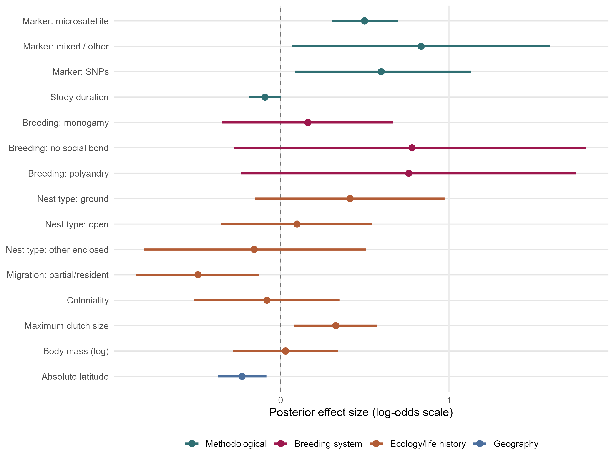

The primary multivariable phylogenetic beta-binomial model jointly evaluates methodological, breeding-system, ecological and life-history predictors of brood-level mixed paternity. It uses 533 records from 481 study identifiers and 326 species.

The model includes random intercepts for study identifier, non-phylogenetic species identity and phylogenetically structured species identity. Continuous predictors use the common scaling constants. The [matched-sample intercept-only comparison](03_overall_model.qmd#matched-sample-model-without-moderators) reports changes in group-level variance.

## Model specification and fitting {#model-specification}

The code below records the accepted model specification and fitting procedure. Rendering this chapter displays the code without fitting the model. Model fitting requires the prepared common-scaling data, phylogenetic covariance matrix and the R packages shown in the code.

```{r}
#| eval: false
#| echo: true
#| code-fold: true
#| code-summary: "Code: full multivariable model"

library(brms)
library(dplyr)
library(posterior)
library(readr)
library(tibble)

options(mc.cores = min(4L, parallel::detectCores()))

model_dir <- "models/common_scaling"
data_dir <- "data/common_scaling"
table_dir <- "tables/common_scaling"
log_dir <- "logs/common_scaling"

invisible(lapply(
  c(model_dir, data_dir, table_dir, log_dir),
  dir.create,
  showWarnings = FALSE,
  recursive = TRUE
))

required <- c(
  "data/data_overall_study_common_scaled.rds",
  "data/phylo_mat.rds",
  "data/continuous_predictor_scaling.rds"
)
missing <- required[!file.exists(required)]
if (length(missing) > 0L) stop("Missing required files: ", paste(missing, collapse = ", "))

dat_all <- readRDS("data/data_overall_study_common_scaled.rds")
phylo_mat <- readRDS("data/phylo_mat.rds")

if (nrow(dat_all) != 619L) stop("Expected the 619-record common scaling dataset.")

valid_breeding_levels <- dat_all %>%
  count(breeding_system) %>%
  filter(!is.na(breeding_system), n >= 5) %>%
  pull(breeding_system)

dat_full <- dat_all %>%
  filter(
    !is.na(marker_type_model),
    is.finite(study_duration_sc),
    !is.na(breeding_system),
    breeding_system %in% valid_breeding_levels,
    !is.na(nest_type_model),
    !is.na(migration),
    !is.na(coloniality),
    is.finite(CS_max_sc),
    is.finite(log_body_mass_sc),
    is.finite(abs_lat_sc)
  ) %>%
  mutate(
    across(
      c(
        marker_type_model, breeding_system, nest_type_model, migration,
        coloniality, Study_ID, species_nonphylo, species_phylo_brms
      ),
      droplevels
    )
  ) %>%
  group_by(breeding_system) %>%
  filter(n() >= 5) %>%
  ungroup() %>%
  droplevels()

if (nrow(dat_full) != 533L) {
  stop("Expected 533 records in the accepted full-model dataset; found ", nrow(dat_full), ".")
}

saveRDS(dat_full, file.path(data_dir, "data_full_brouwer_griffith.rds"))

writeLines(
  c(
    "Common-scaling full model",
    paste("Observations:", nrow(dat_full)),
    paste("Studies:", n_distinct(dat_full$Study_ID)),
    paste("Species:", n_distinct(dat_full$species_nonphylo)),
    "",
    "Breeding-system counts:",
    capture.output(table(dat_full$breeding_system))
  ),
  file.path(log_dir, "model_full_brouwer_griffith_dataset.txt")
)

full_formula <- bf(
  n_mixed_broods | trials(n_total_broods) ~
    marker_type_model +
    study_duration_sc +
    breeding_system +
    nest_type_model +
    migration +
    coloniality +
    CS_max_sc +
    log_body_mass_sc +
    abs_lat_sc +
    (1 | Study_ID) +
    (1 | species_nonphylo) +
    (1 | gr(species_phylo_brms, cov = phylo_mat))
)

fit <- brm(
  formula = full_formula,
  family = beta_binomial(link = "logit"),
  data = dat_full,
  data2 = list(phylo_mat = phylo_mat),
  chains = 4,
  cores = 4,
  iter = 10000,
  warmup = 5000,
  control = list(adapt_delta = 0.99, max_treedepth = 15),
  seed = 123,
  file = file.path(model_dir, "model_full_brouwer_griffith"),
  file_refit = "on_change"
)

writeLines(
  capture.output(summary(fit)),
  file.path(log_dir, "model_full_brouwer_griffith_summary.txt")
)
write_csv(
  as.data.frame(prior_summary(fit)),
  file.path(table_dir, "model_full_brouwer_griffith_priors.csv")
)
write_csv(
  rownames_to_column(as.data.frame(fixef(fit)), "term"),
  file.path(table_dir, "model_full_brouwer_griffith_fixed_effects.csv")
)

draw_summary <- posterior::summarise_draws(posterior::as_draws_array(fit))
nuts <- brms::nuts_params(fit)
configured_depth <- tryCatch(
  fit$fit@stan_args[[1]]$control$max_treedepth,
  error = function(e) NULL
)
if (is.null(configured_depth) || length(configured_depth) != 1L) configured_depth <- 15L

diagnostics <- tibble(
  model = "full_brouwer_griffith",
  observations = nobs(fit),
  max_rhat = max(draw_summary$rhat, na.rm = TRUE),
  min_bulk_ess = min(draw_summary$ess_bulk, na.rm = TRUE),
  min_tail_ess = min(draw_summary$ess_tail, na.rm = TRUE),
  divergences = sum(nuts$Parameter == "divergent__" & nuts$Value == 1),
  treedepth_hits = sum(
    nuts$Parameter == "treedepth__" & nuts$Value >= configured_depth
  ),
  maximum_observed_treedepth = max(nuts$Value[nuts$Parameter == "treedepth__"]),
  configured_max_treedepth = configured_depth
)
write_csv(diagnostics, file.path(table_dir, "model_full_brouwer_griffith_diagnostics.csv"))

message("Common-scaling full model finished.")
```

## Results {#full-multivariable-model}

The primary multivariable model included 533 records from 481 study identities and 326 species. Continuous predictors are expressed per one standard deviation using the common scaling constants. Categorical coefficients are contrasts relative to DNA fingerprinting, cooperative breeding, cavity nesting, regular migration, and non-coloniality.

The marker contrasts in the primary model indicate higher reported mixed-paternity prevalence in microsatellite, SNP and mixed/other studies than in DNA fingerprinting studies, after adjustment for the other moderators. This is consistent with possible underdetection by DNA fingerprinting, rather than a direct experimental estimate of the relative accuracy of marker technologies. The mixed/other category combines different approaches and is not a single newer method.

### Exact coefficient table

```{r}
#| label: tbl-full-model-fixed-effects
#| echo: true
#| message: false
#| warning: false
#| code-fold: true
#| code-summary: "Code"

full_model_table_labels <- c(
  Intercept = "Intercept",
  marker_type_modelmicrosatellite = "Marker: microsatellite",
  marker_type_modelmixed_other = "Marker: mixed / other",
  marker_type_modelSNPs = "Marker: SNPs",
  study_duration_sc = "Study duration (1 SD)",
  breeding_systemmonogamy = "Breeding: monogamy",
  breeding_systemno_social_bond = "Breeding: no social bond",
  breeding_systempolyandry = "Breeding: polyandry",
  nest_type_modelground = "Nest type: ground",
  nest_type_modelopen = "Nest type: open",
  nest_type_modelother_enclosed = "Nest type: other enclosed",
  migrationWeak = "Migration: partial/resident",
  coloniality1 = "Coloniality: colonial",
  CS_max_sc = "Maximum clutch size (1 SD)",
  log_body_mass_sc = "Body mass, log10 (1 SD)",
  abs_lat_sc = "Absolute latitude (1 SD)"
)

full_model_coefficients <- readr::read_csv(
  "tables/contrasts_equal_tailed.csv", show_col_types = FALSE
) |>
  dplyr::filter(model == "model_full_brouwer_griffith", kind == "coefficient") |>
  dplyr::transmute(
    Predictor = dplyr::recode(contrast, !!!full_model_table_labels, .default = contrast),
    Estimate = estimate, SE = SE,
    `Lower 95% CrI` = lower.CrI, `Upper 95% CrI` = upper.CrI,
    `Mean OR` = OR, `Lower 95% OR` = lower.OR, `Upper 95% OR` = upper.OR
  )
knitr::kable(full_model_coefficients, digits = 3,
  caption = "Posterior means, posterior standard errors and 95% equal-tailed credible intervals from the primary multivariable model. OR summaries are calculated after exponentiating each posterior draw; the exponentiated intercept represents baseline odds.")
```

```{r}
#| echo: true
#| eval: false
#| message: false
#| warning: false
#| code-fold: true
#| code-summary: "Code"

full_model_path <- "models/common_scaling/model_full_brouwer_griffith.rds"
stopifnot(file.exists(full_model_path))
model_full_brouwer_griffith <- readRDS(full_model_path)

full_fixef <- as.data.frame(brms::fixef(model_full_brouwer_griffith)) |>
  tibble::rownames_to_column("term") |>
  dplyr::filter(term != "Intercept")

lower_name <- intersect(c("Q2.5", "l-95% CI"), names(full_fixef))[1]
upper_name <- intersect(c("Q97.5", "u-95% CI"), names(full_fixef))[1]

full_effect_labels <- c(
  marker_type_modelmicrosatellite = "Marker: microsatellite",
  marker_type_modelmixed_other = "Marker: mixed / other",
  marker_type_modelSNPs = "Marker: SNPs",
  study_duration_sc = "Study duration",
  breeding_systemmonogamy = "Breeding: monogamy",
  breeding_systemno_social_bond = "Breeding: no social bond",
  breeding_systempolyandry = "Breeding: polyandry",
  nest_type_modelground = "Nest type: ground",
  nest_type_modelopen = "Nest type: open",
  nest_type_modelother_enclosed = "Nest type: other enclosed",
  migrationWeak = "Migration: partial/resident",
  coloniality1 = "Coloniality",
  CS_max_sc = "Maximum clutch size",
  log_body_mass_sc = "Body mass (log)",
  abs_lat_sc = "Absolute latitude"
)

full_effect_groups <- c(
  marker_type_modelmicrosatellite = "Methodological",
  marker_type_modelmixed_other = "Methodological",
  marker_type_modelSNPs = "Methodological",
  study_duration_sc = "Methodological",
  breeding_systemmonogamy = "Breeding system",
  breeding_systemno_social_bond = "Breeding system",
  breeding_systempolyandry = "Breeding system",
  nest_type_modelground = "Ecology/life history",
  nest_type_modelopen = "Ecology/life history",
  nest_type_modelother_enclosed = "Ecology/life history",
  migrationWeak = "Ecology/life history",
  coloniality1 = "Ecology/life history",
  CS_max_sc = "Ecology/life history",
  log_body_mass_sc = "Ecology/life history",
  abs_lat_sc = "Geography"
)

forest_data_full <- full_fixef |>
  dplyr::transmute(
    predictor = dplyr::recode(term, !!!full_effect_labels, .default = term),
    group = dplyr::recode(term, !!!full_effect_groups, .default = "Other"),
    estimate = Estimate,
    lower = .data[[lower_name]],
    upper = .data[[upper_name]]
  ) |>
  dplyr::mutate(
    group = factor(
      group,
      levels = c("Methodological", "Breeding system", "Ecology/life history", "Geography", "Other")
    ),
    predictor = factor(predictor, levels = rev(predictor))
  )

p_full_model_forest <- ggplot2::ggplot(
  forest_data_full,
  ggplot2::aes(x = estimate, y = predictor, colour = group)
) +
  ggplot2::geom_vline(
    xintercept = 0, linetype = "dashed", linewidth = 0.5, colour = "grey45"
  ) +
  ggplot2::geom_errorbarh(
    ggplot2::aes(xmin = lower, xmax = upper), height = 0, linewidth = 1.1
  ) +
  ggplot2::geom_point(size = 2.8) +
  ggplot2::scale_colour_manual(values = c(
    "Methodological" = "#2f6f73",
    "Breeding system" = "#9D174D",
    "Ecology/life history" = "#b35c35",
    "Geography" = "#4b6f9e",
    "Other" = "grey40"
  )) +
  ggplot2::labs(
    x = "Posterior effect size (log-odds scale)", y = NULL, colour = NULL
  ) +
  ggplot2::theme_minimal(base_size = 12) +
  ggplot2::theme(
    panel.grid.minor = ggplot2::element_blank(),
    panel.grid.major.y = ggplot2::element_line(colour = "grey90"),
    legend.position = "bottom"
  )

dir.create("Figures/model_diagnostics", recursive = TRUE, showWarnings = FALSE)
ggplot2::ggsave(
  "Figures/model_diagnostics/full_model_fixed_effects_forest_plot.png",
  p_full_model_forest, width = 9, height = 6.8, dpi = 300
)
ggplot2::ggsave(
  "Figures/model_diagnostics/full_model_fixed_effects_forest_plot.pdf",
  p_full_model_forest, width = 9, height = 6.8, device = "pdf"
)
```

```{r}
#| label: fig-full-model-forest-plot
#| fig-cap: "Posterior mean fixed effects and 95% equal-tailed credible intervals from the full multivariable phylogenetic beta-binomial model. Continuous predictors are expressed per one standard deviation using the common scaling derived from the overall analytical dataset; categorical coefficients are contrasts relative to the model reference levels."
#| echo: false
#| out-width: "100%"


```


## Fixed-effect design diagnostics (Tables S5 and S8) {#full-model-design-diagnostics}

These diagnostics use the same 533 complete observations as the accepted primary multivariable model. The published data file is also used for the matched-sample intercept-only model; it retains all predictors needed here. No models are fitted or updated by the code below.

Table S5 reports Pearson correlations for the four continuous predictors in that model. Body mass was log10-transformed before standardisation. All correlations use the same 533 records, with no pairwise deletion. Centring and division by a positive standard deviation do not change these correlations. Table S8 describes the unweighted fixed-effect design, including the intercept, treatment-coded categories and continuous predictors with their existing common scaling. No additional rescaling is applied. The exact 2-norm condition number is the ratio of the largest to the smallest singular value. The matrix has 533 rows, 16 columns and rank 16, with a condition number of 15.70; there is no exact linear dependence among its columns.

```{r}
#| eval: false
#| echo: true
#| code-fold: true
#| code-summary: "Code: reproduce Tables S5 and S8"

# Reproduce Supplementary Tables S5 and S8 without fitting a model.
# Run from mixed_paternity_final with base R.
# This published dataset is the retained data of the accepted full model;
# it is also used for the matched-sample intercept-only comparison.
dat <- readRDS("data/data_null_matched_533.rds")

fixed_formula <- ~ marker_type_model + study_duration_sc + breeding_system +
  nest_type_model + migration + coloniality + CS_max_sc +
  log_body_mass_sc + abs_lat_sc
predictors <- all.vars(fixed_formula)
stopifnot(nrow(dat) == 533L, all(complete.cases(dat[predictors])))

# Preserve the fitted category order and reference levels explicitly.
expected_levels <- list(
  marker_type_model = c("DNA_fingerprinting", "microsatellite", "mixed_other", "SNPs"),
  breeding_system = c("cooperative_breeder", "monogamy", "no_social_bond", "polyandry"),
  nest_type_model = c("cavity", "ground", "open", "other_enclosed"),
  migration = c("Strong", "Weak"),
  coloniality = c("0", "1")
)
for (variable in names(expected_levels)) {
  stopifnot(identical(levels(dat[[variable]]), expected_levels[[variable]]))
}
treatment_contrasts <- lapply(expected_levels, contr.treatment, base = 1L)
X <- model.matrix(fixed_formula, data = dat, contrasts.arg = treatment_contrasts)
stopifnot(nrow(X) == 533L, ncol(X) == 16L, qr(X)$rank == 16L)

# S5: the four continuous predictors actually used in the final model.
# Body mass was log10-transformed before standardisation. Positive linear
# standardisation does not change Pearson correlations. No pairwise deletion
# is needed: all four variables are complete in the same 533 records.
continuous <- c("CS_max_sc", "log_body_mass_sc", "study_duration_sc", "abs_lat_sc")
labels <- c("Maximum clutch size", "Log10 body mass", "Study duration", "Absolute latitude")
correlation_matrix <- cor(dat[continuous], method = "pearson", use = "everything")
dimnames(correlation_matrix) <- list(labels, labels)
correlation_table <- data.frame(
  Predictor = labels, correlation_matrix, row.names = NULL, check.names = FALSE
)

# S8: unweighted fixed-effect design, including the intercept, treatment-coded
# categories and the existing common-scaled continuous predictors. No further
# rescaling is applied. The exact 2-norm condition number is sigma_max/sigma_min.
singular_values <- svd(X, nu = 0L, nv = 0L)$d
condition_number <- max(singular_values) / min(singular_values)
stopifnot(isTRUE(all.equal(condition_number, kappa(X, exact = TRUE))))
design_table <- data.frame(
  Model = "Primary BG full model", Records = nrow(X),
  Rank = qr(X)$rank, Columns = ncol(X),
  Full_rank = qr(X)$rank == ncol(X),
  Condition_number_2norm = condition_number
)

dir.create("tables/common_scaling", recursive = TRUE, showWarnings = FALSE)
write.csv(correlation_table, "tables/common_scaling/full_model_correlations.csv", row.names = FALSE)
write.csv(design_table, "tables/common_scaling/full_model_design_diagnostics.csv", row.names = FALSE)
write.csv(data.frame(Column = colnames(X)),
          "tables/common_scaling/full_model_design_columns.csv", row.names = FALSE)
print(correlation_table, digits = 6, row.names = FALSE)
print(design_table, digits = 8, row.names = FALSE)
```

```{r}
#| echo: false

correlation_table <- read.csv("tables/common_scaling/full_model_correlations.csv", check.names = FALSE)
design_table <- read.csv("tables/common_scaling/full_model_design_diagnostics.csv", check.names = FALSE)
knitr::kable(correlation_table, digits = 3, caption = "Table S5. Pearson correlations among the continuous predictors of the final 533-record multivariable model.")
names(design_table) <- c("Model", "Records", "Rank", "Columns", "Full rank", "Condition number (2-norm)")
knitr::kable(design_table, digits = 2, caption = "Table S8. Fixed-effect design diagnostics for the final 533-record multivariable model; exact 2-norm condition number.")
```

[Download the S5 correlation table](tables/common_scaling/full_model_correlations.csv) · [Download the S8 diagnostics](tables/common_scaling/full_model_design_diagnostics.csv) · [Inspect the 16 design columns](tables/common_scaling/full_model_design_columns.csv).


## Convergence diagnostics and beta-binomial precision {#full-model-convergence}

The accepted primary model used four chains with 10,000 iterations each, including 5,000 warm-up iterations per chain, yielding 20,000 retained posterior draws. The diagnostics below refer to the same 533-record fit reported in the main text and Supplementary Table S10. The maximum R-hat is 1.0114 (1.011 when rounded to three decimal places). There were no divergent transitions or maximum-treedepth hits.

| Diagnostic | Value |
|:--|--:|
| Observations | 533 |
| Study identifiers | 481 |
| Species | 326 |
| Chains | 4 |
| Post-warm-up draws | 20,000 |
| Maximum R-hat | 1.0114 |
| Minimum bulk ESS | 899 |
| Minimum tail ESS | 2,096 |
| Divergent transitions | 0 |
| Maximum-treedepth hits | 0 |
| Maximum observed tree depth | 10 |
| Configured maximum tree depth | 15 |

The posterior mean beta-binomial precision parameter is φ = 29.76, with a 95% equal-tailed credible interval of [16.12, 59.41]. These summaries were calculated directly from the retained posterior draws. In this beta-binomial parameterisation, larger φ corresponds to less extra-binomial dispersion; the finite estimate indicates residual extra-binomial variation after accounting for predictors and random effects.

[Download convergence diagnostics](tables/common_scaling/model_full_brouwer_griffith_diagnostics.csv) · [Download the precision summary](tables/common_scaling/full_model_precision.csv).

## Response-scale predictions {#full-model-predictions}

![ Population-level fixed-effect predictions from the primary multivariable model. Points and vertical intervals show posterior means and 95% equal-tailed credible intervals for (A) molecular marker type and (B) migration. The label "Partial/resident" denotes the analytical Weak category, which includes resident species and species exhibiting weak seasonal, local or irregular movements. Lines and shaded areas show posterior means and 95% equal-tailed credible intervals for (C) maximum clutch size and (D) absolute latitude. Random effects are set to zero; non-focal continuous predictors are set to zero on their common standardised scales and categorical predictors to their reference levels. ](Figures/common_scaling/full_model_key_effects.png){#fig-full-model-key-effects width=100%}

[Download the prediction figure as PDF](Figures/common_scaling/full_model_key_effects.pdf). The figure uses the accepted common-scaling fit and is the same version as in the main manuscript. [Figure-generation code](scripts/generate_common_scaling_figures.R).
