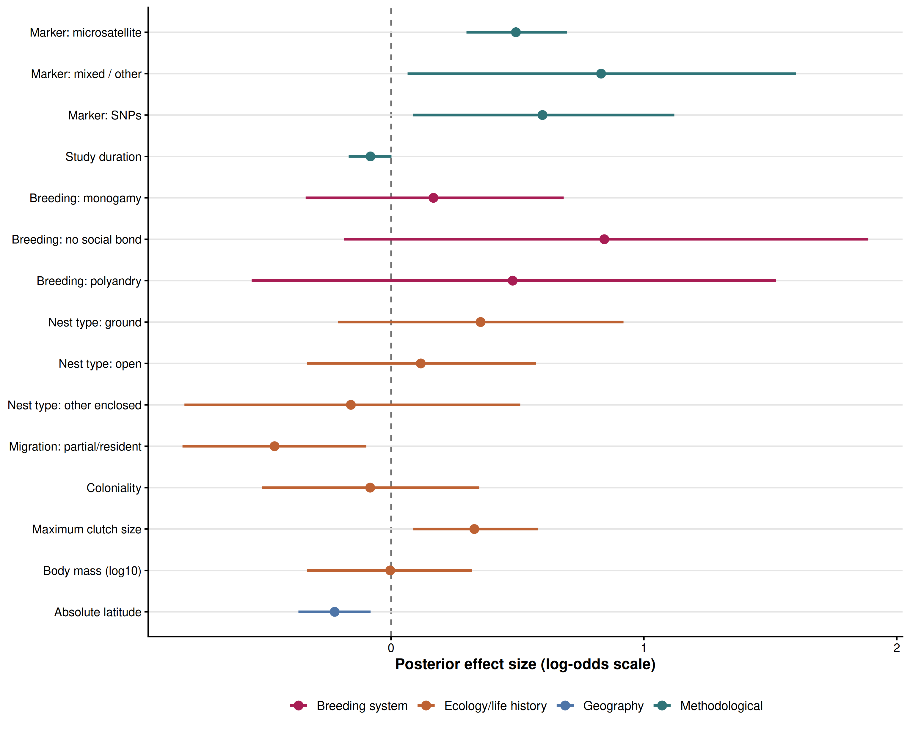
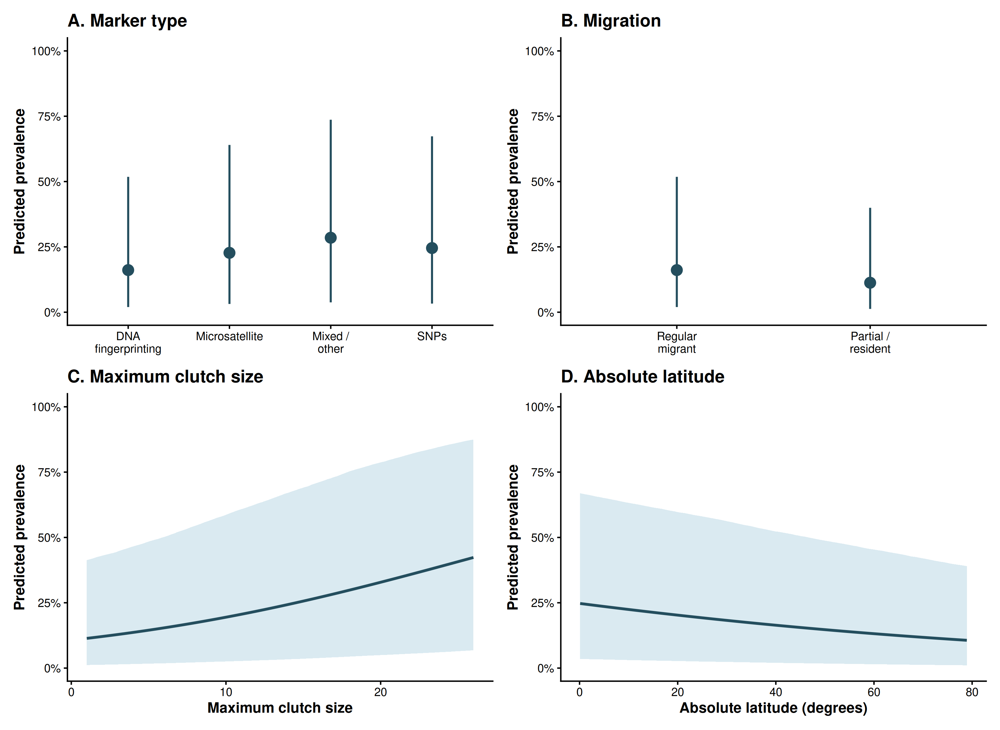
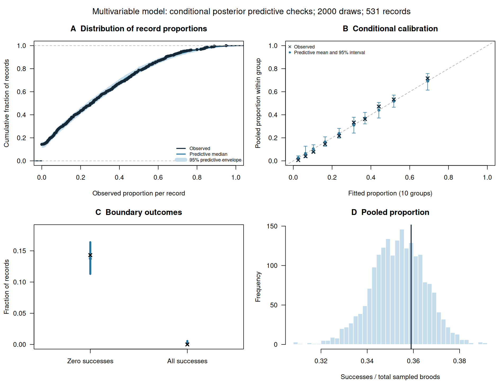

All results on this page use the models after exclusion of the two records for the common ostrich (6/6) and Nelson’s sparrow (8/8), whose exact counts could not be verified as broods with at least two genetic sires. Other records were retained, including the saltmarsh-sparrow record from the same Walsh study. Updated 5 November 2026.

Estimates are posterior means with 95% equal-tailed credible intervals (CrI). Odds ratios are summarised after exponentiating each contrast draw. Prevalence predictions are summarised after inverse-logit transformation, with random effects set to zero. Continuous effects use the original common scaling constants, retained unchanged after exclusion. Mixed paternity refers to the source-derived brood-level measure described in Methods; source reporting sometimes used brood-level EPP without identifying sire number.

## Multivariable model

531 records, 480 study identifiers and 324 species; 14903 mixed-paternity broods out of 41511 sampled broods.

| Coefficient | Mean log odds [95% CrI] | Mean OR [95% CrI] |
| --- | --- | --- |
| Intercept | -1.956 [-3.906, 0.072] | 0.240 [0.020, 1.075] |
| marker type modelmicrosatellite | 0.494 [0.298, 0.695] | 1.647 [1.348, 2.004] |
| marker type modelmixed other | 0.831 [0.066, 1.601] | 2.478 [1.068, 4.957] |
| marker type modelSNPs | 0.599 [0.088, 1.120] | 1.884 [1.091, 3.066] |
| study duration sc | -0.081 [-0.167, 0.002] | 0.923 [0.846, 1.002] |
| breeding systemmonogamy | 0.168 [-0.337, 0.683] | 1.223 [0.714, 1.980] |
| breeding systemno social bond | 0.843 [-0.187, 1.887] | 2.676 [0.830, 6.601] |
| breeding systempolyandry | 0.481 [-0.551, 1.523] | 1.858 [0.576, 4.585] |
| nest type modelground | 0.354 [-0.210, 0.919] | 1.485 [0.811, 2.508] |
| nest type modelopen | 0.118 [-0.332, 0.573] | 1.155 [0.718, 1.774] |
| nest type modelother enclosed | -0.159 [-0.817, 0.511] | 0.903 [0.442, 1.667] |
| migrationWeak | -0.460 [-0.824, -0.098] | 0.642 [0.439, 0.907] |
| coloniality1 | -0.082 [-0.511, 0.349] | 0.943 [0.600, 1.418] |
| CS max sc | 0.330 [0.088, 0.580] | 1.401 [1.092, 1.787] |
| log body mass sc | -0.003 [-0.331, 0.320] | 1.011 [0.718, 1.378] |
| abs lat sc | -0.223 [-0.366, -0.081] | 0.803 [0.693, 0.922] |

### Pairwise contrasts

Each contrast compares the first category with the second.

| Contrast | Mean log odds [95% CrI] | Mean OR [95% CrI] |
| --- | --- | --- |
| microsatellite - mixed other | -0.337 [-1.096, 0.424] | 0.769 [0.334, 1.528] |
| microsatellite - SNPs | -0.105 [-0.594, 0.393] | 0.929 [0.552, 1.482] |
| mixed other - SNPs | 0.232 [-0.658, 1.119] | 1.398 [0.518, 3.063] |
| monogamy - no social bond | -0.676 [-1.597, 0.266] | 0.570 [0.203, 1.305] |
| monogamy - polyandry | -0.313 [-1.272, 0.644] | 0.823 [0.280, 1.904] |
| no social bond - polyandry | 0.362 [-0.916, 1.639] | 1.773 [0.400, 5.149] |
| ground - open | 0.236 [-0.268, 0.744] | 1.309 [0.765, 2.104] |
| ground - other enclosed | 0.513 [-0.161, 1.194] | 1.774 [0.852, 3.300] |
| open - other enclosed | 0.276 [-0.327, 0.880] | 1.383 [0.721, 2.412] |

### Variance components and precision

| Quantity | Posterior mean [95% CrI] |
| --- | --- |
| Phylogenetic species variance | 3.120 [1.487, 5.377] |
| Non-phylogenetic species variance | 0.463 [0.138, 0.821] |
| Study variance | 0.091 [0.001, 0.232] |
| Beta-binomial precision | 28.208 [15.797, 55.265] |
| Species-level phylogenetic heritability | 0.856 [0.674, 0.972] |
| Prevalence at zero random effects (proportion) | 0.161 [0.020, 0.518] |

### Sampling diagnostics

| Maximum R-hat | Minimum bulk ESS | Minimum tail ESS | Divergences | Treedepth hits |
| --- | --- | --- | --- | --- |
| 1.0031 | 791 | 1586 | 0 | 0 |

[Download posterior summary](tables/refit_20261105/model_full_brouwer_griffith_summary.csv) · [Parameter-level diagnostics](tables/refit_20261105/model_full_brouwer_griffith_parameter_diagnostics.csv).

[Download PDF](Figures/refit_20261105/full_model.pdf).

## Response-scale predictions

Non-focal continuous predictors are set to zero on their common scales and categorical predictors to reference levels. These are conditional predictions for this reference profile, not averages across species.

[Download PDF](Figures/refit_20261105/full_model_key_effects.pdf).

## Conditional posterior predictive checks

## Collinearity

| Predictor | VIF | Lower 95% CI | Upper 95% CI |
| --- | --- | --- | --- |
| marker type model | 1.121 | 1.044 | 1.333 |
| study duration sc | 1.077 | 1.018 | 1.337 |
| breeding system | 1.328 | 1.199 | 1.539 |
| nest type model | 1.243 | 1.133 | 1.444 |
| migration | 1.257 | 1.143 | 1.459 |
| coloniality | 1.057 | 1.008 | 1.392 |
| CS max sc | 1.191 | 1.094 | 1.390 |
| log body mass sc | 1.085 | 1.022 | 1.330 |
| abs lat sc | 1.351 | 1.217 | 1.566 |

### Continuous-predictor correlations

| Predictor | study duration sc | CS max sc | log body mass sc | abs lat sc |
| --- | --- | --- | --- | --- |
| study duration sc | 1.000 | -0.049 | -0.046 | -0.008 |
| CS max sc | -0.049 | 1.000 | -0.225 | 0.271 |
| log body mass sc | -0.046 | -0.225 | 1.000 | 0.011 |
| abs lat sc | -0.008 | 0.271 | 0.011 | 1.000 |

### Design matrix

| records | columns | rank | condition |
| --- | --- | --- | --- |
| 531 | 16 | 16 | 15.7990571020539 |

