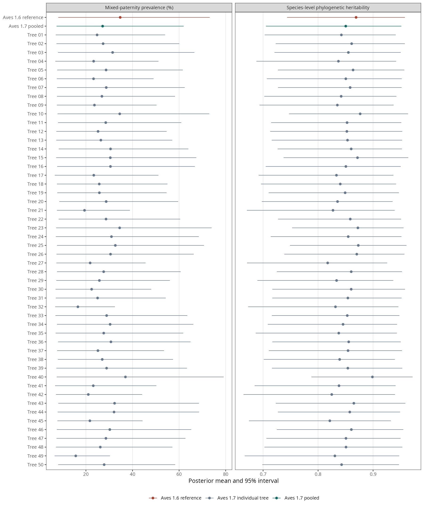

## Scope

We refitted the overall intercept-only beta-binomial model to exactly the same **619 records, 554 study identifiers and 375 species** as the primary analysis. The response counts, priors and random-effects structure were unchanged. The primary Aves 1.6 analysis remains the reference; moderator models were not refitted across trees.

We sampled 50 trees without replacement from the 100 dated stochastic replicates of **Aves 1.7, Clements 2025**, using seed 20261106. The source is [AvesData commit 4af84f1](https://github.com/McTavishLab/AvesData/tree/4af84f14f8f3df26bd4480202689b08ea0fc2c48/Tree_versions/Aves_1.7/Clements2025), file `dated_rand_sample_clements.tre`. The replicates reflect selected uncertainty in taxonomic placement and dating, not a posterior sample from one joint Bayesian phylogenetic analysis. Aves 1.7 includes a date-calibration correction, so this comparison combines the version update and sampled tree variation; it does not isolate either contribution.

## Results

The phylogenetic contribution remained high: **H² = 0.850 [0.705, 0.951]**, compared with **0.869 [0.744, 0.958]** under the reference tree. Per-tree posterior means ranged from 0.817 to 0.899. The qualitative conclusion of dominant phylogenetic structure was similar across frameworks.

Prevalence at zero random effects was more sensitive: **27.16% [7.38, 61.96]**, compared with **34.71% [8.12, 73.16]**. Per-tree means ranged from 15.6% to 37.0%. This is the inverse-logit of the intercept, not a marginal estimate averaged over random effects and not the raw pooled brood proportion.

| Quantity | Aves 1.6 reference | Aves 1.7: 50-tree mixture |
|---|---:|---:|
| Prevalence at zero random effects (%) | 34.71 [8.12, 73.16] | 27.16 [7.38, 61.96] |
| Species-level phylogenetic heritability (H²) | 0.869 [0.744, 0.958] | 0.850 [0.705, 0.951] |
| Phylogenetic species variance | 3.365 [1.947, 5.312] | 2.885 [1.582, 4.750] |
| Non-phylogenetic species variance | 0.472 [0.203, 0.783] | 0.470 [0.203, 0.782] |
| Study variance | 0.074 [0.00018, 0.234] | 0.074 [0.00020, 0.232] |
| Beta-binomial precision (φ) | 18.568 [12.075, 32.961] | 18.620 [12.110, 32.766] |

Entries are posterior means and 95% equal-tailed intervals. The Aves 1.7 intervals describe an equally weighted mixture of posterior draws across trees. Group-level variances are on the logit scale. H² is phylogenetic variance divided by the sum of phylogenetic and non-phylogenetic species variance; study variance and beta-binomial dispersion are excluded.

[Download the figure as PDF](Figures/aves17_sensitivity.pdf)

## Model settings and pooling

For each tree we recalculated the phylogenetic correlation matrix, preserving species matching and matrix scaling. Each model used four chains with 10,000 iterations, 5,000 warm-up iterations, `adapt_delta = 0.99`, and `max_treedepth = 15`. Fits used brms 2.23.0 and rstan 2.32.7. The prior on each random-effect SD was half-Student-t(3, 0, 2.5); the intercept prior was Student-t(3, 0, 2.5), and precision had a Gamma(0.01, 0.01) prior, matching the reference model.

We derived variances, H² and prevalence within each draw, then combined 20,000 draws per tree (1,000,000 draws in total). Equal draw counts give each tree equal weight. Interval endpoints were calculated from the mixture, not averaged across trees. The mixture propagates the sampled tree variation but does not cover all sources of phylogenetic uncertainty.

## Diagnostics and additional check

All 50 fits saved successfully, with **zero divergent transitions and zero maximum-treedepth hits**. Across all monitored parameters, maximum R̂ was 1.0137, minimum bulk ESS was 562 and minimum tail ESS was 1,256. Five fits (sample indices 14, 21, 41, 42 and 47) exceeded R̂ = 1.01 for study-level SD, precision and/or log posterior. These mild mixing warnings are retained in the diagnostic record rather than described as universally satisfactory convergence.

For the reported quantities, maximum R̂ was **1.0032 for H²** and **1.0013 for prevalence**. Minimum bulk ESS was 1,435 and 5,491, respectively; minimum tail ESS was 1,442 and 8,020.

As a diagnostic check, omitting the five flagged fits yielded **H² = 0.851 [0.708, 0.952]** and **prevalence = 27.45% [7.38, 62.45]**, close to the full mixture. All 50 trees remain in the reported analysis. The 45-tree check is not an alternative phylogenetic sample and does not establish convergence of every parameter.

## Downloads and provenance

- [Comparison table](tables/aves17_sensitivity/comparison.csv)
- [Per-tree estimates](tables/aves17_sensitivity/per_tree_estimates.csv)
- [All-model diagnostics](tables/aves17_sensitivity/diagnostics.csv)
- [H² and prevalence diagnostics](tables/aves17_sensitivity/key_parameter_diagnostics.csv)
- [Five flagged fits](tables/aves17_sensitivity/models_requiring_review.csv)
- [45-tree diagnostic check](tables/aves17_sensitivity/diagnostic_45_tree_check.csv)
- [Selected source-tree indices](tables/aves17_sensitivity/selected_trees.csv)
- [Tree-source version and checksum](tables/aves17_sensitivity/tree_source.json)
- [Tree-matrix checks](tables/aves17_sensitivity/tree_audit.csv)
- [Analysis scripts](tables/aves17_sensitivity/analysis_code.zip)

The scripts use the existing reference brms fit and prepared project objects on Totoro; the archive is code, not a standalone bundle of fitted models. Twenty-iteration diagnostic runs used to test file saving were never included in the scientific summaries.
